# @Praha-4

**云，在灰色天空浮动  
飘过朦胧尖顶的教堂  
有个人，倚着栏杆  
放眼暮水苍茫  
他的双手  
放在古老的石头上**  
----摘自卡夫卡《一场战斗的描述》中对查理大桥夜景的描写  
  
走近查理大桥的第一天下午，冷风冷雨的天气，实在没有心情从桥的这头踱步过去，只是站在挡雨的屋檐下远远地望着。  
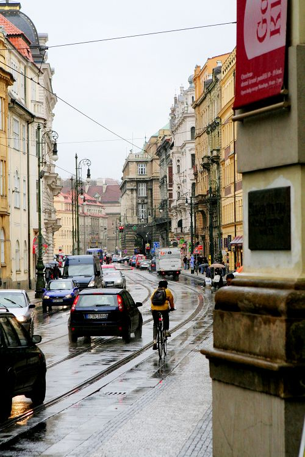   
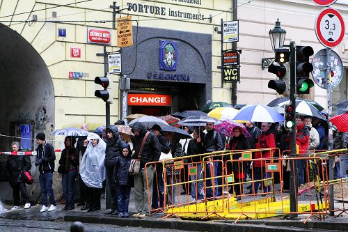  
  
一个人好象行走了一天，下午快五点时回到Cechuv most（契夫桥）与Helen和Miranda汇合。时间尚早，经历了一整天风雨的折磨，太需要一杯热呼呼的饮料了。走进一家咖啡馆，好象是西班牙人或是墨西哥人开的，乡村风格的装修。盼着雨停的客人趴在窗台上张望。为了打发时间和寒冷，陆续点了两杯热茶和一份巧克力蛋糕。  
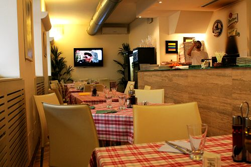   
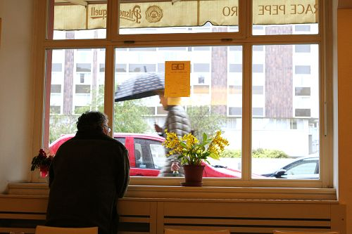   
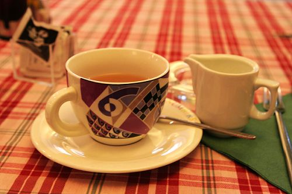   
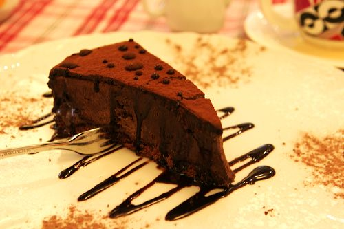  
  
布拉格的确是个多桥的城市，从古至今共有180座桥梁，布拉格市区范围内，伏尔塔瓦河面上由南向北架起的的大桥就有15座，其中最壮观的就属查理大桥。第二天一早是个大晴天，天气虽然还很冷，但好过下雨。这一次满心喜悦地走过修复中的查理大桥。  
  
查理大桥的原址是一座仿罗马式的桥，被称为Judith Bridge，现在靠近小区的桥塔是Judith Bridge的遗迹。由于Judith Bridge被洪水冲毁得很严重，于是在1357年查理四世下令建造的另一座大桥来取代它。  
  
查理大桥与布拉格共同经历了很多历史事件，包括1393年瓦茨拉夫四世把当时的总主教圣约翰.内波穆克丢到桥下；1621年白山战役之后10位新教徒的人头被挂在旧桥塔上示众；1648年瑞典利用查理大桥进攻布拉格并摧毁西侧的旧桥塔；1723年桥上装上油灯，100多年后又换上煤气灯......  
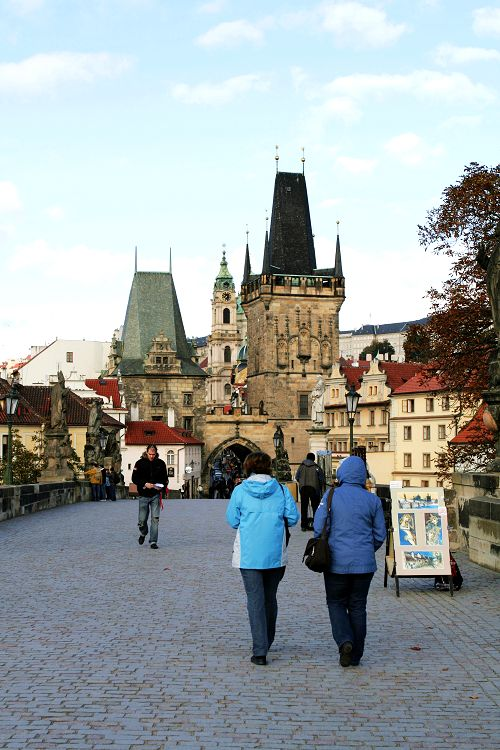  
  
布拉格政府非常重视查理大桥的维修和保养，禁止车辆通行，纯粹是人行道。除了建筑本身具有吸引力之外，桥上还有各式各样的艺术摊贩。  
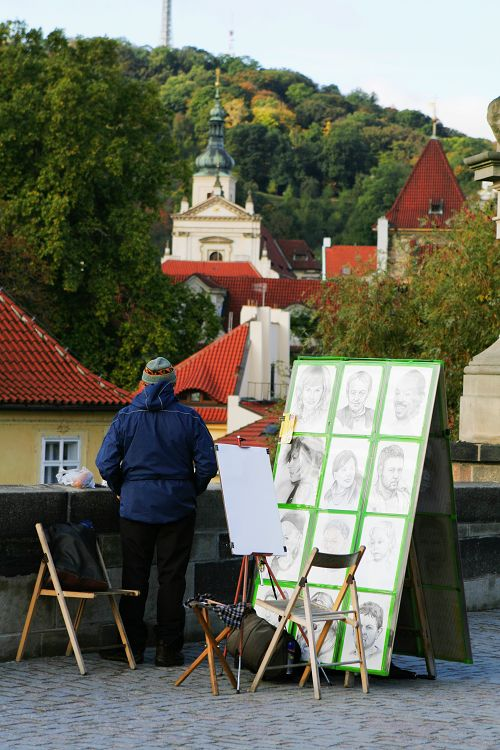  
  
在查理大桥上约30座众多宗教圣徒的雕塑中，最吸引人的是这尊从旧城方向来数右边第8个的圣约翰.内波穆克像。  
  
内波穆克1387年成为布拉格教区的总主教，当时神圣罗马帝国的瓦茨拉夫四世喜欢把神职人员当做政治附属。当内波穆克得知瓦茨拉夫四世要推举一个不够资格的人担任一个修道院的院长后，他提早集合该修道院的修士选出了新院长。此举触怒了瓦茨拉夫四世，内波穆克被瓦茨拉夫四世烧死后丢入River Moldau（摩尔达河），传说当晚有7颗星星出现在他沉没之处，内波穆克在1729年被耶稣会封为圣徒。  
  
这座雕像完成于1683年，据说触摸圣像右下角的浮雕会带来好运，所这块区域总是被游客擦得亮堂堂的。  
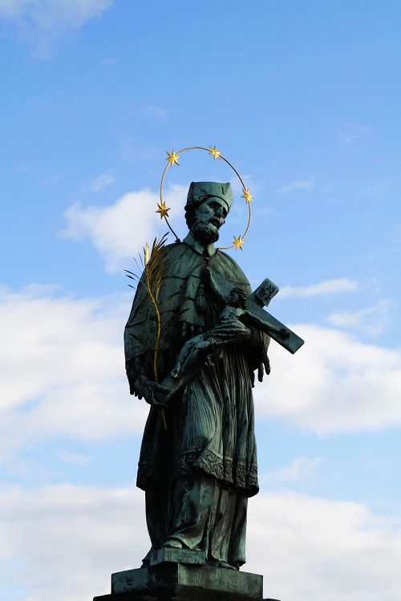   
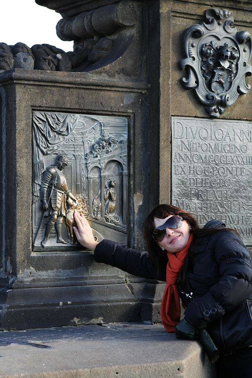  
  
Sasa在查理大桥上使用这款在北美发售的银灰色350D拍摄，看多黑色单反机身机身，当看到这款颜色时还是蛮特别的。有没有发现她的手被冻得红红的，可见当时有多冷，完全可以穿羽绒服了。真要感谢光光提前预告天气，否则我可是一件棉衣都没准备带呢。  
  
  
查阅查理大桥上各个雕像，对应的这座是St. John the Baptist（施洗者圣约翰）像，犹太人先知，早期基督教会以他为耶稣基督的先驱。关于他的生平来源于四部《福音书》、《使徒行传》和史学家约瑟夫斯。其母名以利沙伯，可能是耶稣之母玛利亚的亲属；其父是祭司撒迦利亚。  
  
The Virgin and Child with St Anne and St John the Baptist(圣母子、圣安妮和施洗者圣约翰)是达芬奇的炭笔画 ，作于1499年—1500年，现藏于英国伦敦英国国家美术馆。许多密谋理论家从达芬奇作品中对施洗者圣约翰的迷恋程度来看，总结出达·芬奇“感染”了约翰耐德异教，将施洗者圣约翰视作真的基督，真正的上帝之子。（欢迎纠错，如果我查阅的信息有误的话。）  
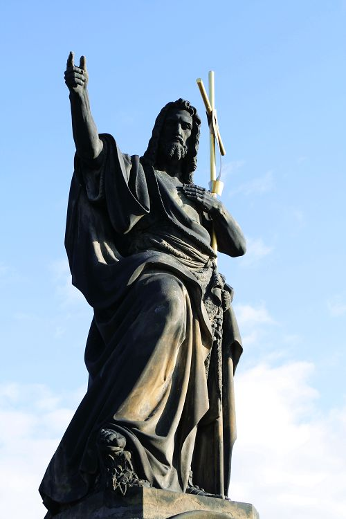  
  
且当作触摸十字架能带来好运吧~  
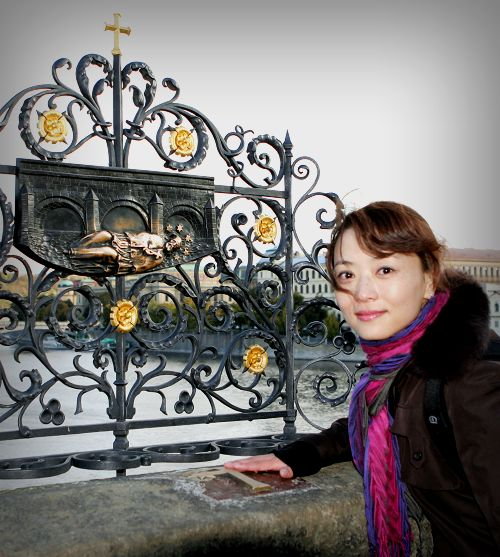  
  
香港女孩子Jenny，开始我觉得她穿的衣服都好鲜艳，后来发现在阴雨天里穿着鲜艳衣服拍出来的照片非常好看。注意她身后当地人的打扮，30年代的精致摩登放在当下也好看。  
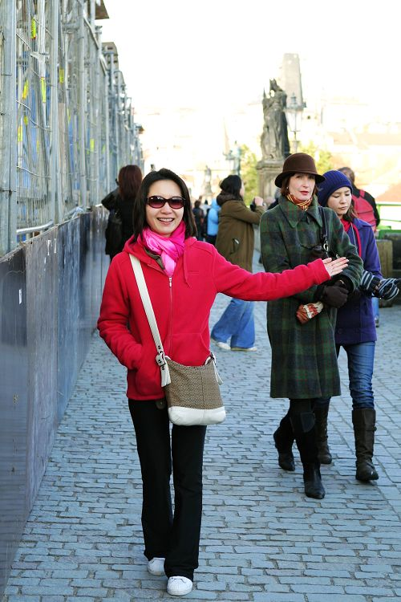  
  
查理大桥北边较高的哥特式桥塔出自Peter.P之手。  
  
卡夫卡的作品中有桥也有水，他从来没有明确指出是哪条河、哪座桥，或许因为他太熟悉每一条河、每一座桥，在他的概念中它们已经成了统一的意象，不再有本质的区别。他有一篇专门描写桥的散文，其中这样写道：“我是一座桥，僵硬而阴冷。......从未有过游人误入此地......就这样我伏卧着等待，我必须等待，只要没有坍塌，任何一座已经架起的桥都不可以放弃桥的职守......在卡夫卡笔下，这座桥不仅没有名字，而且桥已经不再是建筑意义上的桥，它变成作者自己，粉碎在湍流的河流中。卡夫卡看见的是一个与自己对视的不屈的幻影。  
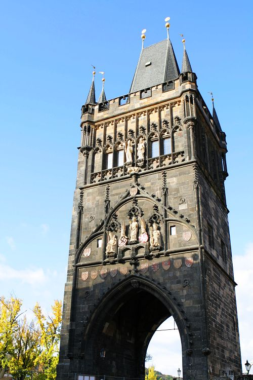   
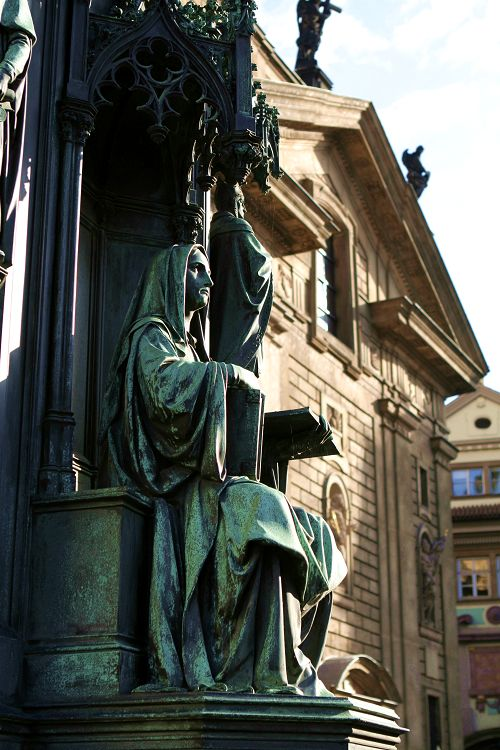  
  
河边有许多户外咖啡座和吧台，夏天的时候坐在这里应该很惬意吧~  
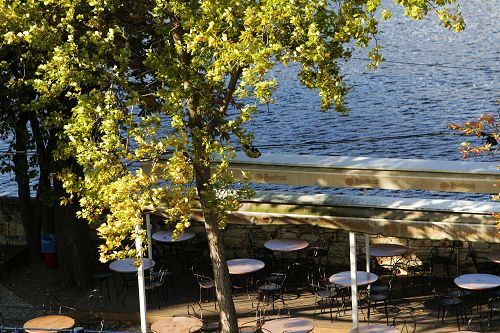  
  
以及供游客使用的脚踏船。  
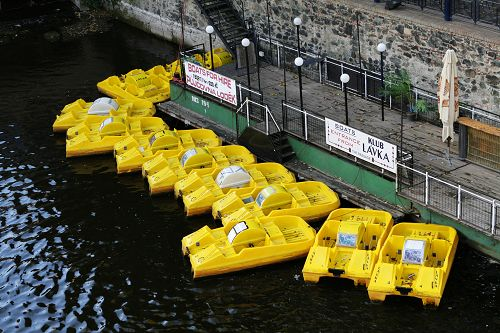  
  
阳光照射在桥墩上的景象真是迷人。   
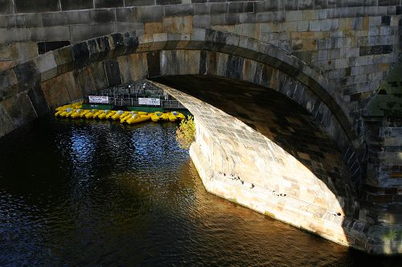  
  
从查理大桥拍摄的契夫桥全景。  
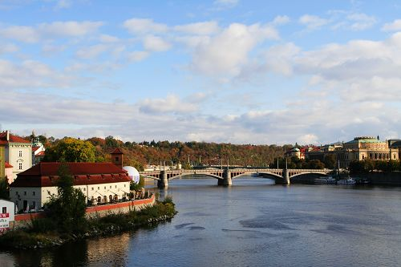  
  
查理大桥上的恋人，男孩子戴着黑色礼帽、着黑色上衣、留着长发，是不是犹太人典型的打扮？  
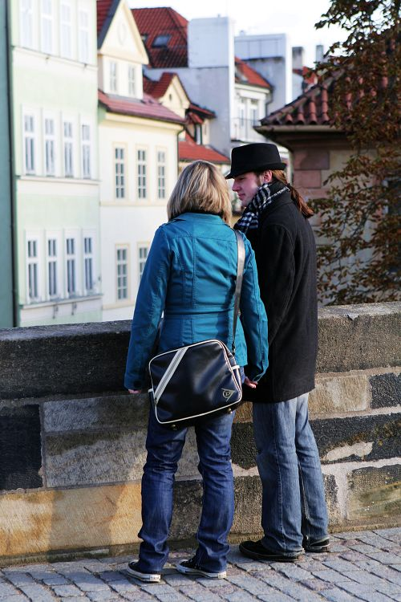

---

## 评论（2）

**喜刷刷** · 2009-11-15

真的蛮冷的哟，当地人穿得很多。很多人撑伞等候那张是不是大家在等过马路？

**Christina** · 2009-11-15

对呀，是游客啊，很多很多游客在风雨中。。。下雨天真是狼狈。

