# @Praha-5

**布拉格不放手......这个小母亲有利爪。**  
----摘自1902年12月20日卡夫卡写给奥斯卡.坡拉克的信  
  
曾经号称为”犹太人的布拉格“，今天也只有将近1500个犹太居民。巴黎大街上修缮一新的犹太教堂，商店门口高悬的大卫星标志都在向来布拉格的游人无声地述说那些不为人知又无法忘却的故事。这是布拉格最古老的犹太人餐厅。  
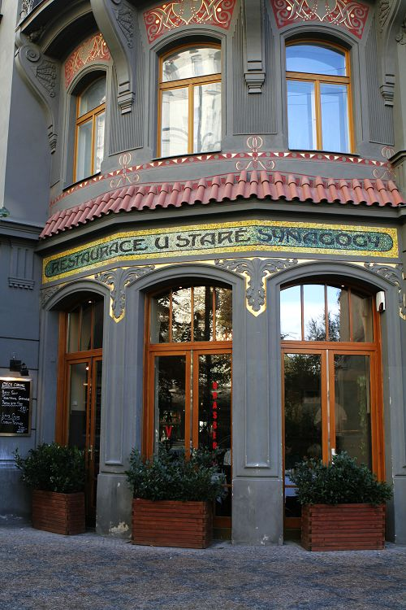  
  
拿着书慕名而来的游客很多，比如这位寻找到Stary zidovsky hrbitov（旧犹太公墓）的女士，表情中满是崇敬与期待。  
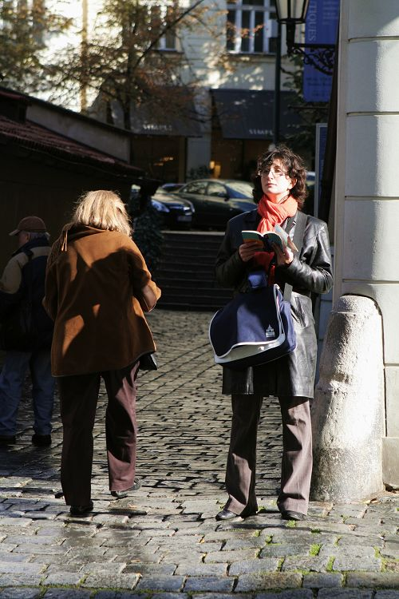  
  
不远处的那栋建筑就是“旧犹太公墓”及“犹太博物馆”的入口处，一位不懂英语的犹太老妇人坐在里面卖票，共有6处参观，但不在一个地方，全票价是300克郎。  
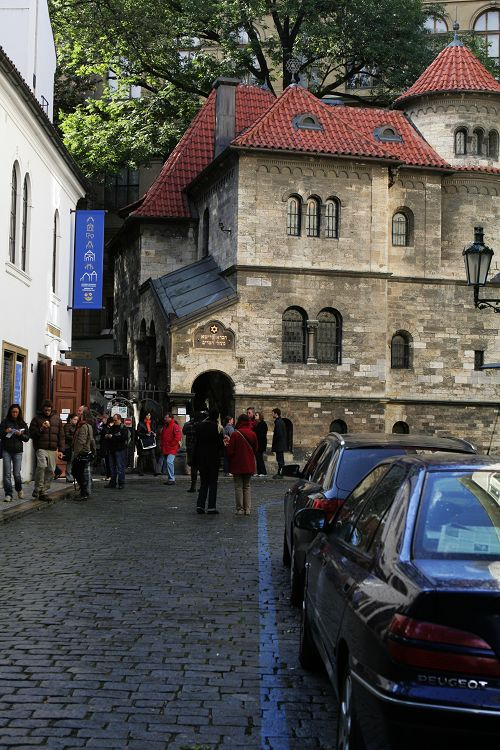   
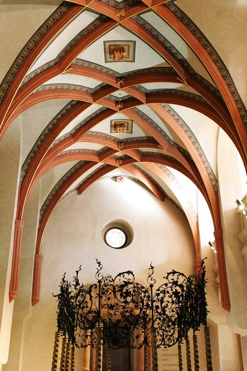  
  
入口处有售卖犹太男人戴的小圆帽，用卡子夹在头顶的头发上。墙上密密麻麻排列着故去的犹太人姓名及从出生到死亡的时间。  
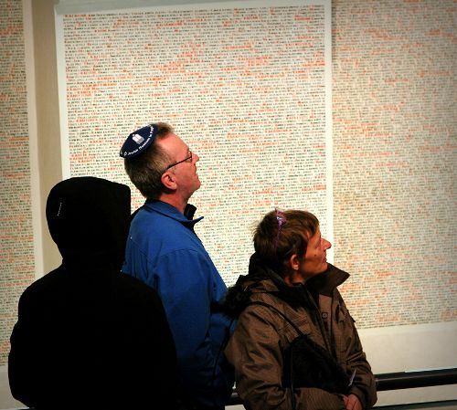  
  
为了展现如此之多的亡灵姓名集中印刷在墙上给人的震撼，这张本应横向的照片被旋转成竖着的长方形。  
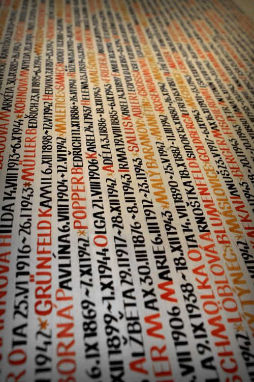  
  
这是全欧洲最大的犹太墓地，大约建立于15世纪初期，至今共有12000个墓碑立于这快面积狭小的墓园中，因此墓碑层层叠叠，最多叠到12层。其中最有名的是犹太教长老Rabbi Low和Rabbi David Oppenheim的墓碑以及华丽的巴塞维之墓。  
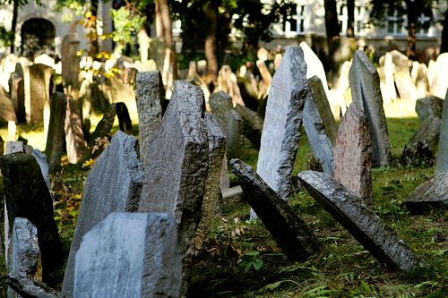   
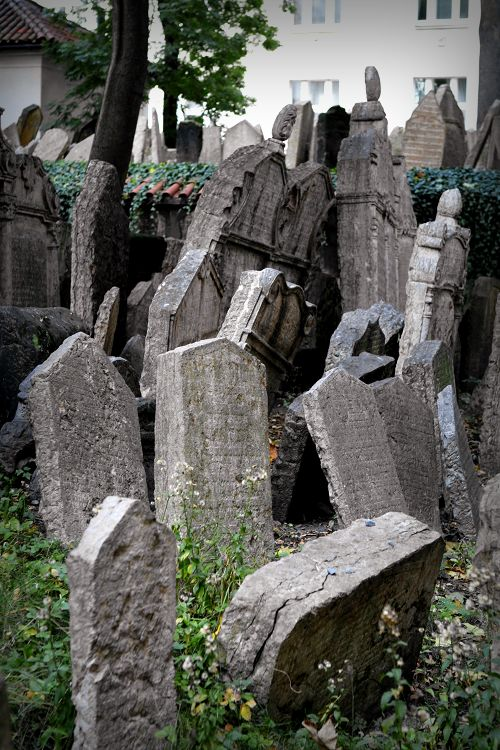   
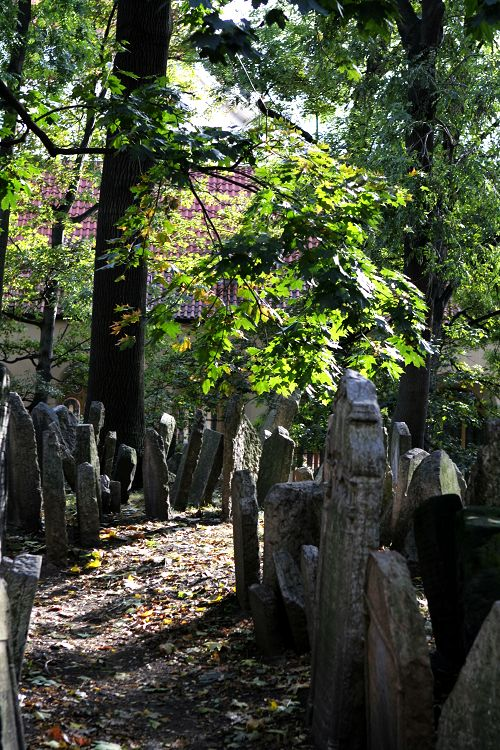  
  
不知道这是否是类似祭台之类的小建筑，有许多小石子和被塞进石缝的折叠起来的纸头，想必那些纸头里一定写着些什么吧？  
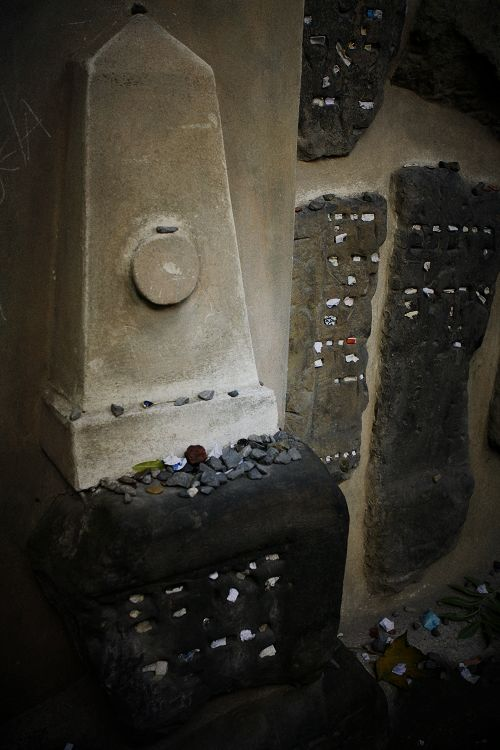  
  
有景点的地方一定会有商贩售卖纪念品，价格会略高于非景点区。  
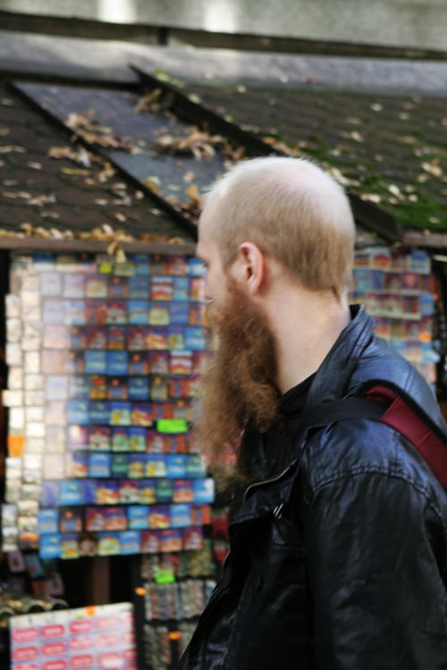  
  
我在这里发现了这副彩色格子油画，想起自己很喜欢的陈问问的处女作《Where is my homeland?》。  
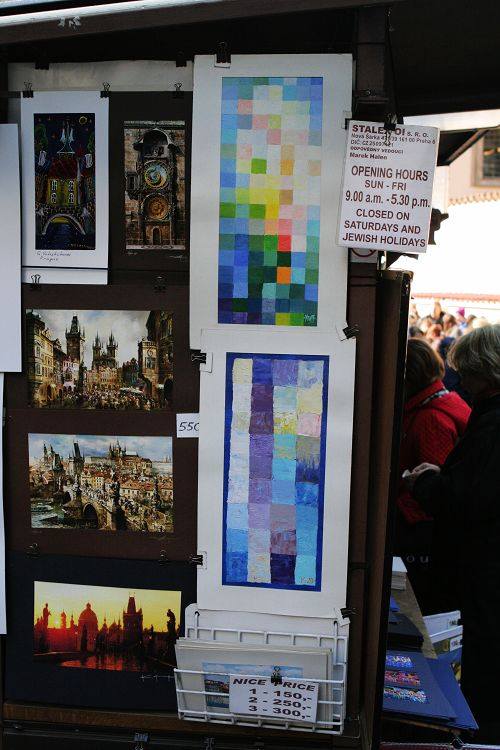  
  
身处犹太区的氛围并不会让人感到愉悦，就象从建筑群中投射下的这缕阳光，只照亮这一小部分。  
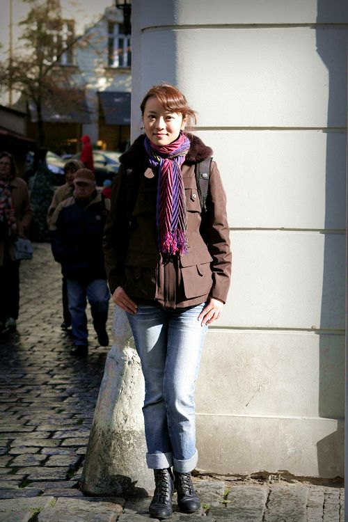  
  
卡夫卡时代的布拉格已经有近60万人口，其中23万居民分居在8个城区内，犹太城翻建中的约瑟夫城区属于布拉格的第5城区，紧靠在伏尔塔瓦河东岸。19世纪时这个河岸号称“摩岛河的膝盖”（摩岛，Moldau，伏尔塔瓦河的德语名称），因为常有水灾，最外圈很难建房盖屋。  
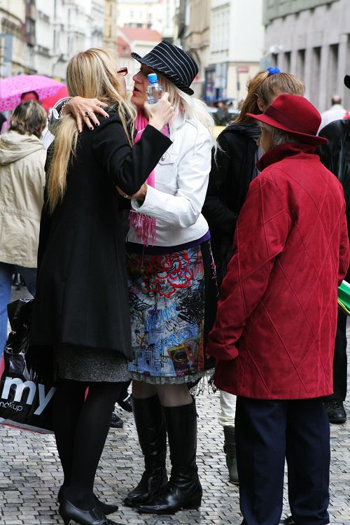  
  
当年整个犹太城区都有城门控制人员车马进出，夜间城门关闭。由于人口泛滥，犹太城里的空间越来越小，生存环境每况愈下。因为害怕传染病蔓延到布拉格其他城区，1893年2月11日政府立法决定，拆除这个城区中上百年堆积起来的残垣断壁。  
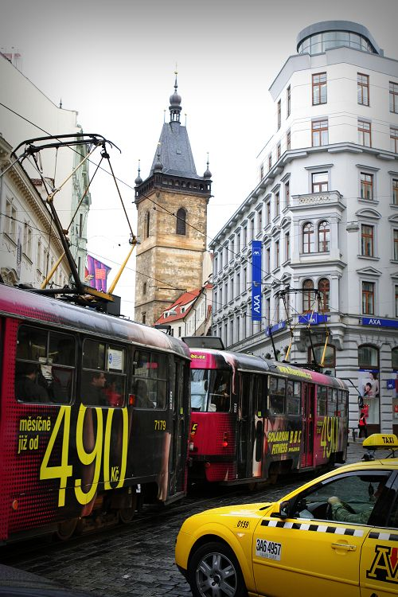  
  
在1897年至1917年的20年间，犹太城始终是一个巨大的建筑工地，可能比现在笼罩在灰尘中不见天日的南京城还要恶劣。在推倒住宅区的灰土烟尘中，那个上百年里曾经连接着这个特殊群体的纽带也随之土崩瓦解。尽管犹太人市政厅和大大小小犹太教堂基本保留并得到修缮，但对于出生后的卡夫卡却从来没有感觉到这里有他的根基，没有感觉到自己是一个真正的犹太人，他始终感觉到捷克人和德国人对犹太人的一致歧视。  
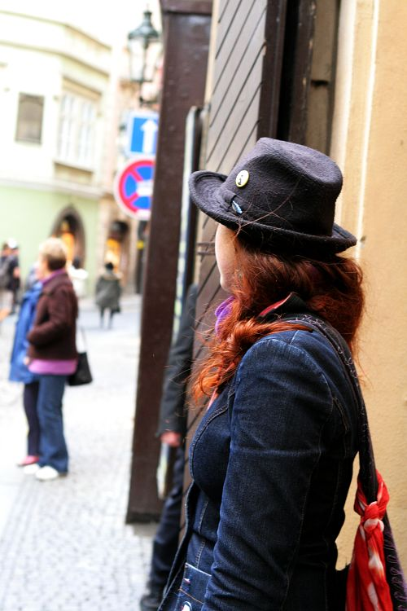  
  
  
尽管德皇在19世纪中叶提出犹太人可自行选择居住地，享受和基督徒一样的自由，但现实中的过渡却远远没那么简单。犹太人的门窗被涂上血迹，谁要和犹太人签订房屋协议就会受到恐吓。卡夫卡曾经读到一本书，书中描述捷克人到犹太人居所打砸抢的情景：“疯狂的人们吼叫着冲进犹太城，有小伙子、醉汉，遗憾的是其中还有妇女，他们撞倒门窗，砸烂家具，连被子和枕头都被剪开......瞬间白雪飞舞......”  
  
当年，弗洛伊德的父亲在光天化日之下被种族歧视分子侮辱，头顶上的帽子被打落在地，除了默默地拣起之外没有别的办法，弗洛伊德始终不能原谅父亲一味的忍受而不思抗争的行为。而有人将放弃犹太教、转向基督教作为避免这个灾难的可能之一。德国诗人海涅曾说过，基督教是迈进欧洲文化的入场券，但尽管他接受了基督洗礼，却还是没能摆脱犹太人的命运。  
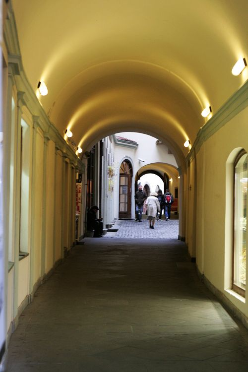  
  
翻建后的犹太城改称为约瑟夫城，北面正好以卡夫卡出生地的那栋建筑为界，与布拉格老城区划分开。而这个地理分界也是卡夫卡从儿时起的心理分界，身为捷克犹太人的后代，说着社会少数阶层认同的德语，卡夫卡从来都是站在临界点上徘徊，从来没有过归属感。  
  
人们日常使用的“布拉格德语”是一种不带地方口音，极为简洁的书面德语。卡夫卡正是以这样的母语，在这座他从未真正离开却又从未真正属于他的城市里生活、工作、写作了一生。和其他同期作家不同的是，卡夫卡在他的作品中从未用犹太人的形象做主角，甚至连配角也没有，他宁可将自己一贬到底做动物。他所经历的种族歧视留下的伤痕不可愈合。  
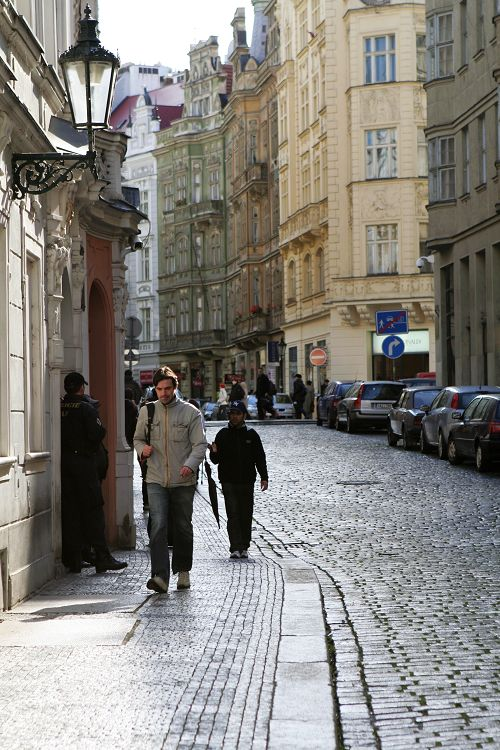  
  
*（有关布拉格的部分文字均来自《卡夫卡与布拉格》）*

---

## 评论（9）

**喜刷刷** · 2009-11-16

那个犹太墓地我很向往，还有重庆那个文革墓地。欧洲这个季节真的很冷啊，不过那里的人们似乎丝毫不会因为寒冷而影响情绪，多彩而热烈。

**itsmin** · 2009-11-16

图片文字都很棒。继续继续。

**Christina** · 2009-11-16

天下少数民族很多，为什么惟独犹太人这么不招人待见？有谁能解释一下这个民族为何命运如此悲惨？

**喜刷刷** · 2009-11-16

可能这个民族太有才了，呵呵～

**shenwen** · 2009-11-16

当布拉格和卡夫卡成为某种带有咖啡味道的名词，它们真正的面貌已经被藏匿。  
我喜欢这些色调的照片。

**monica** · 2009-11-16

每个宗教都有存在的意义，起码它抚慰了它的信徒们。

布拉格，是我曾爱过的男人最喜欢的城市。虽然我未曾亲临。在心中，总有一席之地。  
卡夫卡，我喜欢的作者。可惜不曾了解过他的过去。可叹。

**大湖** · 2009-11-17

“天下少数民族很多，为什么惟独犹太人这么不招人待见？有谁能解释一下这个悲惨的民族吗？”  
To understand this, Bible is one of the good place to start.

**[Nio](http://www.nioxiao.com)** · 2009-11-17

亡灵姓名最震撼！

**[光光](http://gaoguangguang.blogbus.com)** · 2009-11-17

“天下少数民族很多，为什么惟独犹太人这么不招人待见？”  
1.宗教信仰的不同，最根本的不同。  
2.他们生活在别人的土地上。  
3.人类具有排除异己的天性。  
4.因为愚昧所以狭隘，所以相信诬蔑犹太人的谣言。  
5.政治原因。

看的书目前能总结出的几点。

