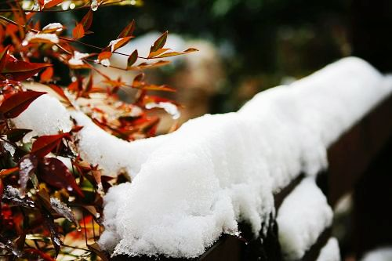
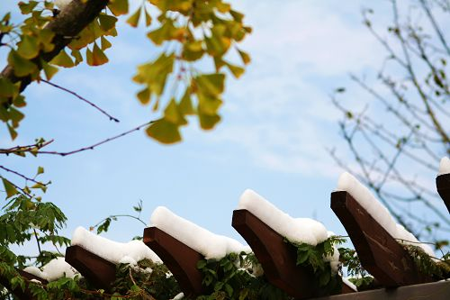
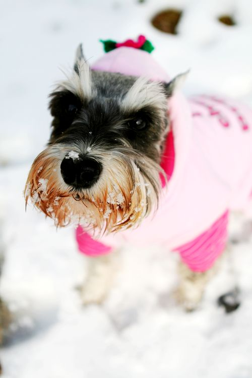
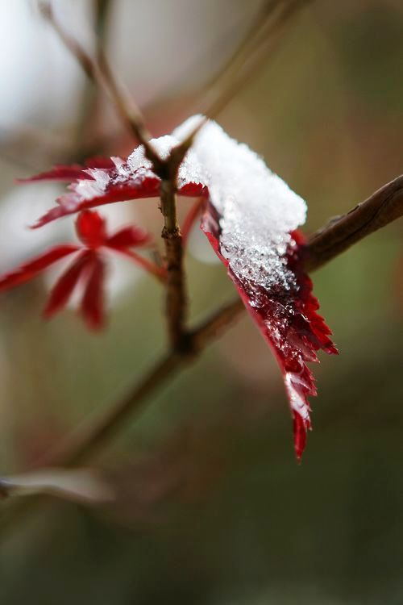
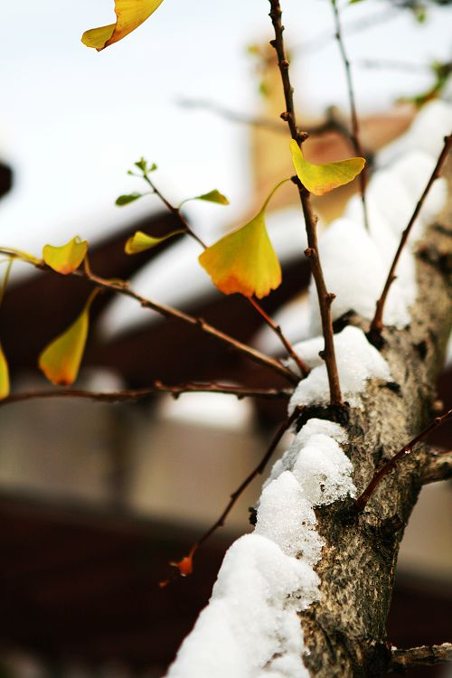

# 下雪啦，天晴啦。

前天夜里开始下雪，昨天下了一天，今天便放晴了，2009年第一场雪好短暂啊。  
  
中午散步，阳光出来了，两只谗猫先闻一闻，然后尝一尝，土豆尽然一路走一路吃起雪来。它们象所有小孩子一样喜欢雪，在雪地上神经质地奔跑，Luke冲到雪地上猛地趴下来，雪花四溅，它也乐此不疲。  
  
早晨我终于在众多堆积的衣物中找到一双手套，还是08年2月大雪天在上海时Angie送我的，手心是皮手背毛呢的料子。打雪仗不怕手冷了，其实只有我打它们的份儿，土豆身手敏捷，总能躲过飞过去的雪球。而Luke的反应和它的性格一样敦厚迟缓，几乎百发百中砸到它身上，它边躲边跳边兴奋地叫，可就是不逃跑，也许它们知道这是游戏吧？还有更令人高兴的事儿，昨天下午到今天土豆是在狗厕所上便便的，Look！白天与黑夜总是交替出现，现在，真的，是大晴天呐。  
  
越满足的日子越会让人产生惰性，无欲无求的生活，天天宅着。。。该多好。。。借用[**旗旗**](http://freshqi.blogbus.com/logs/51434203.html#cmt)小朋友的一句话：**“去他的过去的苦痛和未来的死亡，我只求现在爽。”**逗号前面的话还蛮酷的，后面的我不敢说出口，因为下午还得工作。  
  
   
   
   
   

---

## 评论（14）

**喜刷刷** · 2009-11-17

土豆大人的胡子，哈哈～

**itsmin** · 2009-11-17

下雪穿棉袄，天晴戴草帽！

**Christina** · 2009-11-17

它们好喜欢在雪地里奔跑啊，很好玩~

**[Jansfer](http://jansfer.com)** · 2009-11-17

好美

**[薇安](http://bulaoge.com/?vivianxu)** · 2009-11-17

这个冬天来的真早，下雪了居然。

**zyz** · 2009-11-17

土豆这张好靓！偏心，没有LUKE的。

**高原** · 2009-11-17

心中的太阳, 陪伴着四季的更叠. 我在院子里种了这两种树.

**星晔** · 2009-11-17

跟南京的家人通话知道下雪了，再看到茶的初雪美图，让远在异乡的我乡愁更重。

**[少爷](http://jennyshaoye.blogbus.com/)** · 2009-11-18

照片拍得好美啊

**卉子882** · 2009-11-18

偏心，没有LUKE的 ！

**zq** · 2009-11-18

LUKE是帅哥，土豆是靓妞，哈哈！片子的色彩真是漂亮地一塌带滴一抹！

**大姜炖去** · 2009-11-18

土豆小朋友真是粉嫩啊

**[山树](http://shanshu.blogbus.com)** · 2009-11-18

这雪景可真美.我现在只能乖乖的,不能东走西跑.真让人抓狂啊.

**[Nio](http://www.nioxiao.com)** · 2009-11-18

把每一天都当最后一天来过，哈

