# @Thun-1

——以下照片均在瑞士的THUN拍摄——  
  
父亲带着两个孩子，其中一个抱在怀里，一个走在前面戴着婚纱穿粉色衣服的小女孩，衣服上有点脏兮兮的。不过，模仿新娘是我们每个女孩子小时侯都曾有过的故事吧？  
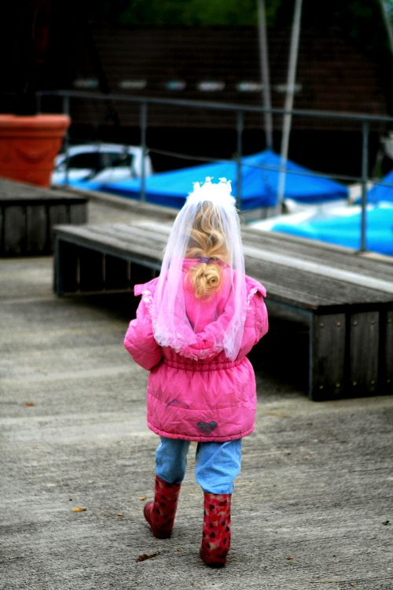  
  
在我们乘船的码头拍下这只水鸟，象一枚翡翠石上雕刻出来的图案，漂浮的白色是天空云朵的倒影，这张照片有点图画的效果，鸟的爪子象版刻，其他部分则象油画。周围有许多这样的水鸟，嘴是白色的。  
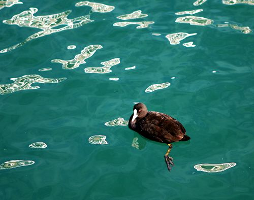  
  
游船服务员下船来接货，为我们服务的那个女服务员既漂亮又迷人，脸上总是挂着甜美的笑容，为此我们给了小费，如果我没记错的话。  
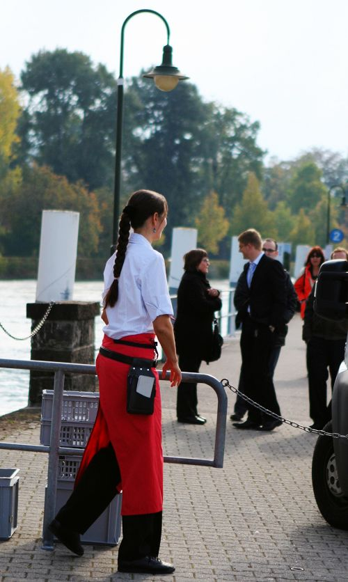  
  
我们两乘上这艘名为BERNER OBERLAND的游船，添了钱从二等舱换到一等舱，主要考虑到一等舱视野更为开阔，Miranda非常认真地在研究地图。  
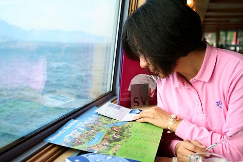  
  
在国内养成的习惯，茶水喝完总是可以续热水的哇，但游船上这一杯袋泡茶约5、60人民币，喝完就完了，不能续热水。  
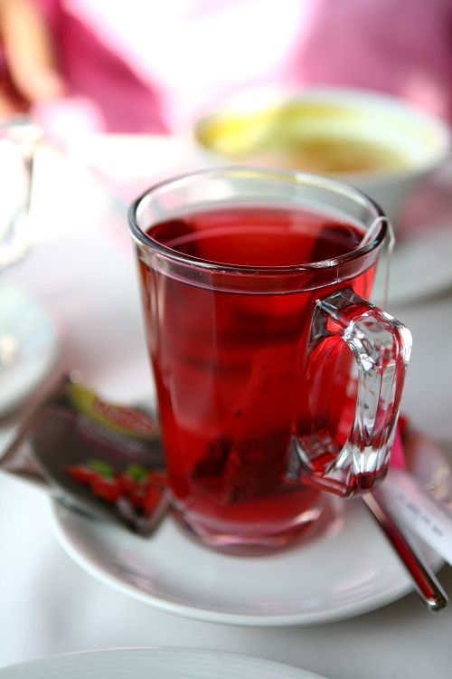  
  
瑞士法郎的硬币，5元硬币最大。  
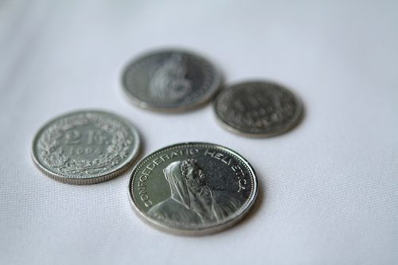  
  
以及THUN湖里的鱼，味道与我们之前吃过的鱼没啥区别。  
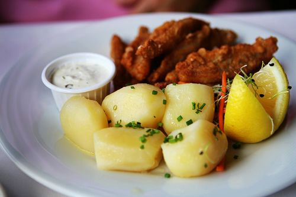  
  
这个册子好象是在售票点拿的，如果不是就是HANS给我们的，记不大清了。我把它带回国了，以后有机会再去。  
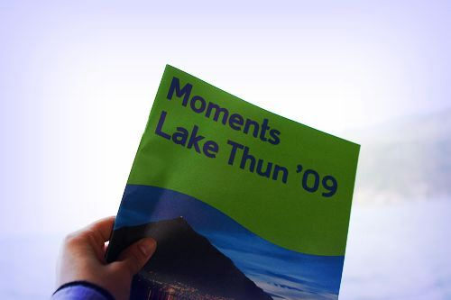  
  
帅气的年轻船员，美景天天看也有审美疲劳吧？那么。。。如果他要度假的话，会不会喜欢往沙漠地儿里跑呢？  
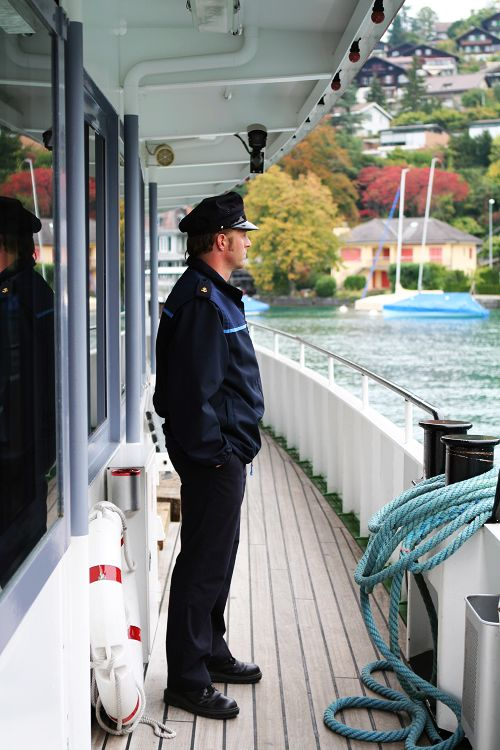  
  
所谓“海天一色”，在THUN湖也能观赏到。  
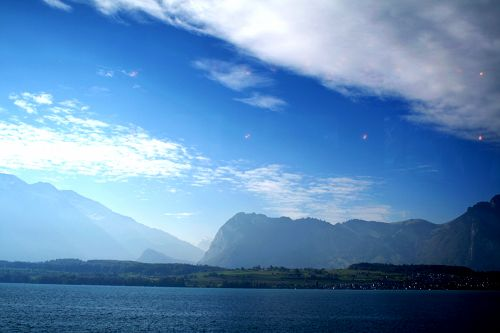  
  
Miranda和我在这个寂静到疑似无人的小镇上下了船，它的名字叫“ST.BEATUS-HOHLEN”。  
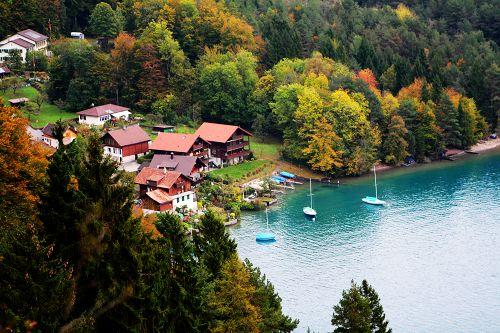  
  
从ST.BEATUS-HOHLEN码头到CAVE中间路过一条在山边凿出的公路。  
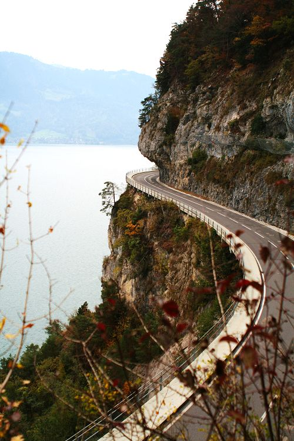  
  
这条往CAVE的山路就这样缤纷五色又幽静深远。  
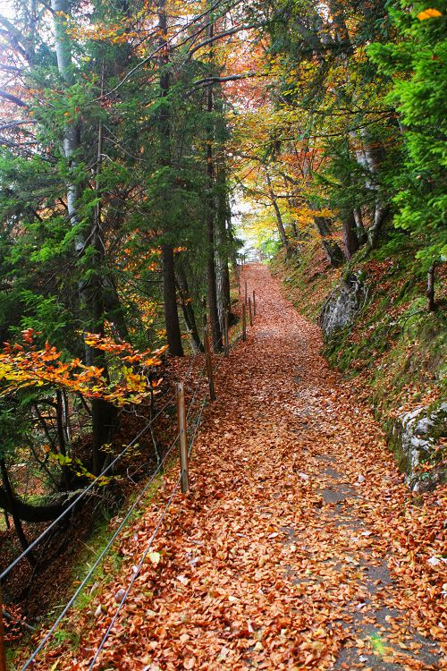  
  
那些穿过森林投射在叶片上的光。  
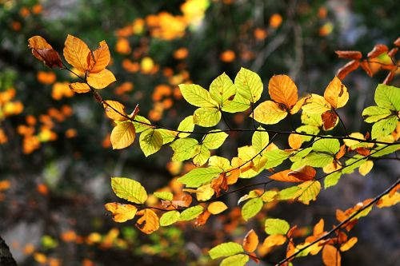  
  
保留了树叶的原色，弱化了泥土及树干的色彩，我自己非常喜欢这张有点鬼魅的照片。  
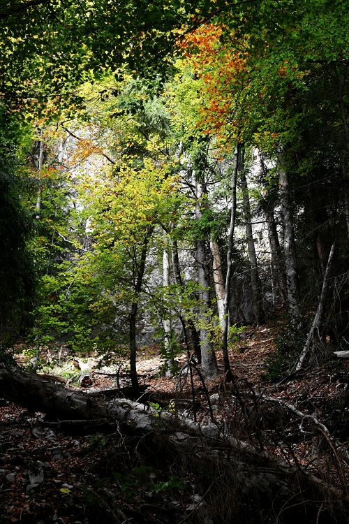  
  
路上遇到一对徒步登山的夫妻，先生穿着黑色上衣，搭配着红色上衣的太太，很协调的色彩，均双手拿着辅助登山的拐杖，他们帮我们俩拍了合影。山路上难得遇到人，正因为这样瑞士的山水才保存得如此完美。  
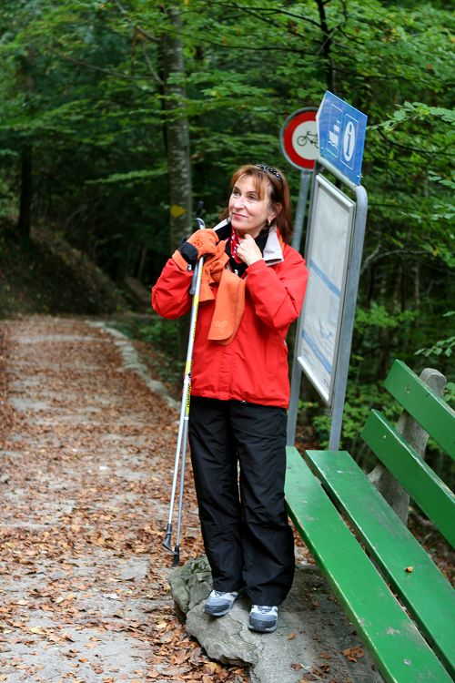  
  
公认我平时走路已经很快了，没想到Miranda走起山路来比我还要快。本以为我自理能力比较强（我妈也这么夸我的），没想到Miranda在极其理智和有条理的情况下还能腾出精力照顾周围人。忽然想到以前看过恋爱中的北京女性会抢着主动埋单的故事。。。以及听说真正的北京孩子与家庭联系相对比较紧密。。。向首都理性又独立的女性们致敬，我觉着Miranda应该能代表北京女性风范了！  
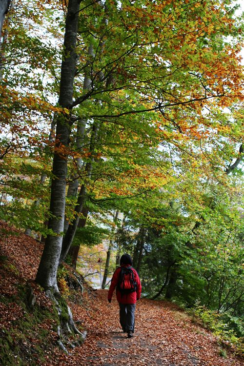  
  
我们到了山上的这个CAVE，她在那里买了张明信片开始写情书给北京的爱人，就是这么一路浪漫过来的啊~感觉我们整个人到瑞士才完全苏醒过来，完全恢复光彩与活力！  
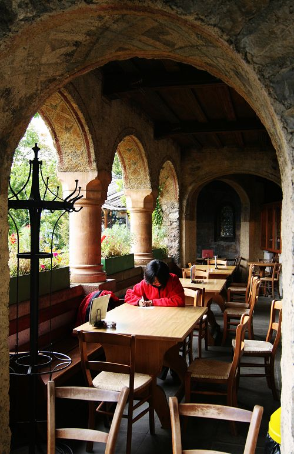  
  
她笑嘻嘻地写啊写啊，甜蜜四溢，如今这张张不同地方发回的明信片是否已经到达？  
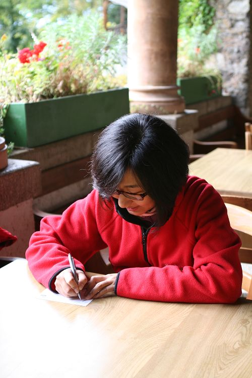  
  
贴上爱心小邮票。我们在欧洲期间均用这个带封口的塑袋装平时用的零钱，比装在钱包里好，塞在衣服口袋里，随时随地拿出来用，火车票也装里面，不起眼啊。即使小偷见了也不会起歹心，没有吸引力啊。  
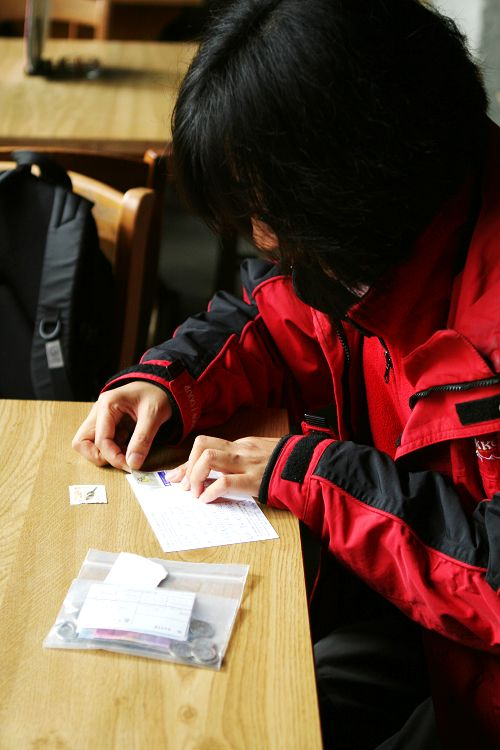  
  
这个小镇真的好安静，怀疑只有夏季时间才会人声鼎沸？终于，还是寻着一些喧闹看到三个在家门口嬉戏的孩童，奇怪这肤色均来自一个家庭吗？  
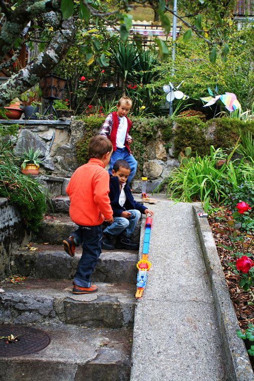  
  
以及以下生物。估计它们也寂寞死了，多久才能见到一个人啊？  
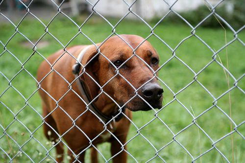   
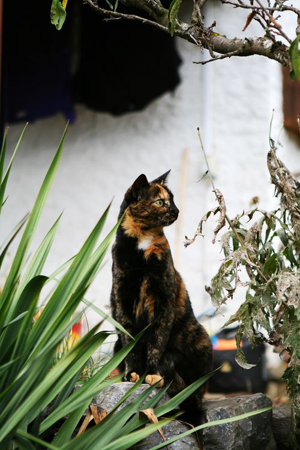  
  
停靠在码头及吊在房子下面的私家游艇，是不是只为夏季主人度假时使用？真的好喜欢这样的地方，让都市人有一个月时间在这样的地方过滤一切的坏情绪坏空气坏心理。。。神清气爽地回去工作效率会更高啊~  
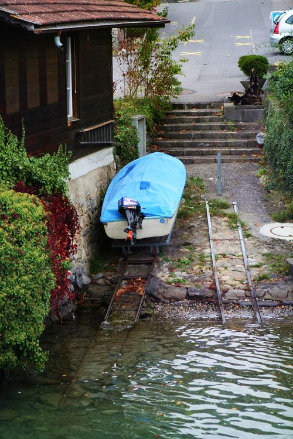  
  
沿途风光美不胜收，如果有足够的时间，可以慢慢将THUN和INTERLAKEN两个湖畔的小镇一一体会。我们两坐船上琢磨着湖畔那一栋栋漂亮的房屋，得多少银子才能买下来？以及是不是都是有钱人度假的第N个居所？人真的很少，瑞士是非移民国家，想移民到瑞士比较难，不是光有钱就能办到的吧？！  
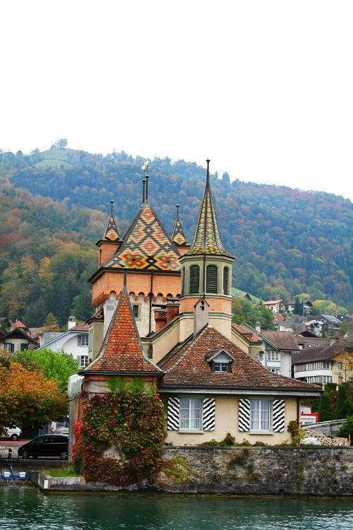  
  
下船时好不容易拍下这位光着膀子打毛衣的老太太。从我们上船到途中下船，再上船，这群老姐妹就一直坐在那里谈笑风声。其她老太太穿得都还比较保守，就更突出她的风情无限！船舱里我还穿着毛衣呐，除了体质不同，人家活得那个自在。。。  
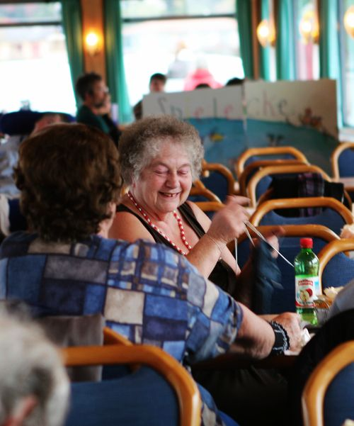  
  
从CAVE回到ST.BEATUS-HOHLEN等游船，由Miranda拍摄。这次旅行真是朴素，不完美的身材当然要好好搭配才行，可是不晓得我为什么用这条仔裤搭配这双平的不能再平的鞋？错乱的天气，错乱了我的搭配。也庆幸，没有穿喜爱的鞋旅行，否则肯定面目全非的回家。  
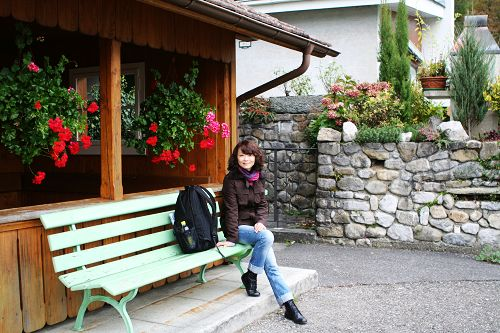  
  
等船时给自己的脚拍一拍，真辛苦这双鞋了，穿了5年，换过鞋带。但这次旅行中的磨损最严重，又是雨水泡又是岩石磨的，袜子基本穿一两天，大拇指那儿就一个洞，边旅行边扔袜子。不是袜子质量不好，是行走时间长啊。  
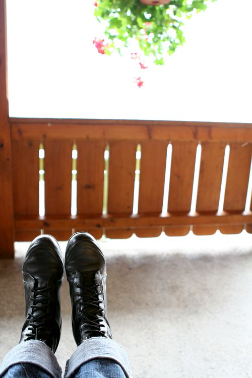

---

## 评论（13）

**喜刷刷** · 2009-11-20

喜欢水鸟图和猫咪图。

**小原子** · 2009-11-21

那句船员往沙漠跑，我笑得不行….精辟。  
那张悬崖公路感觉真好~~

**[光光](http://gaoguangguang.blogbus.com)** · 2009-11-21

真想在那个面海面山的公路上开车，转弯过去，敞篷的车。

**[joanna](http://yanmer.cn/blog)** · 2009-11-21

水鸟的那张绝了！喜欢在落叶上踩着，沙沙的声音

**bluegirl** · 2009-11-21

有的时候袜子很快就磨破了是因为鞋前端内侧磨损而磨破袜子，你看看是不是鞋子的问题。不知道我说明白了没有。。。

**雯子** · 2009-11-21

那条公路太有意思了，想在上面开车。又饱眼福了哦，你下次什么时候再去瑞士嘛？约上我一起去嘛，看了你拍的照片心痒痒的想出去玩哦，布拉格也很美哦。

**[acmiler](http://after1997.blogbus.com)** · 2009-11-21

很漂亮的地方啊。真想去，人间仙境一样。

**陈问** · 2009-11-21

最向往这些藏在山林里无人问津的镇子了。好象在那里养狗种花爬山，度过一整场人生。

**zq** · 2009-11-23

还有那么漂亮的照片吗？赶快都拿出来呀！

**[山树](http://5a5b0c3d)** · 2009-11-23

真是太美了~~

**lilian** · 2009-11-24

这张显得你很知性哦~

**Christina** · 2009-11-25

还有很多照片，担心大家看得审美疲劳了，呵呵~

**Faye** · 2009-12-08

三个小朋友也可能是邻居吗？孩子们总是喜欢串门的。

另外，Bluegirl说的是呢，我也有一双很耐穿的鞋子，因为长途跋涉，里子比面子先破损，磨破了好几双袜子才发现问题所在。茶也看以检查一下，是不是鞋子的问题。

