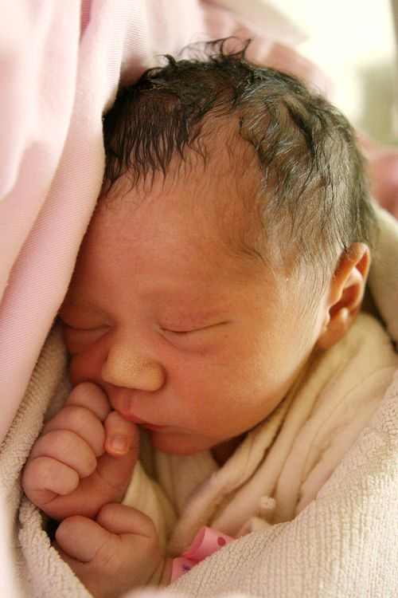
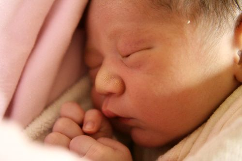
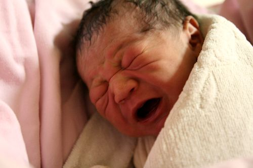
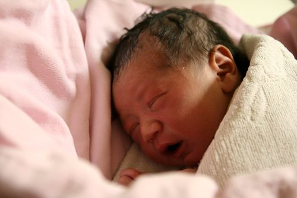
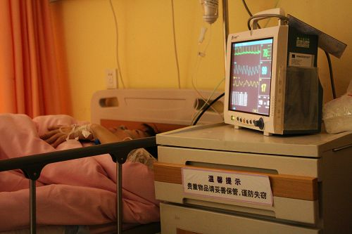
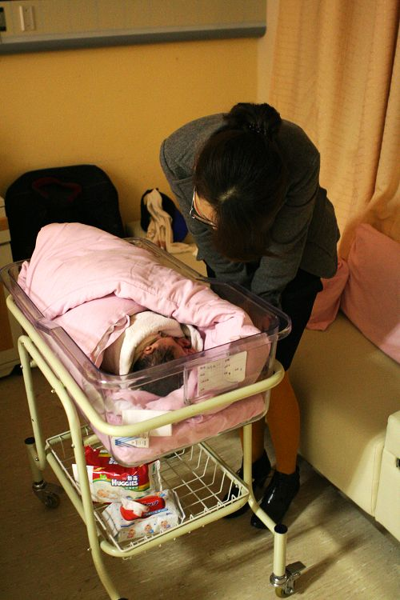

# 感恩节出生的宝宝。

下午收到短信：儿子。想着这家人肯定高兴坏了，尤其在一个有着传统封建思想又单传的家庭，做媳妇的肯定松了一口气。其实生男生女不重要，重要的是生一个健康的宝宝，[**山树**](http://shanshu.blogbus.com/)加油啊！因为孩子的头部有9.99CM的直径，医院建议剖腹产，剖腹产据说比自然分娩要痛苦些，在生完之后。我们刚刚到达之前小护士才给年轻的妈妈挤过肚子，朋友躺在病床上说：“这护士和我仇啊，那么用劲。”孩子的爸爸吃完晚饭大摇大摆地从外面回来。才出生几个小时的宝宝正在安静的睡觉，可能被我们几个话佬吵着了，作出欲哭状，却只打雷不下雨，哼哼几声继续睡去，好鲜嫩的生命啊！  
  
另外一对夫妻，从妻子怀孕到还有一个多月的预产期，一直是丈夫照顾太太，双方父母都没有帮忙，蛮少见的。人家先生说起来一脸很平常很正常的摸样，多少夫妻有孩子前后不是长辈们帮忙照顾着，本身回家做饭的男人就少之又少，象这样自己照顾孕妇的男人就更少了。有些人在婚前并没什么吸引力，也不会花言巧语，但是婚后真是模范丈夫。我有个女同事很喜欢买首饰，他们度蜜月的时候丈夫花了几千元给她买了只蓝宝戒指，说现在没那么多钱，就先买这只送给你。过了一年这个同事的丈夫又主动买了一只一克拉100分的钻戒给她，可是她依然对那只蓝宝珍惜不已。动情地说：“人品真的很重要，找对人对女人将来的幸福很重要，他就是那种不太多话，但会主动去做的男人，什么都为家着想。”  
  
   
   
   
   
   

---

## 评论（10）

**鸟人** · 2009-11-27

做妈妈好幸福啊,我打心眼里羡慕那些“大肚婆“们

**[山树](http://shanshu.blogbus.com)** · 2009-11-27

哇.刚出生的宝贝皮肤好皱啊…真不知道将来我的小石头会是什么样子.  
我老公现在也是这样,前前后后忙碌着.我们自己照顾自己,我也觉得挺称心如意的.自己动手丰衣足食.求人不如求己.

**雯子** · 2009-11-27

我是铁了心要剖了。大肚婆日子过得不像没大肚前舒服啊。怀孕了才知道妈妈好伟大好无私的奉献啊。 http://sh.talk.iyun.com/5/1-668297-0.html。

**候鸟** · 2009-11-27

听说其实生孩子也不是特别疼，而是大家越说越夸张了，只要怀孕的时候坚持适量运动。我想如果能自己生，就不剖，我就发次狠，呵呵，看看究竟有多疼：）

**[shao ye](http://jennyshaoye.blogbus.com/)** · 2009-11-27

do you have a plan too???

**Angel** · 2009-11-28

cute

**HANK** · 2009-11-29

建议每一个父亲在升级的时候都要在产房里呆着。  
绝对是一次洗礼。

**itsmin** · 2009-11-29

呀，很像我儿子刚出生时候的样子。

**lilian** · 2009-11-30

看起来你还是蛮喜欢小宝宝的~

**mandy** · 2009-11-30

如果自己具备能生的条件还是建议自己生，会有疼痛，但是能挺过来。

