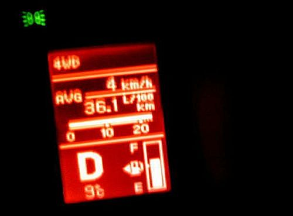
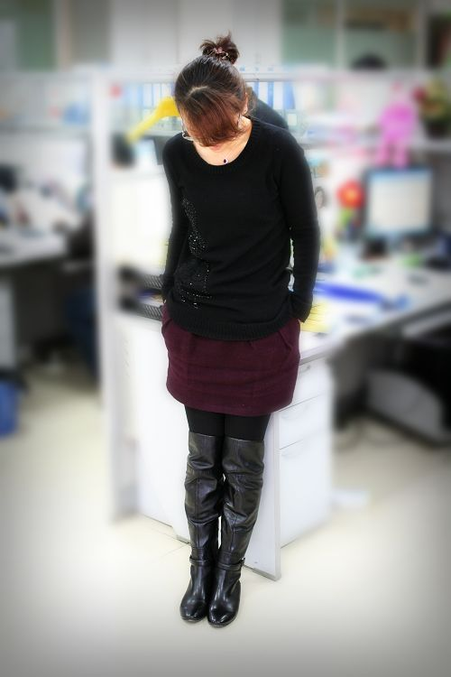

# OUT啦？！

Maggie一行三人准备10号去香港，正好手上的八达通卡给她们用，省得缴100港币押金，用完带回来给我哦。感觉她们不是去扫货而是去做卧底，不过有问问在，应该不是去扫货而是去做食客。其实现在圣诞前后的香港知道大陆人要来，已经不打折了。公司几人提前一周扎进落山鸡，考察美国黑色星期五都在卖些啥。欧洲商场里的顾客也是川流不息，大家边喊着穷边主动四处撒钱，在ZURICH的最后一天，在班赫夫商业街从早晨逛到中午也没等到开门，一问人家星期天从不营业的。如果经济不好应该延长营业时间吧？谁说经济不好啦？那简直是谣传！  
  
而最近我相当满足地沉浸在各种美食中，晚饭在山顶吃的饱饱回家，电台正在播放黄凯芹的粤语老歌《浪漫咖啡厅》，真的很老，百度里居然没搜到这首歌的mp3，虽然比较老但在冬天的夜晚听起来还是挺温暖的。  
  
以及，两次在电台听到“苏打绿”，第一次一位操苏北普通话的记者采访苏打绿的FANS，（这种二半调子的普通话给我的感受就象听到利器搓玻璃、搓铁皮的声音）大致说这些粉丝从喜欢偶像型的小帅哥到渐渐欣赏有思想碰撞型的歌手，听到其中两个粉丝的发言，女孩子的声音却好似无性别，恰好这晚另一个电台正好播苏打绿的歌儿，男性声音却“姨”到令人发指的地步。。。那么。。。真是人以群分，物以类聚，什么人喜欢什么人！象她或他或者我，性别特征如此明显的人类，是不是已经OUT啦？  
  
自从SHARP手机掉水里送去维修后，一直用旧手机拍照围脖，画质差，将就看看。  
如果不错开下班高峰时间，几乎每天都会遭遇堵车，“堵”出来的油耗。  
  
  
去德基都会艳羡几眼大厅里的蓝宝基尼，哇噻，真是大人们的玩具，好想开一圈感受一下。。。。底盘太低，很难适应南京这个大工地的路面状况。有N次石子儿蹦起来砸到车，最近一次居然砸到前档玻璃上，以为哪个淘气包用弹弓射击呢。还真有这样的神经病，大约两三周前下班高峰有人在高架上朝下扔窨井盖，砸中好几辆车。。。这有惊有险的驾车路。。。  
  
知道蓝宝基尼前身是生产什么的吗？是生产拖拉机的！没想到吧？几十年前蓝宝基尼公司的老总买了辆法拉利，总是出现问题，到4S店修，人家不怎么理睬他，于是他一气之下就从生产拖拉机转到生产跑车了。这个跨度真是大，不过人家也跨了几十年了。  
  
  
中午回家吃饭其实挺紧张的，但是保证质量，主要还是为了小狗中午能晒着太阳散步。今天中午用青菜和香肠炒过夜饭，香喷喷的，两只狗狗赖在厨房里不肯离开。这也是我对目前的工作状况还算满意的主要原因，可以照顾家人及宠物，以及酝酿美好又细腻的心情沉浸于生活，这是让人依赖又快乐的本源。有个要好的女同事跟我说：“有次听到隔壁办公的女人讲因为常常加班出差，回家孩子都不认识她了。。。想想自己好幸福。”不要做女强人、女超人，还是做个真女人比较幸福些！  
  
  
以及在德基买到梦寐以求的过膝皮靴，平的不能再平的底，非常适合超短裙搭配。我对完美的真皮皮具有着一切的好感。记得最后一天站在ZURICH商店橱窗外的雨中，久久欣赏着橱窗里的过膝靴，那个跟不是太高也并不低，做工细致款式大方。。。最终因为星期天，期盼就象肥皂水吹出的泡泡“砰”的一声破灭了~  

---

## 评论（21）

**itsmin** · 2009-12-01

黄凯芹，一个久违的名字。很男人的歌声，性别特征明显;+)，但是不out。Out久了就会变成in的。you wait and see…

**Christina** · 2009-12-01

哈哈哈哈哈~~~~~~~~~黄凯芹，一个久违的名字。很男人的歌声，性别特征明显;+)

老大，您太逗了！

**[光光](http://gaoguangguang.blogbus.com)** · 2009-12-01

我至今没搞清楚苏打绿到底是男的还是女的。豆瓣电台一出来我就赶快放下一首。

**Christina** · 2009-12-01

电台介绍“苏打绿”，说他们是在大学期间整出的乐队，清一色男生。张信哲的声音虽然也象女声，但还有优美可言，苏打绿的主唱那声音真就是“姨”的感觉！

**itsmin** · 2009-12-01

等李宇春苏打绿们风头一过，潮流就会回归。玉米？（还是春卷？）们看到不要恼火哈。

**邃** · 2009-12-01

我也是苏打绿的粉丝，他们声音虽然咿呀呀的，但是很特别啊

**邃** · 2009-12-01

看见你围脖里的过膝长靴了，呵呵，本来我今年也准备买一双，在商场里试了几次，发现小腿太粗，以后脱靴太难，未果！

**Christina** · 2009-12-01

声音的确很特别，对不起，打击了你这样的粉丝啊~  
我买的这双一定适合你，因为脚踝位置比较宽松，不是紧腿的。

**zq** · 2009-12-01

过膝靴子很“ING“哦！赞一个！”以及“，本人喜欢男人很像男人、女人很像女人、男很不像男女很不像女，呵呵。

**Christina** · 2009-12-01

楼上的意思就是不管象什么。。。都通吃啊？！  
哈哈哈哈哈~~~广告贴吗？

**陈问** · 2009-12-01

嘿嘿。我对名牌折扣没兴趣。去买书，一年四季价格都一样。

**Christina** · 2009-12-01

知道你去就想着不是去扫货的。借本书给你，上面有几家书店和美食店的推荐，带我多吃好吃的啊！

**邃** · 2009-12-01

嘻嘻，没有被打击，觉得比较另类。  
个人比较而已！  
关于男人是不是男人，女人是不是女人，没有考究。

**lilian** · 2009-12-01

也想拥有一双传说中的过膝靴，不过这个月已经超支了，坚决屏牢~

**喜刷刷** · 2009-12-01

洗碗还带着红围脖儿啊，真爱美哟～喜欢你的新靴子。

**Christina** · 2009-12-01

嘿嘿~洗碗还穿着超短裙来~

**jack** · 2009-12-01

靴子很帅气,黄凯芹的歌好像叫<浪漫咖啡店>~~

**[laogeek](http://www.laogeek.net)** · 2009-12-01

下载黄凯芹的浪漫咖啡店:  
http://119.1.96.25/p091119p/L/0328/6.Wma

曾经只讲求情调  
曾经将感情炫耀  
谈笑说笑  
为彼此也都需要  
若怕有逐渐沉闷了  
自我的心诗一般飘渺  
离别了算了  
说爱情其实很次要  
如今得我前来独坐  
深宵这恬静情人座  
杯中的苦涩味  
就似惩罚我  
如果可以又回复昨天  
温馨温暖从头热恋  
交给她永远  
浪漫咖啡店  
害怕有逐渐沉闷了

**Christina** · 2009-12-02

呵呵，原来我把歌名记错了，谢谢楼上的！

**[薇安](http://bulaoge.com/?vivianxu)** · 2009-12-02

喜欢在厨房的那张

**[淘宝网靴子](http://www.nvxuezi.com)** · 2009-12-05

穿上这靴子真的很有女人味啊

