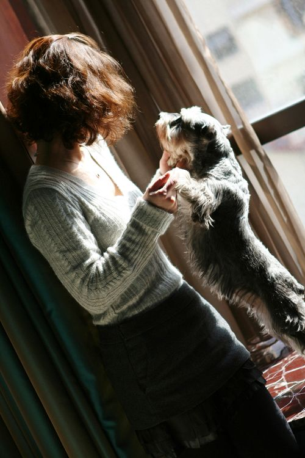

# 午后

阳光虽好，火气却大。牙龈有点肿，睡一觉又下去了，嘴唇上有火气，内心也有。兴奋又暴躁，压根不能安心体会细水长流的午后，做任何事情都象去赶集，匆匆忙忙又找上我，静心听音乐看电影拍照，慢悠悠买菜做饭遛狗。。。这一切都因为你必须工作、没有长辈照顾而不可避免的变成一个控制欲强烈的上班族！可是你又不能没有它，没有它将面临“无序”。所有1到10再从10-20。。。都需要计划需要理性执行，想起小时侯老师教我们“烧水的同时可以看书。。。”合理安排所有事务提高效率，控制欲就是这样被培养出来的，象马路上的交通信号灯、虚线、实心线、斑马线和双黄线。如果我可以从这些线条里挣脱出来，那我就不能使用这条笔直又宽敞的马路，还是。。。默默羡慕一下退休的老人吧！  
  

---

## 评论（13）

**[山树](http://shanshu.blogbus.com)** · 2009-12-03

不是你家的luke吧.

**Christina** · 2009-12-03

是土豆。

**喜刷刷** · 2009-12-03

两个家伙的衣服毛色都很般配，暖阳下的情谊图。

**[三月四月](http://11)** · 2009-12-03

我妈妈带回来的，邻居不要的那只小狗，刚刚死了，熬了11天，还是没救活，11天前发现它被主人扔在雪地上，奄奄一息。我还是哭了，我恨它对虐待它的主人还那么忠诚。它不纯种，但它很懂事，每只狗都是生命，都有命运，希望所有的人都善待狗，善待所有生命！

**[三月四月](http://11)** · 2009-12-03

我曾在家说起茶收养土豆的事，妈妈说：真是个好心人，会有好报的。

**Christina** · 2009-12-03

有些人类的灵魂与心灵是不如动物的。

**雯子** · 2009-12-03

拍得不错。2只狗会争宠吧 ？

**aimda** · 2009-12-03

LUKE呢?

**Christina** · 2009-12-03

蹲地上呢，还活着~

**aimda** · 2009-12-03

想死它了.

**Christina** · 2009-12-03

回答争宠问题：建议还是养一只好，两只总会有偏袒，总是犯错的那个当然会用的精力多一些，难免让LUKE受到“冷落”（掩面而泣）

**候鸟** · 2009-12-03

牙龈肿，有火气，就喝豆浆吧，里面再放点豆渣，一起熬一下，消火很快的：）

**okdata** · 2009-12-04

Nice purp，一直想弄只萨摩耶，可惜家里反对  
秋高气燥，泡莲心茶，煮百合汤  
吃点六味/知柏地黄丸吧，以轻泻为界。  
还有就是按着耳廓上最疼的点，刺破放点血。  
多半有用。

