# 微车

在欧洲旅行期间除了拍下许多狗狗的照片，还拍了很多汽车照。  
分享这些超Q的微车。  
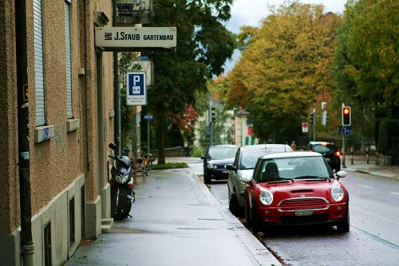   
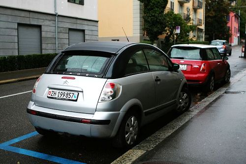   
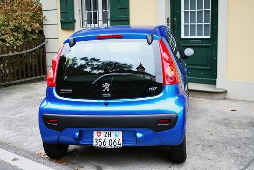   
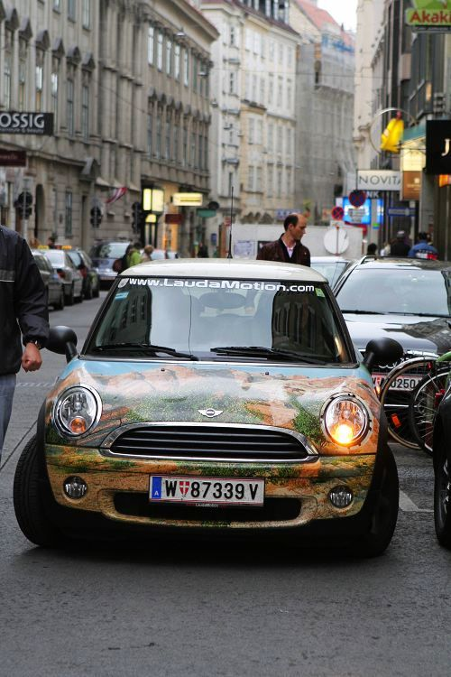   
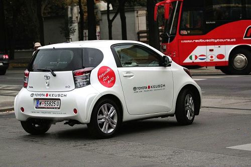   
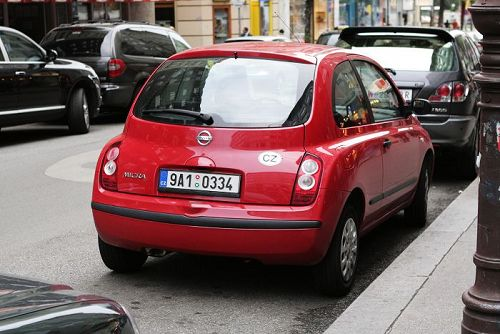   
   
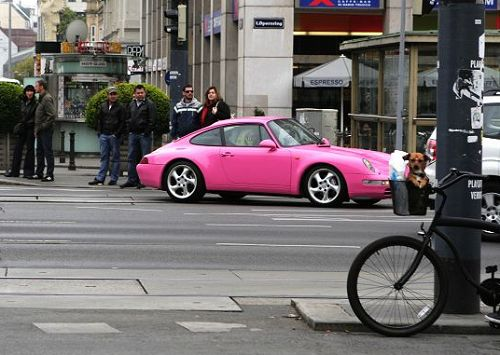   
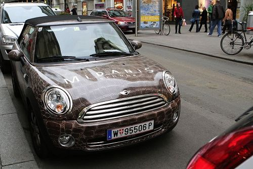  
  
FIAT500明年即将在中国上市，这次旅行在维也纳看到这款车，其他城市倒没发现，这款复古小车有“史上最美微车”之称，配有1.4排量发动机，6速手动变速箱，预计售价在20-25万左右，性价比和MINI一样不高。不过超爱白色操控台设计，太Q了！  
  
第二排左边为目前发售的FIAT500，其余三张照片均为老款车型，恰好新老款停得不远，幸运地被我拍个清楚。  
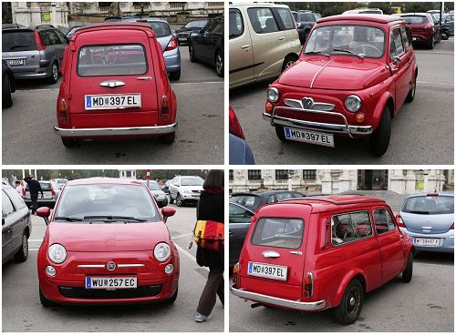  
  
来自官网的FIAT500敞篷版照片，以及各种规格下的英国售价。  
1.2 Pop：1.13万英镑   
1.4 Pop：1.25万英镑   
1.3 Mjet Pop：1.27万英镑   
1.2 Lounge：1.27万英镑   
1.4 Lounge：1.39万英镑   
1.3 Mjet Lounge：1.41万英镑   
  
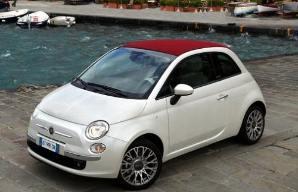   
  
FIAT500内部真是超越传统车的设计。  
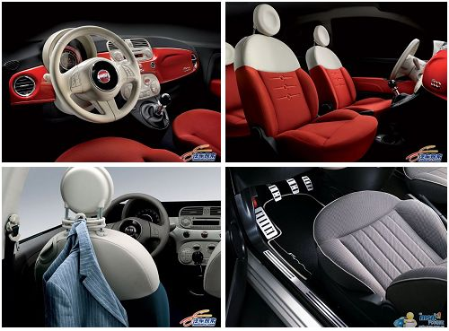  
  
它不是双环小贵族，是真的SMART。国外卖8000欧，国内卖16-20万吧？如果我没记错的话，超不值！电动版Smart将于2012年上市，新车将只在欧洲和美国的主要城市发售，先期可租赁，这要放在国内，那简直是天大的喜讯！  
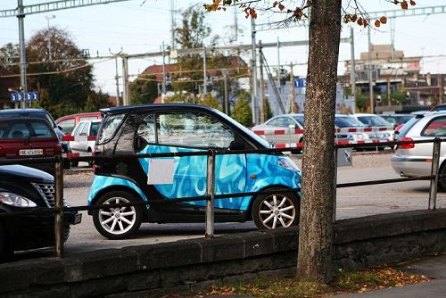   
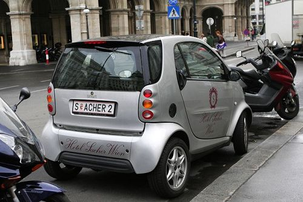  
  
加长版MINI。  
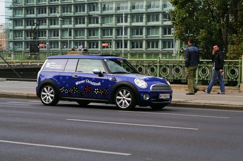

---

## 评论（10）

**陈问** · 2009-12-03

爱死菲亚特那款了。。。古典

**喜刷刷** · 2009-12-03

欧洲微型车满大街都是啊，不过都很有个性。

**aimda** · 2009-12-03

都为小型车,只为代步工具.

**Christina** · 2009-12-03

我也觉得FIAT500适合你，我喜欢那辆“皮具”造型车！

**[三月四月](http://11)** · 2009-12-04

很可爱，统统都很适合我开！！！

**Christina** · 2009-12-04

呵呵~阔爱~

**frank** · 2009-12-04

开BMW X5， LEXUS RX350和ACURA MDX的人多吗？ 这可是美国华人成功的标志车型

**Christina** · 2009-12-04

南京这三款车不少，尤其是LEXUS RX350、300，事实上这些车属于中档偏高档一点的车，美国标准不是世界标准！欧洲有钱人开宾利。在国内买一辆车的钱至少可以在国外买1.6辆甚至两辆同款车。

**frank** · 2009-12-04

北欧人很富，开豪华车可以理解。中国人还是很穷，一般工薪买的起很少吧。美国中高收入的中产（10万－15万一年一人）。开个BMWX5，LEXUS RX350, ACURA MDX不算太过份吧。才6个月工资。就算这样，华人也算是比较图虚荣的了。

**Sherry** · 2009-12-08

国外的小车车看着很顺眼可爱啊，很适合在城市里开。但是这车车开在江宁的大路上，旁边轰隆隆过去一辆卡车或者疯狂的公交，不知道会不会受到欺负。。

