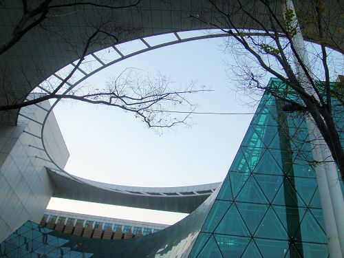
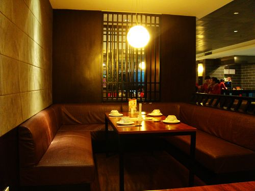
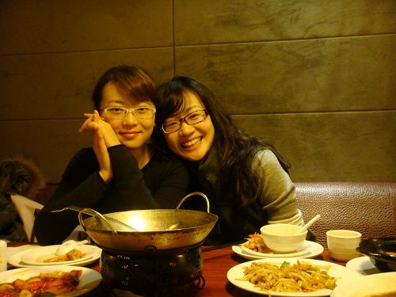
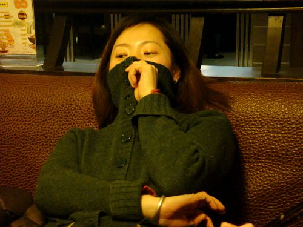

# 淘朋友

午饭后已经下午三点，五点和几个女性朋友约了吃饭，于是将车开到南图停车场，在车上睡了一个多小时，这是我第一次到南京新的图书馆，一个无法静下心来阅读文字的人面对如此有文化的场所也不能静下心来培养感觉。提前半小时坐进饭店，给各人发短信通报，她们都在来的路上，好在不一会儿人也陆续到齐。席间似乎都忘了围脖。  
  
那么多年过去，我们与他人有离合，有持续交往，朋友是淘出来的，有些人一开口你就知道与她气场合不合，有些人相处下来才知道是不是有共同语言，那些**矫情的势力眼。。。热衷家长里短，蜚短流长之人永远也无法留在自己的朋友圈**，以及不擅于用智慧分析不善良的人也要远离。淘朋友就象淘宝贝，淘到喜欢的亦被对方真诚相待，令彼此快乐，淘的过程可能会有伤害，但一定会让自己成熟，总有一些会成为你真正的好朋友，不是吗？友谊最主要的标准其实和爱情一样，就是在一起是否快乐。所以上面那些观点也都不重要，如果两个好朋友在一起撇着嘴讲是非、讲名利、讲男女关系，能讲得很满足、很快乐，也是友谊的一种。  
  
我带了个卡片机随便拍了几张，大家渐渐熟了，聊天气氛真是活跃，我们六个人的声音也真的很大，每次见面都很开心，这次更是。。。笑作一团，当时我在想多希望这样的快乐能长久一些再久一些，把对方都淘成自己的宝贝。  
  
  
   
   
   

---

## 评论（19）

**喜刷刷** · 2009-12-07

呵呵，淘友网。被你淘出来的人都很幸福。

**Anyayaya** · 2009-12-07

昨天，我4岁的女儿郑重其事地交给我一张纸，上面画了五颜六色的几朵花。她说：“这是我给你老板的圣诞礼物。“ 平时周末我们想单独溜出去看场电影什么的想让她乖乖地和奶奶呆着，比较常用的借口就是”哎呀，妈妈的老板要我去加班呢“，而爸爸则是要开车送妈妈去加班所以也得一起走。我猜想这个小妞妞总结出，如果想和妈妈多点时间在一起，务必要对这个“妈妈的老板“好一点啊。。。 我今天把这张纸带到了办公室，准备送给我的老板。

**Christina** · 2009-12-07

所以现在才体会到，能多些时间陪伴家人是多么重要！以及从这中间感受到的快乐也是从前所忽视的！

**邃** · 2009-12-07

最后一张是问问吗？

**Christina** · 2009-12-07

正确!

**浅水区** · 2009-12-07

台湾好像有种说法叫“姐妹淘（tao读一声）”，《康熙来了》有一期请来了小S的几个好朋友，用的就是这个词，觉得挺奇怪的说法，不知道是否和“淘朋友”一个意思

**itsmin** · 2009-12-07

“真正的好朋友”是可遇不可求的。这个社会，利益诱惑太多，患难之交都有可能背叛，更不用说普通朋友了。

**陈问** · 2009-12-07

这么丑也放？看来我遮的不够多……

**shuwua** · 2009-12-08

问问同学，这眉眼还叫丑，你要怎么漂亮啊？请注意影响哦。

**[少爷](http://jennyshaoye.blogbus.com/)** · 2009-12-08

那个女孩子的笑脸,好甜喔. 还有问问太调皮了吧

**Christina** · 2009-12-08

问问那天打扮的才象个日本小女孩呢，尤其那个羽绒外套我们都好喜欢啊~笑的很甜的女孩是8年的好朋友啦~

**[三月四月](http://11)** · 2009-12-08

“如果两个好朋友在一起撇着嘴讲是非、讲名利、讲男女关系，能讲得很满足、很快乐，也是友谊的一种”  
没错，我和我的好友，最大的乐趣就是周末在QQ上大谈男人的缺点，然后交流美食，说说这周买了啥衣服，虽然不在一个城市，但感情确实很扎实。有时我们会一起到另一个城市度假，度一个纯女生的假期

**Sherry** · 2009-12-08

这次聚会的气氛出奇的好，哈哈哈。  
问问从头到脚被C和我欣赏了一把。。

**雯子** · 2009-12-08

姐妹淘，大家在一起聚会是最开心的哦。我很久很久没这样聚会了天天宅在家里。茶美女日子过得很滋润哦！

**陈问** · 2009-12-08

回SHUWUA，把人家脸照这么宽。象话么？

**Christina** · 2009-12-09

呦喂~你那脸都被遮在毛衣里了，哪看得出来了啊？

**吃饭的科学发展观** · 2009-12-10

吃饭的科学发展观：吃自家以素为主；吃朋友以鲜为主；吃老板以精为主；吃公家以贵为主；吃小蜜以奶为主。常与领导吃饭，升官是迟早的事；常与大款吃饭，发财是迟早的事；常与情人吃饭，肾虚是迟早的事；常与异性吃饭，上床是迟早的事。得出结论是：这就是为什么大家一见面就问: “你吃了吗？”的缘故。

**[小丹佛儿](http://www.dlog.cn/dinosaur)** · 2009-12-10

眼镜很嗲~

**okdata** · 2009-12-11

哈哈，南京话读着像“逃朋友”，高  
第一张天井的对比强了一点，正上方补点光好些

