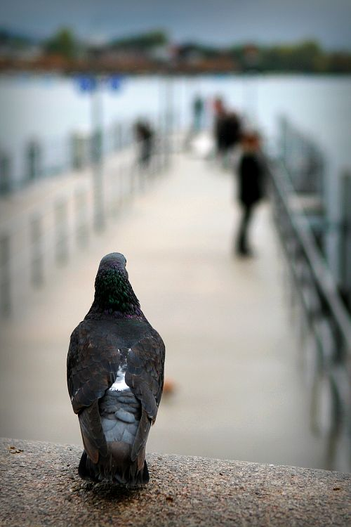

# 工作日

晚上到家只做了一件事，给两只狗洗澡，不晓得为什么一到家连口气儿也没喘就带它们出去遛，也许白天嫌自己不够忙？遛完直接拖进浴室，先给大的洗啊吹的，小的站在浴室玻璃门外安静地看着。给大的搞完卫生然后是小的，一切结束我的腰也直不起来了，时间指向21：49分。如果不仔细想也想不起来自己是不是吃了晚饭？的确吃了，固元膏+稀饭+板栗馅的小饼，吃完就睡。  
  
这样的一天属于自己的时间总是苍白又匆忙，一个上班族要全心全意投入工作最好不要有牵挂，一切都以“快捷”为主，加班也不要有心理负担，不要想着回家做饭，盼着你回家的几双眼睛，买什么菜看什么碟谈什么情逛什么店。。。总之，这样你就可以毫无牵挂地沉浸在工作中。可是这种没心没肺的日子大概只在青春期才有吧？  
  
最近又一风华正茂的朋友准备辞职，打算休息一到两年，皆因太累。想想这份工作的繁杂，与那些运气好一工作就捡到大皮夹子的人简直不好比，优越感不过是错觉而已。所以星期一到星期五，我总是忙忙碌碌，烦躁又快乐，勤劳又勇敢。  
  
拍摄于ZURICH  

---

## 评论（12）

**itsmin** · 2009-12-11

基本上来说，勤劳可以长寿，勇敢赢得尊严，所以啊，茶拥有一个光明的未来。值得庆贺。；+）

**Christina** · 2009-12-11

半仙啊~

**itsmin** · 2009-12-11

多年以后，六朝古都，南京街头。一车疾驰而过，从车顶天窗伸出一金字大旗，上书“半仙赵”。。。

**Christina** · 2009-12-11

天机不可泄露~

**frank** · 2009-12-11

看看我们的工作强度，你在国内已经很幸福了。

**[三月四月](http://11)** · 2009-12-11

你也吃固元膏啊，最近很流行嘛，我看了配方，实在是嫌太麻烦了

**[至清](http://www.yangziqing.net)** · 2009-12-11

忙忙碌碌，烦躁又快乐，勤劳又勇敢。

**habeyond** · 2009-12-11

Anyway ,take care and make yourself happy are most important,try to get something interesting from the boring work. heihei…

**朝九晚五** · 2009-12-11

为什么是他/她捡到皮夹而不是别人,这不纯粹是运气的问题,而且皮夹子也不会是可以白捡的…..  
得失与成败,用自己的心去面对,而不是别人的眼光.

**Christina** · 2009-12-11

运气当然不是“绝对“的概念，任何事物都不是绝对的。每句话之前还要说一下么？

以及固元膏是我姐姐给我做好的，呵呵，幸福吧？！药店也有卖的。冬天到了，补补吧~

**cjcc_1983@126.com** · 2009-12-11

虽然不是白鸽  
还是让我想起了伍佰唱的  
纵然带着永远的伤痛  
至少我还拥有自由

**[至清](http://www.yangziqing.net)** · 2009-12-12

问候Christina.  
因喜茶，误入此地，美文美图悉数入目，顿觉满心欢喜。  
我想，也许从此以后，我将更加喜爱Chinese Tea了。  
我想，也许从此以后的静夜之中，我用心与之交流的，再也不仅仅是一杯寂寞的清茶了。  
品茗阅文赏美图，何不快哉。  
哈哈。

