# 爱@他们

周末看过光光喜爱的男演员列表，总结了下他们的共同点是均有双会说话的眼睛，以及忧郁、稍许的颓废与不羁。这些共同点恰好也是我喜欢的男演员的特点，不过我看了下自己喜欢的男演员，感觉处于两个极端。。。说明两个我同时寄生于同一个我中。  
  
\*\*\*Mel Gibson\*\*\*  
因《Brave heart》对他着迷又崇拜，女人对英雄形象没有免疫力。当然这位英雄还得有男人味和宽宏的胸怀，否则如何装得下世界之大？失望于他主演的《What Women Want》，荧幕牢固的英雄形象之后无法接受生活片中的他。  
  
主要导演作品：  
Apocalypto (2006)  
The Passion of the Christ (2004)  
Brave heart (1995)  
The Man Without a Face (1993)  
Complete Savages(2004)  
  
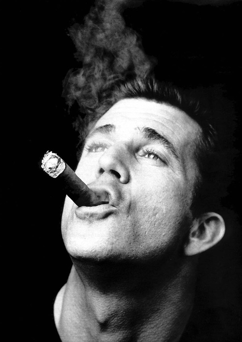   
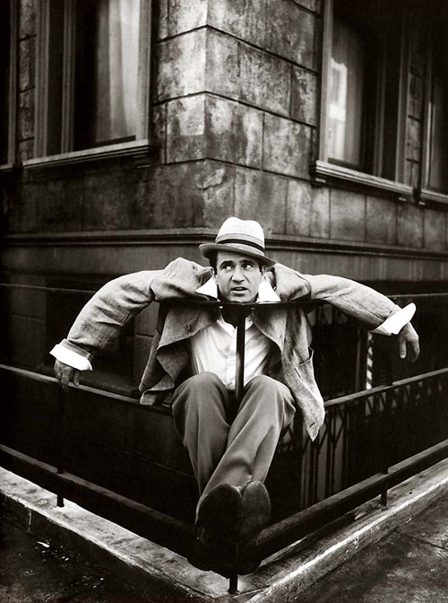  
  
\*\*\*James McAvoy\*\*\*  
因《Atonement 》对他产生兴趣，如果没有影视作品压根不会注意到长着娃娃脸的他。James在《The Chronicles of Narnia 1 》里饰演一只半人半羊（Faun）的配角，呵呵，他一出场就被他那双无辜又有故事的眼睛吸引了，你会觉得那不是普通的一只神兽。以及看过下面这段言论就不难理解他为什么会娶比他大9岁的女人为妻了。  
  
"We're in a horrible, repugnant place now where kids are told it's their right and due to be hugely famous. Not good at their job, not good at anything, just hugely famous. This is not sane.Little girls think they'll be famous if they have vast breast implants and might as well die if they don't. "  
  
近几年出演的电影：  
The Last Station （2008）  
Wanted （2008）  
Atonement（2007）  
Becoming Jane （2007）  
Starter For Ten （2006）  
Wimbledon（2004）  
Shameless（2004）  
  
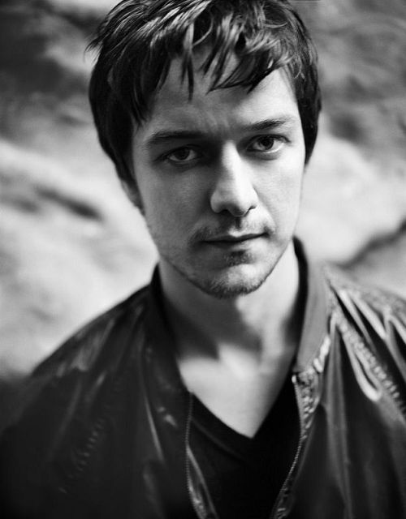   
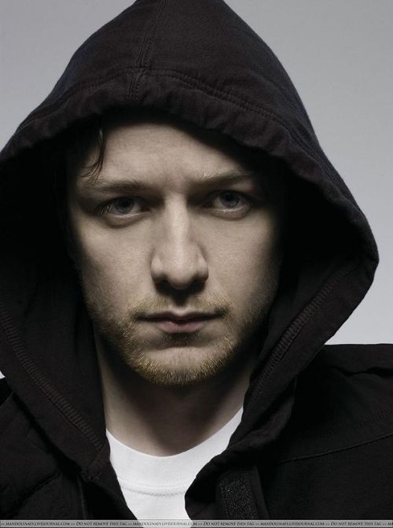  
  
\*\*\*Adrien Brody\*\*\*   
因《The Pianist》认识他、对他产生兴趣。我觉得他长着一副意大利人的摸样，或者说在我印象中意大利男人就长得这样子。可他是地地道道的美国人，脸上挂着一个鹰勾鼻对于从事表演事业的人不是什么好运气，可是这却并没有影响到我对他的喜爱，虽然这也出乎我一贯审美之外。  
  
很多人可能并不知道他曾主演过德国独立导演彼得·泽尔的作品《Love The Hard Way》，2004年1月份我曾为此写过一篇Blog，这部电影根据我国王朔的小说《一半是火焰一半是海水》改编的作品，整个故事置身于纽约，但原著中对人的精神层面的揭露和分析在电影中得到放大。里面的女主角Charlotte Ayanna的身材完全不输给Scarlett Johansson，五官甜美，遗憾的是她没出演什么有名气的作品。  
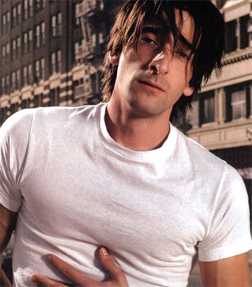  
  
\*\*\*Jason Statham \*\*\*  
喜欢上他是从他作为Audi A8御用代言人开始，那车开的很拽很眩很摆很酷，又一英国演员，曾是英国国家跳水代表队成员之一。他出演了过Guy Richie风格的电影作品：《Lock Stock and Two Smoking Barrels》、《Revolver》、《Snatch》，在Luc Besson为他量身打造的《Transporter》系列片中出演一位技术高超的司机，应该也是Audi赞助的电影。以及三部《CRANK》中饰演愤怒的杀手，就是一个死不了的荧幕硬汉形象。  
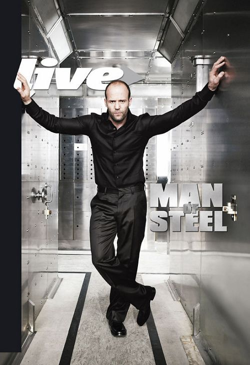   
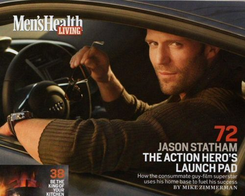  
  
\*\*\*Johnny Depp\*\*\*  
虽然之前有看过他主演的《Sweeney Todd》、《Pirates of the Caribbean》、《Once Upon a Time in Mexico 》三步曲、《Chocolat 》。。。总之他出演的电影非常多，出道早也是原因之一吧？我觉得他身上有一股邪气，具有鬼魅的梦幻气质。我是在三周前才喜欢上这位演员的，因为他的那部《Public Enemies 》。他除了演技精彩之外，情史也颇为精采，具有“好莱坞坏男孩”之称，甚至还被美国小报写成魔鬼的化身。  
  
惊曝人眼球的是1994年，他居然与Kate Mos相恋，性格如此强的两个人虽然深深相爱，但却并不适合在一起。据说某次争吵之后，性格刚烈的Johnny Depp把高级酒店2000美元一晚的套房砸了个稀巴烂而被捕。他现在的太太是位模特，反正不符合我的审美~  
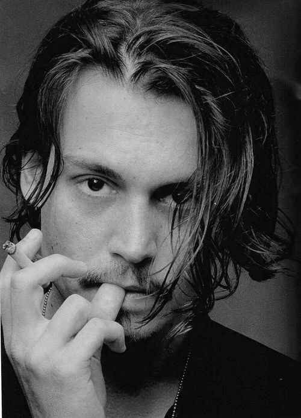  
  
耍酷耍成这个摸样不容易呢，超爱这张。  
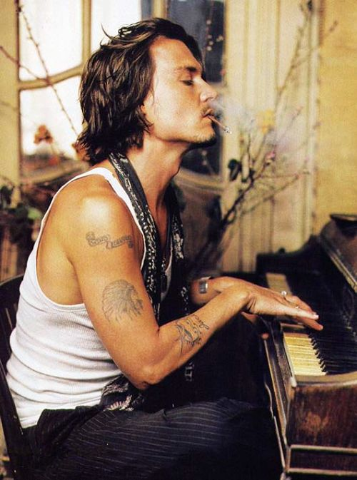  
  
\*\*\*孙红雷\*\*\*  
“有一种狂是来自苦难，没有生活感悟的表演只能是苍白的。”他曾经是霹雳舞教练，不知道吧？喜欢他的演技，不是因为某部作品而注意他，就是他一出现在屏幕上，我就立刻被他的表演吸引了。所以他演什么都无所谓，看他表演就觉得过瘾，很有张力和韧性，把握自如。记得有位戏剧学院的老师曾说过：“演技方面大家不会相差太大，最后还是演员人格魅力的吸引。”  
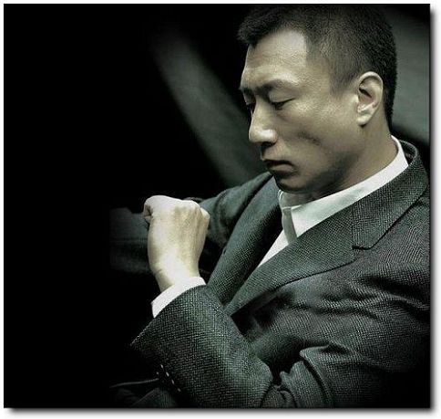   
  
\*\*\*权相佑\*\*\*  
听说韩剧的编剧们是一群在家没事的老大妈，估计每部韩剧都能造出一颗新星。我是因为《天堂的阶梯 》喜欢这花样面容的权像佑，以及对比国外明显摄影，亚洲写真真是缺乏力度和个性。花样美男比较适合青春期的审美，可是他的体型很好啊，可以做时装模特。以及快要不是我的那杯茶了，想起他就觉得单薄。  
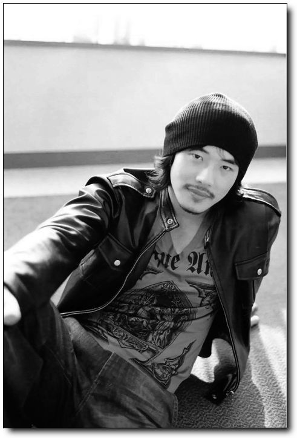  
  
瞧瞧，区别在哪儿？  
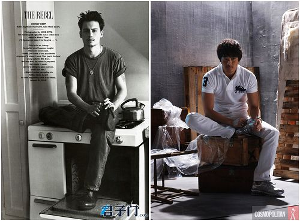  
  
动作一摸一样，气质不同表现也就不同。Johnny Depp可是坐在煤气灶上，脚踩烤箱门，手上还夹着根烟，这就是腔调！哈哈哈哈~~~~~

---

## 评论（27）

**[至清](http://www.yangziqing.net)** · 2009-12-13

喜欢Adrien Brody,感觉这个男人像是一个内心孤独的孩子，眼神有点迷茫、颓废，但是又似乎充满智慧。

喜欢孙红雷，一个很有深度的男人。外表看起来很木讷，很一根筋儿的那种，桀骜不驯，其实内心里也许不知道有多少不为人知的柔软呢。

**[光光](http://gaoguangguang.blogbus.com)** · 2009-12-14

哦，你有两个喜欢的都是我不喜欢的，一个是Mel Gibson，他的基督教原教旨主义主张我不喜欢，他导演的电影所渲染的血腥和暴力我不喜欢。他的那部Apocalypto让我看了第二天都没缓过劲儿来，跟生病一样。就算〈勇敢的心〉也是看了一遍不想看第二遍，虽然是个好电影。另一个是Jason Statham，我都不知道他的名字，但是但凡看见他的电影，马上转台。我受不了他的秃头，还有他的声音。sorry哈。其他的都挺好。

**itsmin** · 2009-12-14

哥坐的不是煤气炉，哥坐的是腔调。哈哈。

**[三月四月](http://11)** · 2009-12-14

有3个是我喜欢的，有一个是我妈妈喜欢的：权相佑

**Sherry** · 2009-12-14

喜欢第二个人的第一张照片，那眼神太抓人了。。这人演的片子我肯定看过一部，就是想不起来了。。  
德普现在都快成大叔了，前几天看到他在某地领奖的照片，造型那个雷人啊。。泪奔了要。。

**Christina** · 2009-12-14

哪三个是你喜欢?

以及我怎么没想到“哥坐的不是煤气炉，哥坐的是腔调”?哈哈哈哈~

Sherry喜欢James McAvoy啊?他个头在这些男人里最矮,你肯定看过Narnia，里面那个半身羊是他演的。

**itsmin** · 2009-12-14

妹妹，因为腔调不是想出来的，是做出来的啊。

**mandy** · 2009-12-14

这几位我都看过，我喜欢的几个：Russell Crowe《角斗士》难忘，Tom Hanks /Nicolas Cage  
/ Al Pacino / Anthony Hopkins 好象都蛮老的哦~~呵呵

**Christina** · 2009-12-14

总之Jason Statham演的片子大部分都蛮“甩”的，难怪光光换台。以及英国男人是不是秃顶的多啊？

**okdata** · 2009-12-14

一直不适应与眼睛会说话的交流，尤其是顾盼流连的女士。大约是自己气场太弱，而且跟不上趟。而杀伤力最大的应该是“无辜又有故事的眼睛”，这往往是进入对方思路的前奏。

说起忧郁，想起戴氏的《雨巷》。昨晚还在跟人谈起忧郁的丁香是否为那个时代文人的追求？有点像某位借樱花和菊花抨击大和劣根的评断。这样的生活态度估计算不得成事。

不羁，嗯，心底的盼望，角落里不停地攒动，彰显个性的动力，活着，就靠它那

**Anyayaya** · 2009-12-14

Adrien Brody新片《The Brothers Broom》，诸多场景在布拉格拍摄，我又是在结束捷克旅程飞香港的飞机上看的，对实地记忆犹新所以非常兴奋。其中有在广场边露天咖啡座的戏，似乎就是我和H因为冷留连了一个下午的座位。去看呵！：）

**Anyayaya** · 2009-12-14

又及：英国男人我见过的秃顶比例挺大。有的不知道秃不秃反正也常年剃个秃瓢。而他们发色和肤色混为一体，不像黑头发的亚洲人可以从青青的发茬子轮廓线上分辨出真伪。所以，第一印象还真是秃顶层出不穷。

**陈问** · 2009-12-14

最爱德普，无人超越。

**cjcc_1983@126.com** · 2009-12-14

神经质的半羊人

**喜刷刷** · 2009-12-14

我喜欢Mel Gibson，你们都喜欢坏坏的那种啊？

**大湖** · 2009-12-15

My next photo;  
sit on top of a coffin, without shirt (topless), one foot is on a bomb, one hand is holding a bottle of Cognac.  
Would that be cooler than Johnny?  
Hahahaha~~~~~

**农妇某人** · 2009-12-15

Ｄｅｐｐ的太太好像是个歌手吧？还是我记错了？？你喜欢的这几个除了Ｄｅｐｐ，其他的都不在我的清单里面，呵呵。我喜欢凯文柯斯特纳和埃德华诺顿，尤其是前者～～～～

**[三月四月](http://11)** · 2009-12-15

我喜欢的：James McAvoy，就像你说的，他的眼睛太惹人疼爱了，《纳米亚传奇》《赎罪》里演绎的完全是两个方向的角色。Adrien Brody，大家喜欢的理由都差不多，在《金刚》里也很帅的。还有就是孙红雷，爱死他演的《潜伏》了，真是个好演员

**lilian** · 2009-12-15

年轻时也许会喜欢酷哥Johnny Depp，现在只剩下气质腼腆的James McAvoy还能对上胃口。最近在追看一部韩剧，明知剧情狗血，还是夜夜相守，完了完了，什么时候自动归并到大妈大婶一例。

**朝九晚五** · 2009-12-15

我喜欢周迅,不用演就有戏.是不是好演员,和她演个对手戏就能看出来了。

**Christina** · 2009-12-15

楼上的可以把自己当成是王朔和她演演看，呵呵~

**[三月四月](http://11)** · 2009-12-16

我妈一直希望我找个权相佑那样的老公……泪奔

**[三月四月](http://11)** · 2009-12-16

我喜欢孙红雷那样的，小眼睛宽肩膀，不笑的时候很严肃，一笑又特别的傻……在《三枪》的首映式上，他那段现代舞跳得我口水直流……

**Christina** · 2009-12-16

偶滴个神呐….你妈妈还真潮……  
和你审美一样一样，我也是喜欢小眼睛大高个儿的男生，你也很潮，《三枪》都看过啦？！网上骂声一片，果真如此吗？

看完这张什么感觉？黑社会非他莫属，哈哈哈哈哈哈~

**[三月四月](http://11)** · 2009-12-16

孙红雷身上还有股恰到好处的痞味，却怎么看都像是感情专一的人。《三枪》没看过，不是很感兴趣，张艺谋从《我的父亲和母亲》之后的片子都太过商业化，即使要看，我也不会去影院，哪天下载一下看看就行了。孙红雷的电影作品里，最出彩的还是《梅兰芳》里的邱如白了。

**少爷** · 2009-12-17

哇，这里女权泛滥，好。  
听朋友说，盆子给打碎了，真不好意思。下回再找机会吧。

**Habeyond** · 2009-12-18

好久没更新了，俺在等着了呢。。。

