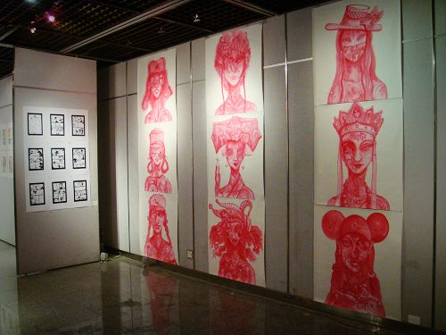
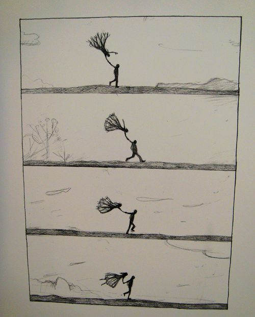
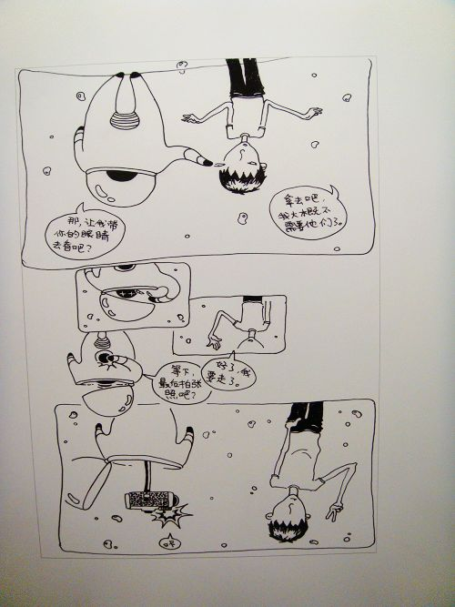
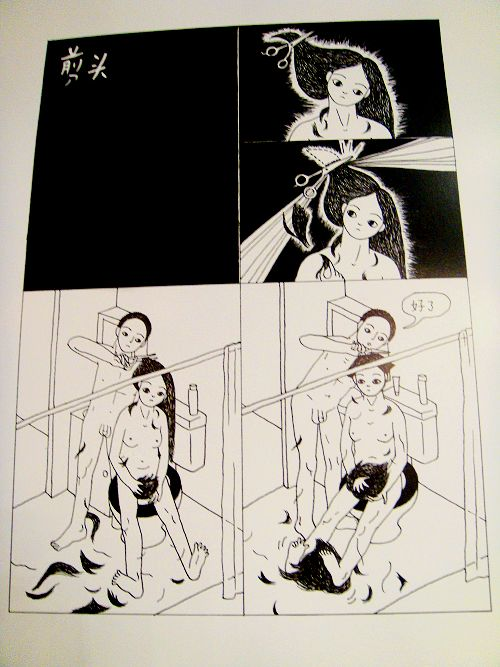
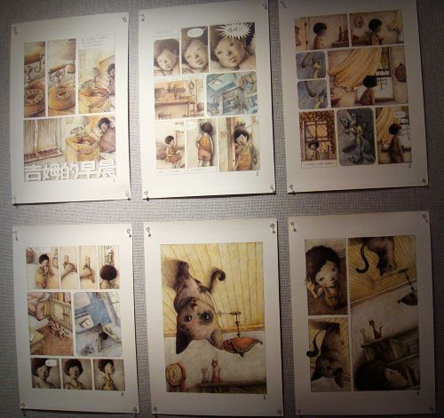
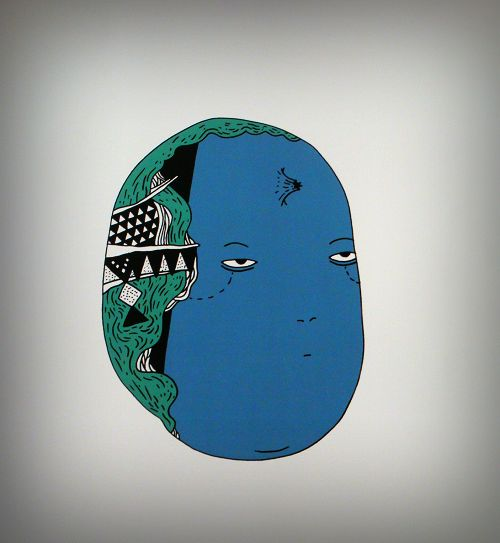
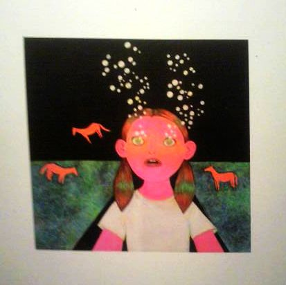
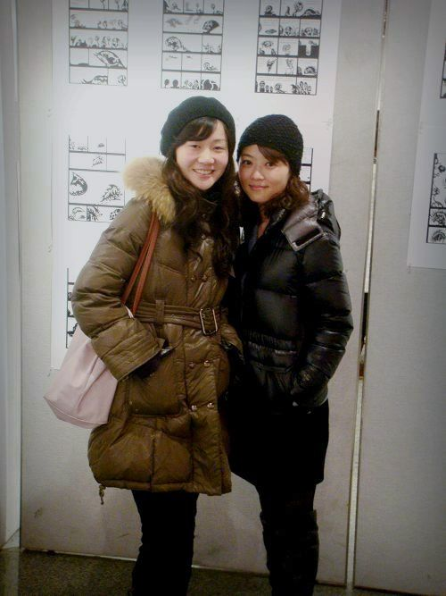
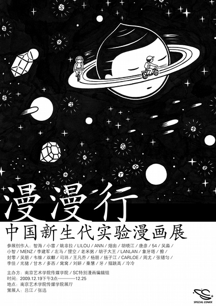

# 忙并快乐着。

周末怎么样都要休息一天，周六决定去南艺看看新生代漫画展。最近工作上超级忙，除了每天加班外，周末也要搭进来，生活质量明显下降。有个同事说他晚上回家会喝点酒才能放松下来睡觉，而我最近躺进被窝要过好久才能入眠，脑子里转啊转啊转啊的。。。这些辛苦只有自己知道。好吧，让我们忙并快乐着。  
  
最爱吕江作品《微笑．中国表情》。  
   
  
这组作品起初吸引我的是简洁的线条，Sherry说有点宫奇竣风格，故事也有点意思，大致是说一个下半身长在土里的女子（树）与一个人类相遇，男子将她从土壤里拔出来带着她行走天下，开始她的下半身仍然是树根（见下图），后来渐渐长出人类的双脚，可以和这个男子一起行走了。寓意各人体会。  
  
  
还喜欢这组漫画的风格，讲述跳楼男孩儿的故事。   
  
  
LAN LAN作品《剪发》，引起我注意的是画中女孩儿象极ziboy的GF，究竟是否是他的GF所画有待查证。作品表现的是女性月经前期，男女双方心理以及情绪上的活动。  
  
  
以下三副有习作有完整故事，均是我喜欢的风格。   
   
   
   
  
两个女孩儿走在我们前面，穿着一样款式一样颜色的UGG款的靴子，我对Sherry说：“你瞧，好朋友穿得都一样，我们也有一样的羽绒服。”去展览前她在电话里说：“不要和我抢，我今天要穿这件羽绒服去。”可是我们又不约而同地戴了黑色毛线帽。  
  
  
它是这样一个展览。  

---

## 评论（10）

**喜刷刷** · 2009-12-20

两个人还同时带了隐形眼镜吧，真是心有灵犀。

**Christina** · 2009-12-20

呀，你真心细，嘿嘿~

**大姜炖去** · 2009-12-20

那个飞在天上的女子像是蒲公英

**少爷** · 2009-12-21

只要快乐着，最好。

**[三月四月](http://11)** · 2009-12-21

卷卷的头发带帽子特别好看。看到这样的展览，一下子就回到在学校里毕业时的感觉，不过现在的学生比我们那时有想法多了

**陈问** · 2009-12-21

因为赶时间，展览都没能好好看，好在有书可以弥补遗憾。还有给茶的礼物，我出门前还想着，结果匆忙间又忘了。。。

**okdata** · 2009-12-21

哈哈，楼主的现代东西看不懂了。  
周六顺带看了一下红星、金盛的画廊，发现新手的东西太多，尤以油画作品明显。相反，一些不经意的百元写意小框确透着功力。看来国人买西洋画还要再练练眼。

**Christina** · 2009-12-21

楼上的楼上的文艺范儿，让我老远就在人群中看到你了，结果你没认出偶。。。汗。。。

**Sherry** · 2009-12-22

OMG，我照得跟大妈似的，浮肿。。  
不得不提一下姚非拉的《明朝那些鸡》，貌似是全场唯一一部搞笑漫画，生活应该明朗一点，多些欢笑，少些阴霾。。

**陈问** · 2009-12-22

TO 茶，我牙成那样，连视力和反应都变的迟缓了。我还在想，这美女不是对我招手吧，我可别傻笑表错情啊。。。

