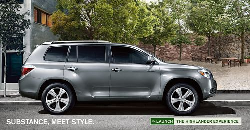

# Toyota的杯具

小日本把中国人当SB耍，国产后的Highlander出丑了，12月中旬温州某人驾驶国产2.7排量的汉兰达居然爬不上一个30度的坡道，同行的面包车和CRV都上去了，就剩他的车爬不上去。我觉得那么重那么大的车，2.7排量太小，3.5的应该不成问题，以及四轮的动力分配可能也有问题。  
  
“开车，下坡别在camry前面，上坡别在Highlander后面。”以及现在大家见面不问“您吃了吗？”而是问“今天您爬坡了吗？”丰田公关不久就会开个飞机过来，一到丰田坡就一头栽下来，然后说，这坡连飞机都飞不过去，小车当然是不可能的了。。。。车到山前必有路 有路必有三十度。各个网站Highlander论坛里访客爆多，太有意思了！  
  
据说温州丰田4S店里的销售经理最近也吃不下饭，顾客一来就要将车开到各种坡道上去试，有的甚至还要开到“汉兰达坡”那儿试车。4S店给出的反馈是：“这是城市车，不是专业越野车。”可是拖拉机能上的坡，汉兰达为何上不去？大家都去买拖拉机得了。最近好多车开到“汉兰达坡”那儿去作爬坡测试，浙江平白无故多了一个人文景点了！  
  
丰田公关厉害，全国的媒体除了新华网其它全部封杀消息，真有能力。  
  
  
  
-[**汉兰达坡已经演变为娱乐旅游景点**](http://ganxc.blog.hexun.com/42341599_d.html)  
-[**爆笑实拍！网友多车测试“汉兰达坡”**](http://ultimatearbor.home.news.cn/video/videoView.do?aid=106594)  
-[**杯具！小面能上丰田汉兰达上不了的小土坡**](http://ultimatearbor.home.news.cn/video/videoView.do?aid=106561)  
  
看看这个视频: [**爬90度坡的超牛越野车**](http://v.youku.com/v_show/id_XMjg0OTM0MTI=.html)

---

## 评论（6）

**[至清](http://www.yangziqing.net)** · 2009-12-20

总体来说还是车辆设计肯定有缺陷。  
我们的SUBARU Forester 比它小不了多少，2.0排量依然跑得很溜嘛。

不过，这一场风波，对于汉兰达来说是“塞翁失马”等着瞧吧，日本人巴不得大家狠狠地骂他们呢。

**itsmin** · 2009-12-21

这茶博士都没有公关下来，丰田公关还是不行啊。;+)

**喜刷刷** · 2009-12-21

我觉得SUBARU Forester 不错，比较低调。茶小姐的推荐很到位。

**[至清](http://www.yangziqing.net)** · 2009-12-21

哈哈，河南有朋友想提Subaru Forester的话，请和我联系呀。我们公司在郑州有4S店。【注：非商业广告，请勿误会，哈哈】

**okdata** · 2009-12-21

心平吧，Highland原本就是城市SUV  
Like most crossovers, the Toyota Highlander appeals to consumers who want an SUV image, cargo-carrying versatility and carlike driving characteristics. Think of the Highlander as an elevated, oversize Camry wagon dressed for the great outdoors, and you’ve got the general idea.  
所以爬坡并非强项。

斯巴如原本就是军车设计，他的SUV是最好的  
两者无可比性

**Christina** · 2009-12-21

三菱是日本军工企业好不好，SUBARU原来是造飞机的。

