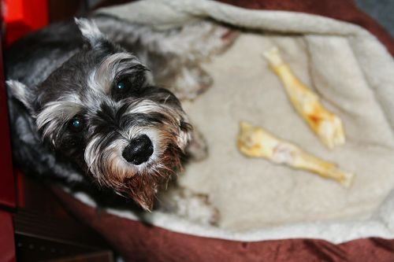
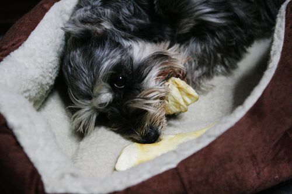
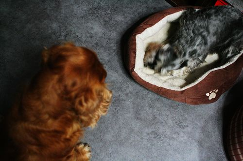
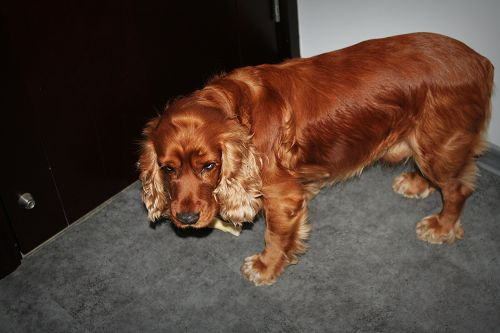
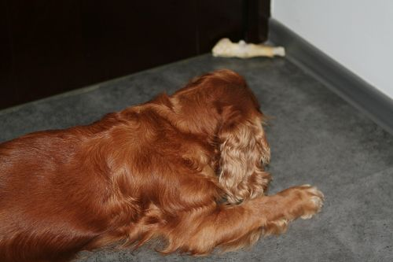
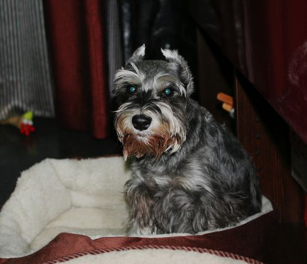
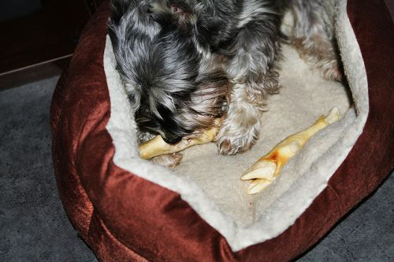

# 它们的故事

大概因为白天很少陪它们，所以买回许多宠物食品，每每离开家之前会丢一些给他们一解苦闷。今天回来晚了马上拿出上等美味，它们都爱。这么做不过是安慰自己罢了。遗憾的是Luke好象对羊蹄子没兴趣，土豆忘我地啃得昏天黑地，偶而抬头看看我。  
   
  
  
Luke好奇地看着它啃啊啃啊啃啊。。。  
  
  
并且叼起一只藏到门后的墙角，并回头警惕地张望。  
  
  
忽然Luke气呼呼地冲到土豆窝前把另一只也叼到墙角，趴下来守着。  
  
  
土豆很无辜地坐在窝里看着我。  
  
  
我把两只羊蹄子还给土豆，Luke倒也不抢了，在窝外看着它继续啃。土豆啃着啃着睡觉了，Luke叼出一只，用两只前爪抱着大啃特啃起来。狗狗的心理活动真是有意思。  
  
  
现在俺们家已经四个狗窝了，全部被土豆尿了个遍，然而它到我家一个月后在我即将崩溃之时，土豆的坏习惯嘎然而止，会在狗厕所上便便了。想来还是需要时间相互适应，主人千万不要过早放弃它们才好。当然土豆还有一个坏毛病：啃鞋子。我那双夏天买的顺牌拖鞋已经被啃得面目全非，奇怪的是只要我在家它是肯定不会啃东西的，所以羊蹄子绝对是福音啊，在我上班的时候可以帮助它解决啃东西的问题。  
  
以及外出散步Luke就是它的小护卫，别的公狗狗想和土豆玩，它会坚决赶人家走呢，真是个醋坛子。

---

## 评论（14）

**喜刷刷** · 2009-12-22

你又给土豆买了新窝啦，真是惯哟～

**Christina** · 2009-12-22

恩，对！原先那个睡一晚，垫子下面都是潮气，透气性不够好。

**andy** · 2009-12-22

luke和土豆的毛真有光泽啊。。。真有光泽啊。。。

**陈问** · 2009-12-23

背着主人在家干坏事的狗，都是有心里上的分离焦虑症啊。也许和它被抛弃有关？在你这里应该找到了归宿和安全感吧，所以它的问题渐渐好了。

**少爷** · 2009-12-23

问问分析得很透彻。狗狗无聊才乱咬东西的。

**[三月四月](http://11)** · 2009-12-23

两个小东西真是太可爱咯

**童话** · 2009-12-23

土豆被主人照顾的很好。我家yogue被教育了一年才会自己去厕所便便，但是他老人家通常是非要去主卧厕所便才开心，如果不让，就闯进衣帽间咬你的真丝裙子。回头也在衣帽间给他放根羊骨头。

**mandy** · 2009-12-23

我家狗狗和我亲热时候也会咬我的拖鞋~

**[shanshu](http://shanshu.blogbus.com)** · 2009-12-23

土豆还挺漂亮的.养了二条狗狗,不觉得麻烦吗?

**Anyayaya** · 2009-12-23

大一的时候，我的狗更要命，爱咬人裤子。来客人的时候，它故作安静地趴在客人脚边，让人完全丧失防范心，然后就偷偷摸摸津津有味地开始嚼客人的裤脚。等客人起身准备告辞的时候，崩溃地发现自己左腿或右腿的裤脚已经千疮百孔。这样的事故发生了好几次。它独自在家的时候，有一次把椅背上一条牛仔裤够下来，这次比较有创意，东咬咬西咬咬，在无伤大雅的地方留下多个洞。我回家看到它端坐在已经糟蹋过的牛仔裤上，挑衅地看着我，似乎对自己的报复行动很是看好。我一瞅，和店里卖的当时流行的破牛仔裤没什么不同嘛！于是就洗干净穿着它上学去了。

**Xiaona W.** · 2009-12-23

突然发现，我被解禁了，喜出望外，今后我会注意的，保证不在茶社信口开河了。  
十分关注Luke和土豆，他们非常可爱！

**frank** · 2009-12-23

你很能理解狗呀，做个狗心理学家，发表一些狗心理学的论文，看来你入错了行。

**不羁之舟** · 2009-12-25

最喜欢看你放狗狗的照片了~

**Sherry** · 2009-12-30

嘿嘿，土豆有新窝了。Luke好壮实啊，拖不住他。家有两条狗，好热闹，上蹿下跳。土豆好粘人，扮乖巧，喜欢看她把脑袋搭在窝边的样子。。

