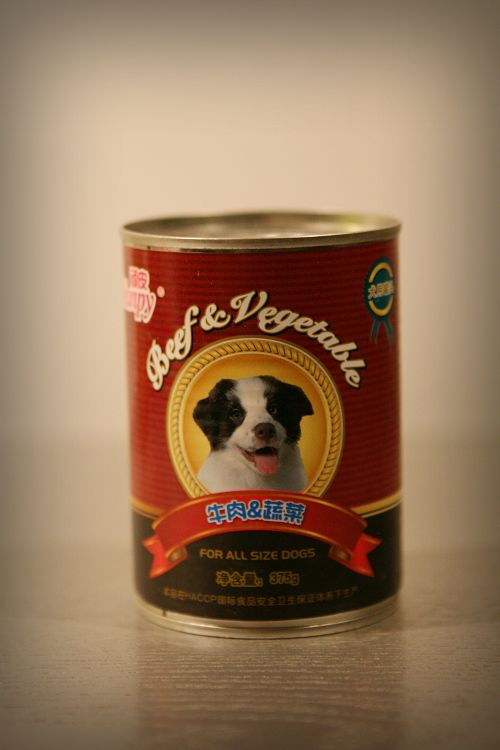

# 平安夜

对所谓的节日已经没有任何感觉，对那些充满激情过节的人们仰视一下。朋友提前来电话邀请我参加今晚的家中party，据说还让公司的行政搜罗了小节目，朋友策划了整个平安夜的活动，我还是没有去。这个夜晚就象许多夜晚一样平常安静，对于现在的我也是一份美好。  
  
晚上步行到超市买到计划中的黑色鞋油和鞋刷，鞋油2.5元一只，鞋刷4元，如果不是在超市购买，这样的价位真让人怀疑是假冒伪劣品。“哪种鞋油最好？”超市里忙着搬迁商品的店员说：“红鸟。”是的，超市里最好的鞋油是红鸟，只要2元。货币购买力越来越低的现况，能有这么便宜的商品是有点儿新鲜，但愿，它的质量比它的价格更能令人安慰。朋友在围脖里问为何不用透明鞋剂？家中早有ECCO好几种鞋剂，效果都不理想，所以试试用过去那种膏状的黑色鞋油，要把我的皮靴擦得锃亮锃亮的，擦得象CRV汽车那样的黑色大头皮鞋一样招摇，呵呵~  
  
平安夜遛狗是不是会有些不同寻常呢？的确。远处不仅有烟火绽放天空，还有少年们的狼嚎，大概青春就象邻居家的狗一样，在钢琴声响起时适时地来个和弦伴唱，管他娘的音准还是旋律，凑个热闹也好。黑暗中有个人影缓慢地移动着脚步，土豆最先冲上前用被割掉后残留的声带沙哑的发出几声警告，在节日的夜晚，这个散步老人的身影显得落寞又凄凉。  
  
狗狗们的平安夜餐是一瓶罐头+狗粮，最近它们的伙食好过我。因为工作忙家里已经一周没开火，在食堂每日花8元可以吃到一个大荤一个小荤及一个素菜的午饭，前天的大荤居然是三只小鸡爪，打菜的阿姨说本来规定只给打两只，还多给了一只呢，泪奔。。。承包食堂的生意人也忒抠了吧？唠叨完，这就擦我心爱的过膝靴去。  
  
说到过膝靴，还要唠叨几句，昨晚见一伦敦回来的女孩儿，穿着ZARA的过膝靴，波西米亚风格的蚕丝长袖花衬衣，外面一件淡紫色皮草。她问：“你穿的是？”“Ninewest。”“哦，英国也有这个牌子。”多新鲜啊。她的先生学建筑出身，现在一家专业汽车杂志社主管中国区业务。据说对美食和时尚颇有要求，她被先生照顾得很好，每天能吃到不同花样的美食，并且精益求精地打扮自己和她。两人最最差的晚餐也是意大利面和皮蛋瘦肉粥。每天往返家和公司之间需要3小时路程，晚饭结束也要11点了。还要仰视一下她那位职业先生，除了品味和热情还需要充沛的精力，这样的男人在国内早绝种了。讨论了因为水质导致英国男人秃顶多，以及英国以貌取人的问题，真是这样吗？不过这个“貌”还有谈吐、气质等综合因素存在。“国内真是太好玩了，明天晚上我要和表妹去1912泡吧。。。”哦，1912，多么遥远的地方。  

---

## 评论（16）

**陈问** · 2009-12-24

即便是凑热闹，还是说声圣诞快乐

**喜刷刷** · 2009-12-24

哈哈，在家呢～我们都一样！

**Christina** · 2009-12-24

啊！都没出去玩啊？大家都快乐！

**shuwua** · 2009-12-24

团拜啊！我也凑一个。

**[至清](http://www.yangziqing.net)** · 2009-12-25

看吧，有时候，能安静的蜷缩也是很奢侈的。

**mandy** · 2009-12-25

自己在家炖了红枣汤~~看了关于德国的几个城市的介绍片~~了解巴洛克建筑与哥特建筑的皮毛~~

**onfire518** · 2009-12-25

茶，昨晚是平安夜，今晚才是圣诞夜，不一样的！

**Xiaona W.** · 2009-12-25

Merry Christmas
&  
Happy New Year!

**Anyayaya** · 2009-12-25

圣诞夜料定影院很少人，所以去看了AVATAR。很好。值得看。

**Christina** · 2009-12-25

多谢onfire518 赐教，咱的确不懂洋节，这就改。

**[huangyuling](http://huang-yuling.net)** · 2009-12-25

圣诞快乐

**angie** · 2009-12-25

提前祝元旦快乐，圣诞我也在家遛狗，嘻嘻

**itsmin** · 2009-12-25

管它什么节，平安健康就好。

**jeneffer77** · 2009-12-27

大家圣诞快乐！

回答2个帖子里的问题哈：（仅供参考，个人经验）  
英国男人秃顶的概率和欧洲男人（或者白种男人）没有差别。英国人确实以貌取人：关键要干净，整洁，衣服（牌子不是太重要）质量好，最最重要的是一张口说话就知道这个人所受的教育和所在的阶层了。

最后，英国人虽然大多部分都谦恭有礼，但他们对有色人的歧视就冷冷的藏在礼貌的面纱里面。

**haohao** · 2009-12-27

我一直用红鸟

**Sherry** · 2009-12-30

平安夜聚会，圣诞夜去的1912，有酒有音乐，有朋友有至亲相伴，这年底真是够快活的。。。

