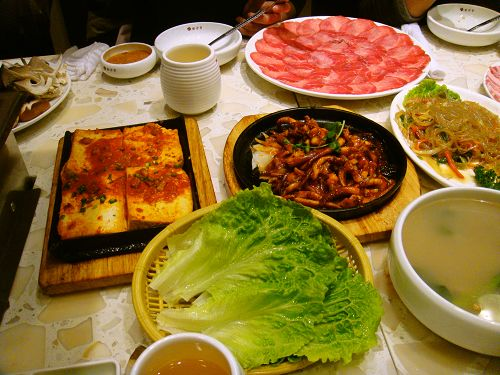
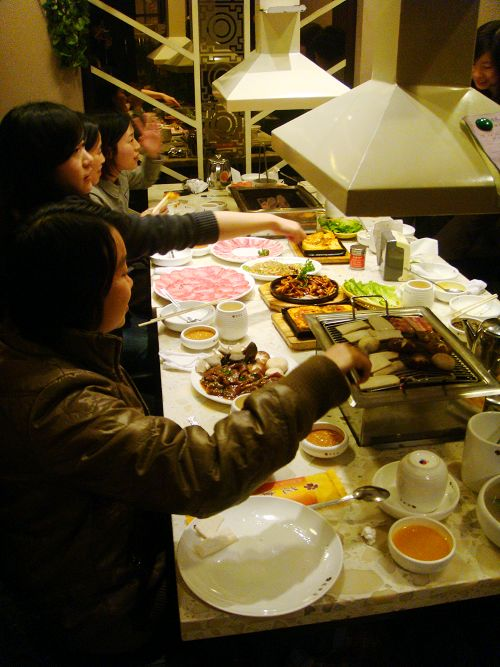
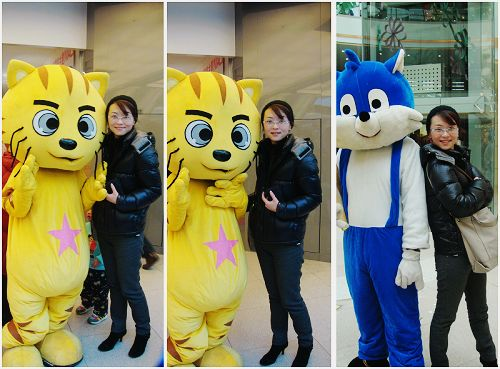

# 苏醒@2010

定了早晨7点的闹钟，准备赶个早儿去口腔医院看看那颗吃东西既感到冷又感到酸的牙齿，假期的早晨，起床的毅志力总是很薄弱，7点钟被放弃了。  
  
可是8点半在手机上看过问问昨晚的新博[**《当肉食家遇上肉》**](http://mosquito511.blogbus.com/logs/55829560.html#cmt)，颇受鼓舞，立刻起床更新茶。要是工作日的早晨也有这样的起床速度该多好！  
  
老父亲一星期前在电话里说：“今天你妈妈带我去新开业的万达广场，在河西金盛装饰城对面，好大的商场啊，我们元旦一起去，好吗？”于是我们一家人元旦在万达顶楼一起吃午餐，年纪大了的人越来越象孩子，当我老了，我一定随遇而安，不逞强不好胜，享受生活为主。  
  
晚上7美见面会，本以为是8美，惟独缺了传说中的小原子。等了半个多小时才进入停车场，期间被一尾数138的二五车夹塞，那时侯甭提有多郁闷了，想象着前面那一车人被暴打的情形，这就过了10 来分钟，才等到停车的位子。  
  
还没吃过几片五花肉，邻炉四美俨然肴核既尽，杯盘狼藉。。。此时只听吃饱了的问问轻声说道：“哎呀，我们应该慢条斯理地吃啊。。。”分享美味在一片乱战中结束。勤劳又能干的[**扑土**](http://incafe.blogbus.com/)耐心又无私地为大家烤土豆、蘑菇和牛舌。。。要知道那只不锈钢夹具需要多好的手劲才能长时间使用啊。在[**扑土的网店**](http://shop34941044.taobao.com/)之后，她的实体店即将在新年开张，喜欢自制咖啡的朋友可以到她那里寻觅钟情的咖啡豆和各种精美餐具。以及，超爱回南京度假的[**Shuwua**](http://shuwua1.blogbus.com/)身上那件古典式耸肩小外套和问问日式打扮，问的想象力也体现在她的搭配上，让人惊喜又赏心悦目！（我第二天去寻她身上那件羽绒服就剩一件红色的了，不适合啊不适合）在时尚流行纵横的时代，穿出自己的风格和品味，不人云亦云，没有一定的底蕴和独特的审美鉴赏力是不行的。那么各位，3号的音乐会再见！  
  
元旦，循序渐进回到生活中缓慢地喘息，在亲朋身边感受温暖与快乐，以及跟着我苦了几个星期的狗狗们，和我在阳光下玩它们热爱的球类运动。这一切让另一个我渐渐苏醒。借用Shuwua的一段话：又长一岁，不代表不能花痴兼白痴，我们要打破藩篱，做一个为了自己的乐子不惜追求低级趣味的人。发现同类时，认真抓住，决不放过。XX而不惑之一也。  
  
难以忍受卡片机的效果，不过记录生活却非常方便，每天装在背包里不占地方也不会吓着别人。  
   
  
  
1月4日电影《阿凡达》即将上映，传说河西万达3D双机播放设备，不是IMAX的哦，确认过了！《阿凡达》电影票120元/张，星期一晚上7:30的票价优惠到50元，再一看只剩第一排和第二排两边的座位，罢了，等一周再看也不迟。  

---

## 评论（10）

**JasonChen** · 2010-01-02

吃饭要慢,跟车要快!新年快乐!

**陈问** · 2010-01-02

我已经从卡片机退步至G1，除了光线有要求，别的都很方便啊。生活里有一部分就是靠记录，并不需要太精致吧。记下我们有这样吃吃喝喝的一天就已经很满足啦。

**喜刷刷** · 2010-01-02

“想象着前面那一车人被暴打的情形，这就过了10 来分钟”….太逗啦~

**雯子** · 2010-01-02

O 又聚餐了。新年快乐！

**okdata** · 2010-01-03

“等了半个多小时才进入停车场….想象着前面那一车人被暴打的情形”。。。。  
哈哈，骑车真好，新年快乐！

**cjcc_1983@126.com** · 2010-01-03

期待阿凡达

**[至清](http://www.yangziqing.net)** · 2010-01-03

丰富，而温馨的假期啊。  
所谓知足常乐，随遇而安大概便是如此吧。

**[Patriasia](http://957681799.qzone.qq.com)** · 2010-01-03

嗯。你的文字很能感染人哪。虽是陌生人，感觉却熟悉。

**vv2life** · 2010-01-03

茶~新年快乐，希望新的一年美丽，平静，心安……

**Sherry** · 2010-01-07

真难忘的一晚，吃完第二天鼻尖上就冒了好大一个痘。。上火上得立竿见影。。

