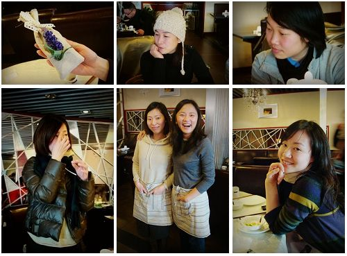
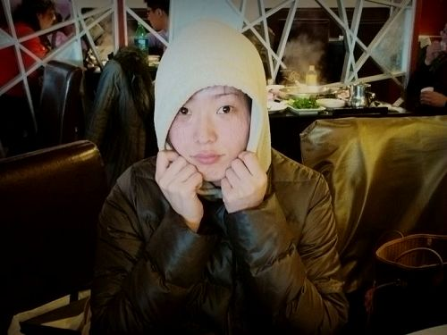
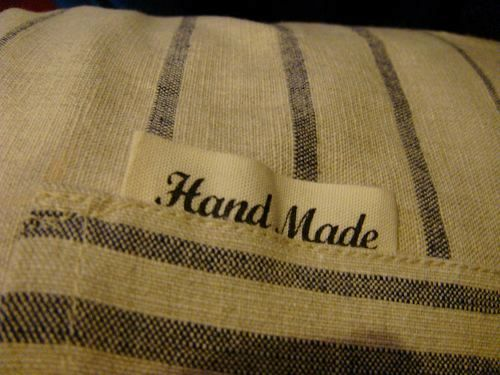
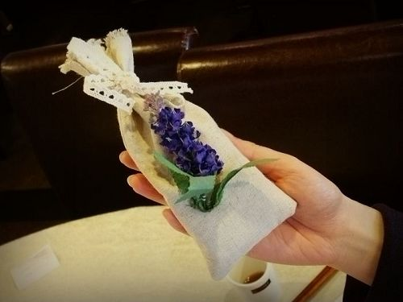
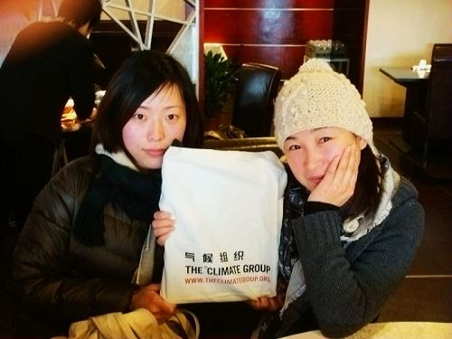
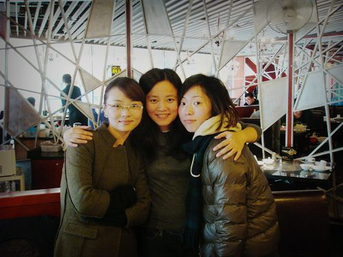

# 平静中的快乐。

这会儿脑子里已经想不起来还有哪些工作要做，举着袋子吃咖啡豆，不对，是咖啡味的豆子，好吃。想着晚上看哪部电影，昨晚第6集里的哈利波特已经老了，故事还是没结束，留着第7集钱慢慢赚。连续几个晚上睡觉前看一部电影，娱乐自己放松神经，就象小原子手工制作围裙，也是娱乐方式的一种，有声色的生活还是看人滴！  
  
小原子制作的围裙，针脚和大牌衣衣的手工有得一拼，间距大小一致，针脚细密，围裙上的商标令人叹为观止。我说小原子，你能帮我做件带袖子的围裙吗？“难度大，我给你买一条得了。”倒！“这围裙就是给准备下午茶的人使用的。”那么，等我学会磨咖啡冲奶茶，一定送我一条有情调的围裙哦！  
  
话说中午又一块儿腐败了，主题是送别低碳人士。认识她之前我不知道“低碳”两字，一个OUT的人如今也能列举有关低碳生活方式一二三呢。听说哥本哈根的大会开的不成功，回来也不跟我们韶韶！饭桌上6人，其中4人是大巴用户，这会儿大巴歇了，没有博的生活是不是不适应啊？我们还有围脖可以织，这会儿我要笑了，免费的就是没保障，没准儿某一天围脖也可能被河蟹咯！目前的生活是相当地满足，平静中的快乐，好甜蜜。  
  
组图里的大家，那两枚厨娘让我们嫉妒死，瞧她们乐的~  
我家烧油腻食品多，没有带袖子的围裙给两护袖也可以，实用为先。  
  
  
好爱这张的表情。   
  
  
惊讶吧？！围裙上的小商标。  
  
  
据说小原子做这个香包把家里的一包薰衣草茶全倒进去佬...还狠心剪下一把绢花中一只！猜想送给大家每人一包，家里的绢花岂不要全秃了？没关系，我们再送新的给你！  
  
  
混迹于环保界的伪气候组织成员，右边是手工大师小原子。据说她做的奶茶比香港地道的丝袜奶茶还好喝呢~  
  
  
为了你们，我只好牺牲自己的形象了，泪奔~以后得侧90度与小脸合影。  
身上这件衣服的色标写着“咸菜色”，当时就想跑去告诉咸菜等人，还没等我说出口，咸菜和低碳便已脱口而出。  

---

## 评论（14）

**喜刷刷** · 2010-01-06

太美妙的瞬间,感谢茶现场发回的报道!

**陈问** · 2010-01-06

其实，我们三人合照也很美啊，你脖子显得很纤细啊。快放嘛。

**Christina** · 2010-01-06

你饶了我吧，对我要求真低！！！

**陈问** · 2010-01-06

哎，我那张真像个熊猫眼+猪肠嘴。你还爱，不是更低要求么。

**Christina** · 2010-01-06

我睡觉去了，只有睡觉才能安抚我。

**shuwua** · 2010-01-06

看看这南京赐我的小肚子！

**小原子** · 2010-01-06

哈哈~~这篇博在夸我的围裙和床头香包，很开心~~大家如果没有要求我就照着这个再做到8仙女人均一个，有要求快提！不过后面还有拎出去上街的小包包….

**陈问** · 2010-01-06

小原子，组织不能给你压力啊。

**[之情](http://www.yangziqing.net)** · 2010-01-06

Hand Made.What mean?

**[薇安](http://www.bulaoge.net/?vivianxu)** · 2010-01-07

那个hand made标签可以买的，手工附件，话说我也买过用来做手工的。哈哈

**大湖** · 2010-01-07

Hand Made.What (is that) mean?  
It means that the bag(product) is made by hand, not by machine.

**不羁之舟** · 2010-01-07

现场报道很精彩：）

**lilian** · 2010-01-07

难得上一次大巴，想不到就歇了。。

**Sherry** · 2010-01-07

原子，你的手工围裙和香包震撼到我唠，对电动缝纫机开始心动。。。

