# 新货&吃货

闻听[**In Cafe**](http://shop34941044.taobao.com/)进了新货，再忙也要去逛逛，赶在7：30前到她店里，就她一个人坐在里面不知道在干吗？也许是数钱？哈哈哈哈~然后我就冲进去以最快的速度拿了10个新进的碗和一个不知道品名的木盒子，走人。  
  
话说越薄的瓷器工艺越高，这些和风系列的碗一直是我想找的。可是它们又不是和风中的浓烈的藏青色，碗上犹如梦幻的花纹，清淡又清淡。  
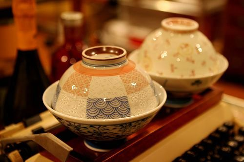  
  
它们端坐在手动打字机上，别有风韵。以及这些IN CAFE的器具可以把咱家MIX个底朝天，很有生活的味道~  
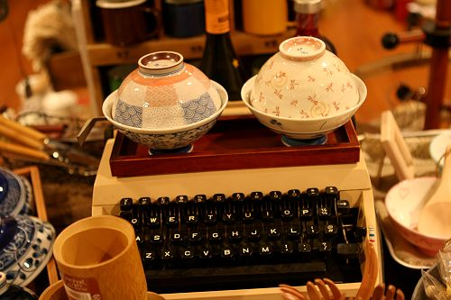  
  
比我买的木盒子略小，在办公桌或者家里的餐边柜上摆放杂乱的文具或袋装咖啡，很不错。  
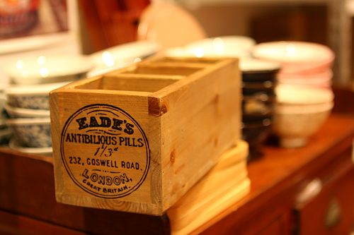   
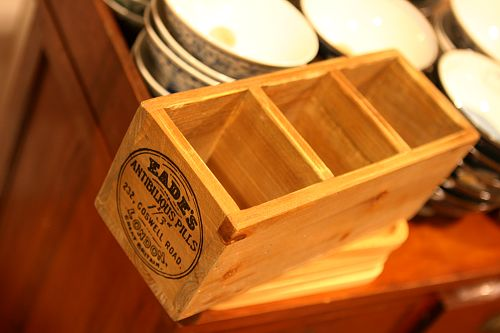  
  
新进的美式搪瓷缸，用它喝冷饮比较合适。  
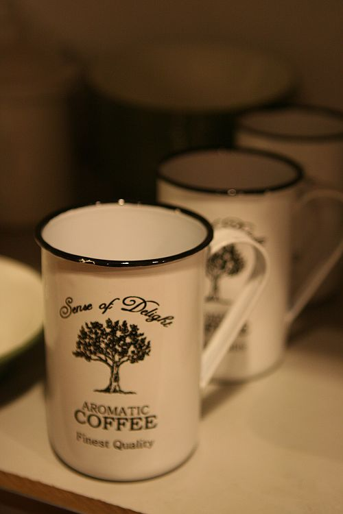  
  
上次去店里还没见到圆点图案的它们。  
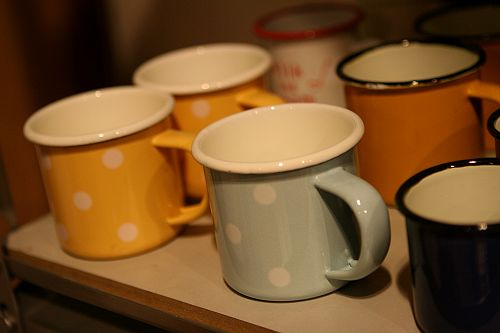  
  
和我那只可爱的白色壶有同样功能，可直接放煤气灶或电磁炉上加热。咖啡色的不错，适合我们这个年纪的家庭用，红色适合单身在家找找做家务的快感或招待朋友的时候拿出来炫炫。  
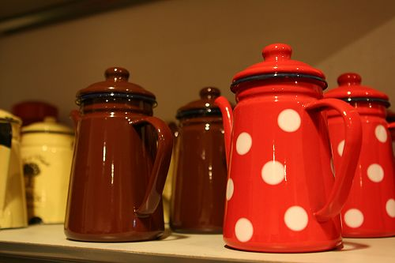  
  
这是上回买回的木勺和搅拌勺，手感很好。与用其他质感的勺子会有不同的奇妙感受。  
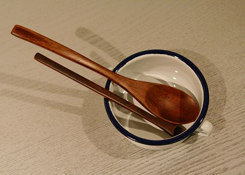  
  
用买回的木盒子将散落在餐柜上的面包糕点收拢在一起，立刻变得有气质起来~  
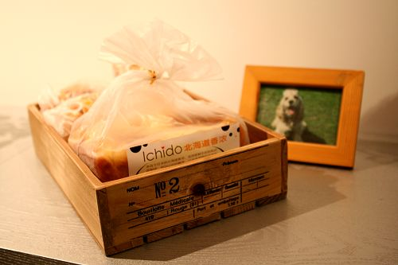  
  
生活比较辛苦，除了美美的睡一觉，就剩下吃来犒劳自己，当然这顿也不是什么大餐。重点是朋友在一起说说话，解解闷。饭后逛商场，发现对什么都没有兴趣，是衣服鞋子的设计越来越没有新意，还是我得了无兴趣病？即使如此，我还是拎了条裙子回家。  
  
有没有瞧见之前掉水里的白色SHARP手机？它还活着~  
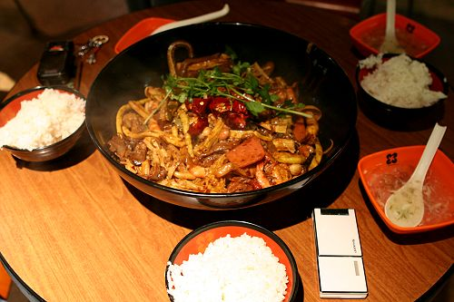  
  
今天，有什么比做一个吃货更满足呢？  
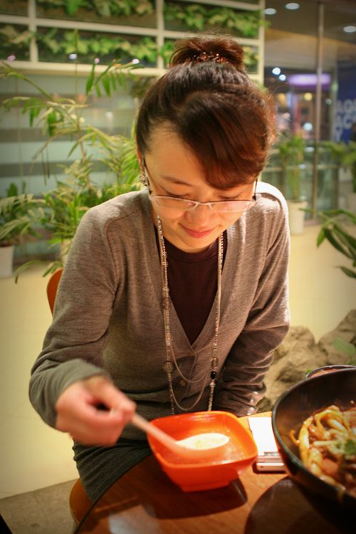

---

## 评论（21）

**喜刷刷** · 2010-01-20

大家推荐我来坐沙发,我就替大家来坐一回吧~~~我也喜欢这碗.

**蚊问问** · 2010-01-20

你拿的正是我早在心中默默定好的款式…..

**Christina** · 2010-01-20

本来打算全部买走，一个也不给你留滴，结果是你家K的表情：“发发。。。生了什么？”数量多地我买不了哇~

**喜刷刷** · 2010-01-20

第一碗弯弯的花纹,象小朋友害羞时耷下来的眼睫毛~~~

**喜刷刷** · 2010-01-20

木勺很有用啊,喝蜂蜜水时用金属勺就容易变色的~

**Christina** · 2010-01-20

哦？是吗？又学了一招~

**喜刷刷** · 2010-01-21

蜂蜜是弱酸性物质,会与金属起弱化学反应.

**putooo** · 2010-01-21

我错了。。以后不能在微薄发布任何新品消息，原本让你来拿碗的。。变成引诱消费~，~>< ~  
吃了美食后，心情大爽了吧~!

**蚊问问** · 2010-01-21

木盒我也有一样的. …

**Christina** · 2010-01-21

你不说，俺们从TB也能知道，嘿嘿~以及问家的糕点面包也和我家一样有气质鸟，哈哈哈哈哈哈~

**[至清](http://www.yangziqing.net)** · 2010-01-21

看起来很精致的物件，很精致的生活，以及很雅致的人儿哦。哈哈。

**truecolour** · 2010-01-21

水游城的香锅～也许今后也可以看到你啊。  
这家In Cafe在哪里啊

**[薇安](http://bulaoge.net/?vivianxu)** · 2010-01-21

哈哈，我也越来越喜欢扑土家的风格了～不过再买实在放不下了。

**Christina** · 2010-01-21

要淘汰才能放得下~

**雯子** · 2010-01-21

碗好看哦，木勺也不错。

**nancy** · 2010-01-21

很喜欢这些小玩意，我是路人。能告诉我南京实体店店址吗？谢谢。方便的话，可否加msn？

**Christina** · 2010-01-21

http://shop34941044.taobao.com/  
上这个地址就能看到实体店位置。  
以及我现在没时间用MSN~不好意思~

**[三月四月](http://11)** · 2010-01-21

是水游城的干锅吧，好想吃，看上去很诱惑人

**一克轻松** · 2010-01-22

小物很有情趣，只是有时候不知不觉会越攒越多哦；）

**lilian** · 2010-01-24

没兴趣还拎了一条裙子?看样子我今天也可以在自己拎回一套两件套之后反省自己为什么也得了“没兴趣病”：b

**Sherry** · 2010-01-28

茶壶好可爱~

