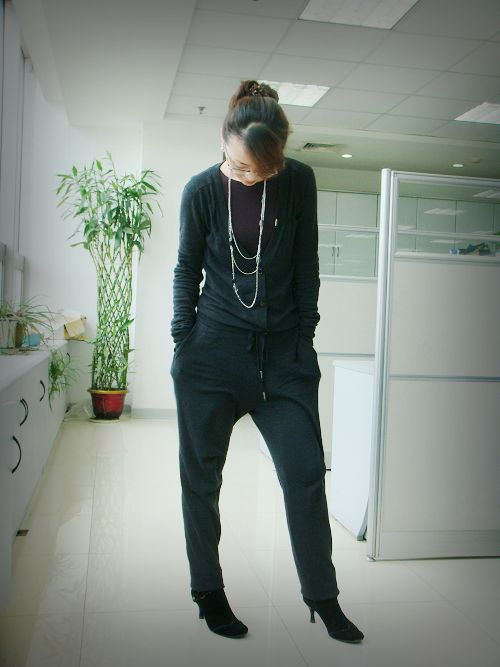
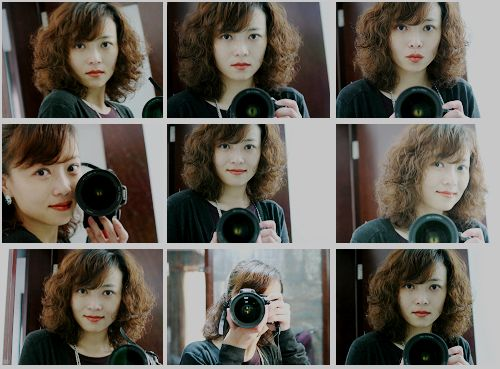

# Dress Blog

联体毛衣裤的问题在膝盖，坐时间长了会有鼓包，当然整件衣服柔软到毫无知觉，适合小周末穿。里面配了豆沙色的TEE，外面配长款修身羊毛大衣或短夹克、带帽运动衫。。。都可以。  
  
  
自从上回染发之后，两天不洗就会出现头皮屑。。。以前我可从来没有这玩意儿，痛苦啊~这次烫的卷比上次小一些，因为头发长得快，那些露出本色的头发影响了细节。这次烫发不是为了批而是为了盘着扎着。  

---

## 评论（25）

**mandy** · 2010-01-21

身材好的人才能尝试连体毛衣裤，会吸身不？

**mandy** · 2010-01-21

也很久没有再使用过MSN，呵呵

**Christina** · 2010-01-21

基本还好，吸身与否取决于里面穿什么质地的衬，比如我今天里面是条连裤毛线袜，会有点小吸身，还没到影响我的情绪，呵呵~

**lilian** · 2010-01-21

不笑好看。。酷酷的。。

**喜刷刷** · 2010-01-21

喜欢中间那三张.毛衣照片有了吗?

**[至清](http://www.yangziqing.net)** · 2010-01-22

美。

**陈问** · 2010-01-22

小照片，第二排，第一个，简直就是个大一女生。

**[光光](http://gaoguangguang.blogbus.com)** · 2010-01-22

像个洋娃娃。烫发和染色很伤头发的呀。

**ware** · 2010-01-22

脸白+红嘴 很吓人呀

**[Christina](http://Lifetea.org)** · 2010-01-22

吓的就是你！

染发最伤害健康，上次染发疼得我满脸冒汗哇！

**[三月四月](http://11)** · 2010-01-22

卷发效果很好啊，过阵子长长会更好看

**卉子882** · 2010-01-22

这个发型好看，又酷又惊艳。配上白白的脸蛋+红红的双唇，我最喜欢的妆容。

我也一直想烫这样的，可是我额前的头发爱出油，洗了头的第二天，头发会贴在额头上。洗头发满，我又懒，所以长着大，我只烫过一次卷毛。

搭理不是油性头发，但是额前爱走形的头发，有什么诀窍不？

**Christina** · 2010-01-22

把它烫伤，头发就蓬松起来了。

有个女性朋友每天早晨起来洗头，只为那么一些些不同的蓬松效果，要美就得下功夫，没有丑女人，只有懒女人。

**一克轻松** · 2010-01-22

挺漂亮的，欣赏你的Style，OL风格又不失个性；）

**[三月四月](http://11)** · 2010-01-22

是的，我现在为了让头发蓬起来，就带着发卷睡觉，其实还蛮痛苦的，中午时，效果没了，就再带上睡个午觉……

**Christina** · 2010-01-22

为什么不烫呢？发质软，卷出来的花效果持续时间不长，是么？

**[三月四月](http://11)** · 2010-01-22

因为前两次烫染把头发伤坏了，开叉的很多，又不想剪短，想再养养再烫。其实卷的效果还好的，今天在网上又买了很多发卷，这样可以多分几缕来卷，效果会更长久些

**lilian** · 2010-01-22

我也是额前容易走形的头发，可能前面长了个旋涡的缘故，所以每次洗完头主要就是吹它最费功夫，真不让人省心哪！

**mandy** · 2010-01-22

偶头发就是少，为了制造出蓬松的效果，偶只有天天早上洗头。养成习惯后不洗就感觉头发别扭。为此每天要早起至少30分钟~~

**[三月四月](http://11)** · 2010-01-22

关于留海，我也烦恼过，因为前面有个旋，总也分不过来，后来去做了个软化，烫了一下，好些了，在网上看到专门的留海夹，可以夹起来用电吹风吹，可以帮助留海定型，不知道有没有效果，地址是：http://item.taobao.com/auction/item\_detail-0db1-2e7f572d1b6744be45eed647d098d937.htm?cm\_cat=0

**Christina** · 2010-01-22

烫+吹，肯定有效果！我脑门也有悬的~

**卉子882** · 2010-01-22

哈哈，用发卷更麻烦，睡觉还隔得慌。。。

难怪，是脑门上的旋在搞怪~

看来，可能效果最好的就是把头发烫伤。恩。。。还是放心去烫头吧，伤了就伤了，伤了有伤了的好处~

**[少爷](http://jennyshaoye.blogbus.com/)** · 2010-01-23

是很好看。茶，你不说你上海的朋友都辞职了么？

**[Christina](http://Lifetea.org)** · 2010-01-24

好象写的是“打算”辞职，听说她又不想辞了。你们到上海前通知我具体到达离开时间，好吗？

**Sherry** · 2010-01-28

我也喜欢第二排第一张，很清纯的感觉，你笑起来很甜美哦，多笑笑，让自己开怀，感冒也容易好呢！

