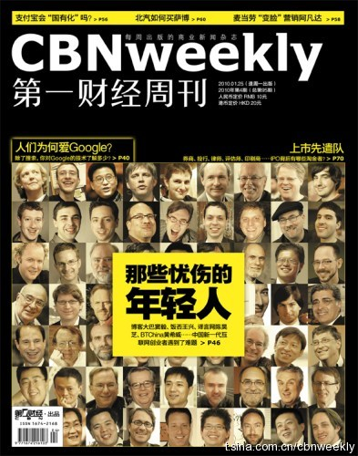

# 那些忧伤的年轻人

  
  
1月13日，下午6点，博客大巴(blogbus.com)CEO窦毅拿着手机从座位上站了起来，在办公室里走了两步，又在原地转了个圈。  
  
　　从1月5日博客大巴在互联网审查风暴中被封算起，已经八天九夜了。13日那天，窦毅打了无数个电话，手机也死机了四次，他对着电话，不停地重复相同的话语。现在，距离解封只有最后一步—通知域名服务商解封，“但是现在所有电话都联系不到他们。”  
  
　　口干舌燥的窦毅其实应该算是个幸运儿，和这一轮互联网整治中受到波及的其他创业者相比，他至少知道需要补齐的是哪个手续，自己该往哪些方向努力。  
  
　　王兴的微型博客网站“饭否”因为“违反国家相关规定”，于2009年7月突然被中国联通北京分公司IDC(互联网数据中心)停止服务之后，至今没有恢复。2009年11月，陈昊芝—译言网董事长兼总经理—也接到了IDC的通知电话，并被告知译言网违反的是“新闻信息服务管理规定”。一个月后，BTChina的站长黄希威接到了一封邮件，被告知自己的网站被取消了备案号……  
  
　　我们采访到了四个年轻人。他们中最年长的也不过才33岁。他们是最新一代的创业者，他们身处最活跃的互联网市场，他们有无尽的创意和把一切付诸行动的勇气，但是，他们不快乐。  
  
　　他们本不该如此。他们创办的网站都有数量不菲的用户，有那么一群人还成了他们的粉丝，他们的创业让很多找不到用户的同道羡慕。但现在，他们只是2009年中国互联网整顿中被涉及到的几个年轻人而已。  
  
　　据人民网的统计，从2009年开始的中国互联网专项整治共涉及到十余万个相关网站，其中也包括了谷歌、百度、土豆、豆瓣等网站。  
  
　　从被关停到恢复，博客大巴用了8天，译言用了差不多50天，这些日子都是让人忧伤的。陈昊芝说，自己儿子11月19日出生，可11月30日关站后，几乎一个月自己都没有机会抱抱他。“这个失落谁能理解？”  
  
　　王兴、黄希威心情肯定更灰暗，因为他们的网站至今仍未恢复。连续创业者王兴已经开始为新的项目出差，自称“能力不够”，凑不够千万注册资金的黄希威却只能无奈地说“我力所不能及”，“关了就关了吧”。  
  
　　同样在这段时间内，Twitter网站的创始人Jack Dorsey开始了自己的再次创业，正式进入电子支付领域。2009年，他的Twitter是最受关注的互联网公司。他意气风发，觉得未来要做的事情还有那么多。  
  
　　他和窦毅、陈昊芝一般年纪，33岁，拥有着这几个年轻人所没有的东西—一张真正的笑脸。  
  
　　2010年1月8日，译言网注册的一个新域名“yeeyan.org”上线，其原来的域名“yeeyan.com”至今尚无恢复的消息。陈昊芝期待着“yeeyan.com”能尽快解封。他觉得，现在的互联网环境如果让自己这样“创造社会价值和创新型企业的人”考虑后路，这是一件很可悲的事情。所以“就算是扛，我也会扛过去”。但是，要扛多久，“说实话，我现在还不知道。”  
  
　　1月13日晚8点左右，在窦毅他们等待了整整一天之后，一位坐在电脑前的工作人员突然喊了起来，“我们被解封了！”几个脑袋顿时围了上去，大家不由自主地鼓了掌，遍地笑容。“赶紧公告！”窦毅一声令下。  
  
　　20时05分，新浪微博(http://t.sina.com.cn)上出现了博客大巴的最新信息。  
  
　　此时，窦毅习惯性地掏出手机，看了看，又放回了兜里—电话暂时可以休息一下了。  
  
　　BlogBus  
　　创立日期 2002年12月  
　　创始人 郭晓雷。2003年10月，窦毅接手BlogBus，任CEO  
　　用户数量 800万注册用户；近7万VIP用户  
　　关停日期 1月5日下午5时左右中止域名解析  
　　恢复日期 1月13日20时  
　　关停原因 因为一篇已删除的低俗色情信息  
  
原文来自：[**《第一财经周刊》**](http://tech.sina.com.cn/i/2010-01-21/12343792701.shtml)

---

## 评论（5）

**ware** · 2010-01-22

后悔没和facebook一个国家的人

**autumnginger** · 2010-01-22

唉……

**lilian** · 2010-01-22

我们社区的网站也被封了……

**[薇安](http://www.bulaoge.net/?vivianxu)** · 2010-01-23

窦毅就是横戈吗

**HANK** · 2010-01-23

对于这次，我真的没有办法反击同事对我伟大的祖国的质疑。

