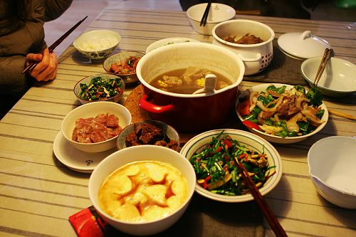
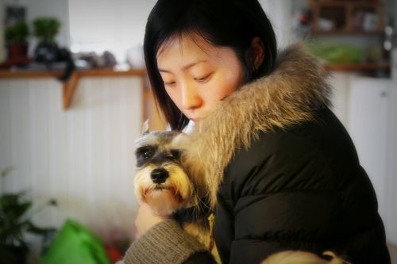
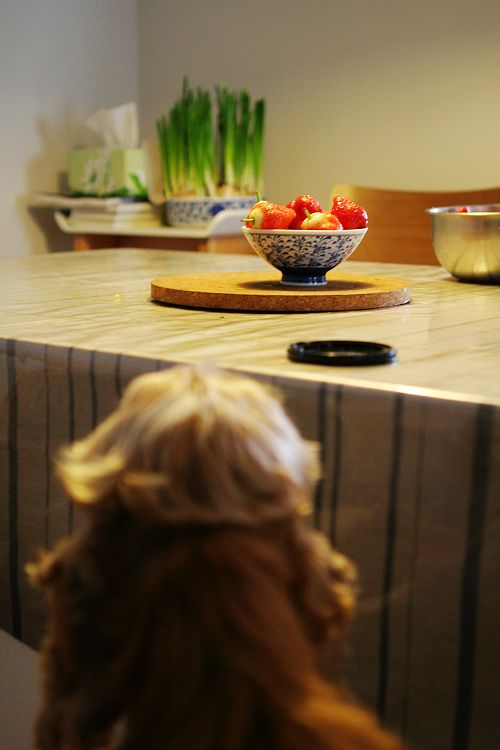
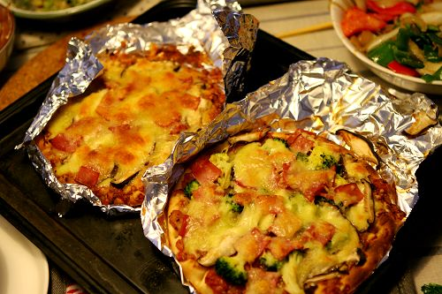
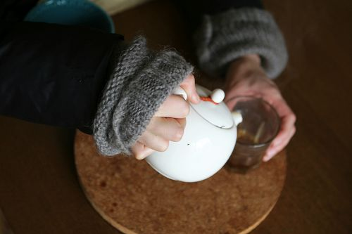
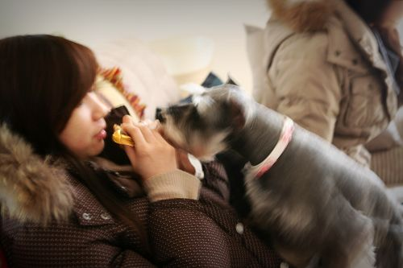
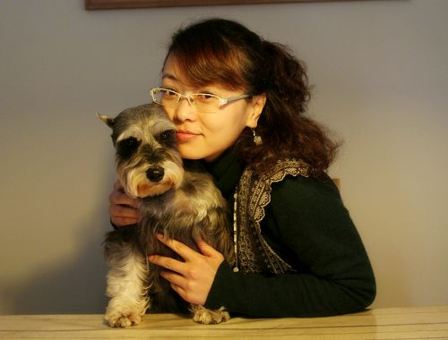
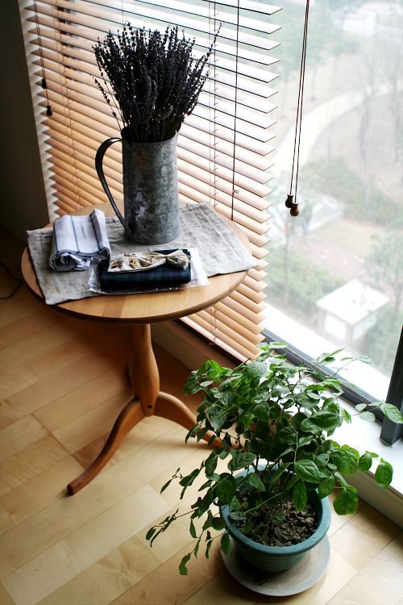

# 我们在一起

昨晚问问更新blog，四次都没有成功。检查时误删整篇文字，心碎的同时感叹大巴真如惊弓之鸟，难怪大巴的CEO被媒体称为“忧伤的年轻人”，究竟是什么字导致博客不能更新？今天上围脖才知，在问问凌晨反复尝试下，原来“死”、“被打死”成为被禁的罪魁祸首。好吧，现在大巴用户和大巴的读者也要跟着一块儿忧伤了！  
  
——四次被禁的《在一起》，转自问问博客——  
  
一只叫土豆的狗。  
  
脏兮兮的出现在我家近的宠物店里，它生过N胎，两次剖腹产，耳朵被剪（为了美观），声带被割，犬牙也被磨成平的。它5岁了，生到不能生，子宫就被摘掉，然后就被丢弃到店里。  
  
如果要为不公平的事情生气，得要生到什么时候？  
  
即便对弱小的生命体抱有同情，我也时刻叮嘱自己要克制。因为克制自己的情绪和感情，也是一个人在社会上的生存之道。但愿我妈给我的情感量能够轻一些，可社会待我又不至于坏到什么地步，朋友多半有情有义，对于不幸的事情，我们心里明白，以微薄已力，大多数时候也只能做个旁观者。  
  
K爷是我一年多前在垃圾堆边捡来的狗。当时它和一只母狗玩。母狗不愿跟我回家吃饭。一个礼拜后，这只叫小花的母狗在院子里被送去了西天。 我难受，也为在我家吃得皮毛贼亮的K爷感到庆幸。它与死亡擦边，自己的初恋也已结束。而浑然不知人世险恶，也是身为狗的幸福啊。  
  
天气很好的下午，我和路边狗土豆一起玩，我唤：“土豆~！”它颠颠跑来，深深望着。它有一副好脾气，一个肥屁股，一把乱胡须，一双黑葡萄似的眼睛。和任何人都不闹别扭，它不是被宠大的孩子，温和之下自有一股生存的韧劲。  
  
我没有办法养它，我对于它，就是一位平凡的路人而已。  
  
若干日后，土豆被朋友茶收养。在我俩对上号之前，她也不知道土豆狗曾经和我玩耍。我想呢，人和人，和动物之间存在着潜伏的网络。和什么样的人成为朋友，和什么样的动物为伴，貌似都有安排，我们不过排队走入进程而已。生离死别要发生，重逢也终有时，各位不必过于忧虑。  
  
据说土豆患有严重的分离焦虑症。我一度怀疑急性子茶会把它送还店里，即便如此我也不怪她，因为适应一只狗比经历恋爱困难得多，至少谈不拢的情人不会在你家四处撒尿和乱咬鞋子……但是她熬过来了，土豆症状减轻。我为自己低俗的判断感到无地自容。  
  
今日家宴，我见到了温顺土豆。它深邃、粘人、一往情深。我知道它找到了归宿。看着这中年横福的家伙，我真心为它高兴！  
  
深邃、粘人、一往情深的土豆。  
  
  
在家常常做饭的人应该了解，准备这一桌饭菜不容易。兰质蕙心的问问在上周五晚上准备好净菜，等我们快到的时候开始烧。有肉骨茶、豆腐鸡蛋羹、韭菜炒淡菜、咸蛋黄豇豆、板栗炖小鸡、爆炒猪肝、南京农村香肠，我最爱吃她做的豆腐鸡蛋羹、韭菜炒淡菜、咸蛋黄豇豆、。她最得意的肉骨茶，俺生生没得尝到，都吃得狼吞虎咽唉~  
  
  
温柔在一起的问问和土豆。  
  
  
谁敢挡在怪大叔“外外”与食物之间，怪大叔可是要发火的哦！  
  
  
有爱的[**小原子**](http://0524gao.blogbus.com/)亲手制作的披萨，两种口味：培根芝士和蘑菇花菜。  
  
  
这把白色的小茶壶我也爱。  
  
  
两个小朋友抢糖吃。  
  
  
香香滴卡通土豆，被所有阿姨抱了个遍，真是受宠若惊的一天。  
  
  
圆桌上的铁皮桶和插着的薰衣草来自扑土的IN CAFE，小原子连夜手工赶制的米色香袋我也有一个，等天晴时拍照，一定要看看上面那些特别的纽扣，太有爱了~  

---

## 评论（13）

**雯子** · 2010-01-31

土豆的身世好感人哦！怪不得我觉得土豆耳朵怎么那么小尖尖呢！请问茶同学能告诉我豆腐鸡蛋羹和韭菜炒淡菜怎么做啊？好想做来吃吃哦。

**陈问** · 2010-01-31

为什么这两篇都微薄都没有抓到呢？奇怪！

**Christina** · 2010-01-31

说明新浪比大巴牛气唉~搞得定“死”和“被打死”，呵呵~

**Christina** · 2010-01-31

做鸡蛋豆腐羹的方法，一定要平整有型，所以蛋液打好后不能有泡沫，办法是用滤网过一遍，出来的又嫩又平。

另一道菜，雯子去问问哪里寻吧，我真不晓得。

**喜刷刷** · 2010-01-31

分享的感觉已经很温暖了,要是能亲临现场,会更美妙~

**okdata** · 2010-01-31

日本电影里说，狗给人的是一生，人给它的是一部分，善待吧。  
铁皮桶更适于放在花房，这里的用品应该精细一些

**少爷** · 2010-01-31

问问是个好姑娘，你也是。我喜欢这人与狗有关的文字

**putooo** · 2010-01-31

对狗狗的爱开始泛滥了~~·  
菜一定很好吃~^++^

**shuwua** · 2010-01-31

扑土没有去聚会吗？  
问问的围脖，土豆一定也爱依偎。  
外外的头发长了，锅盖卷了。

**陈问** · 2010-02-01

哈哈，外外是翻盖老。  
我家哪有什么花房，精致的花器插上这把薰衣干草，反倒是少了野趣。所以精致的我收了起来，换了铁皮。

**Christina** · 2010-02-01

呵呵~我们都好爱土豆围脖~以及问家还是挺精致精巧的~PUTOO没去，很遗憾，但我们几个人下午冲到她店里啃鸭头滴，嘿嘿~

**[薇安](http://bulaoge.net/?vivianxu)** · 2010-02-02

我优先在微博上看了聚会的现场发布照片！羡慕～女友之间更多的是细腻和温馨

**chayer** · 2010-02-05

终于知道了土豆的故事，想哭却觉得温暖，因为她现在有了茶。

