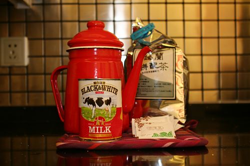
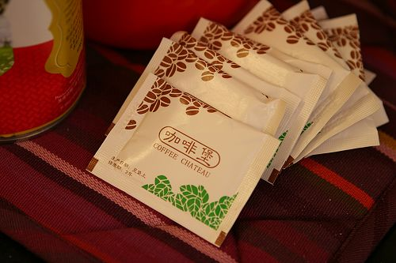
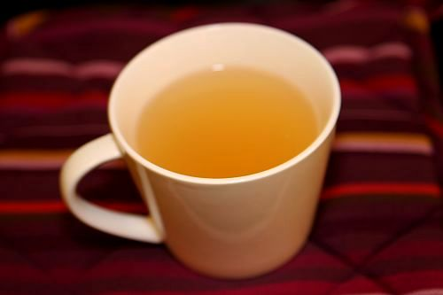
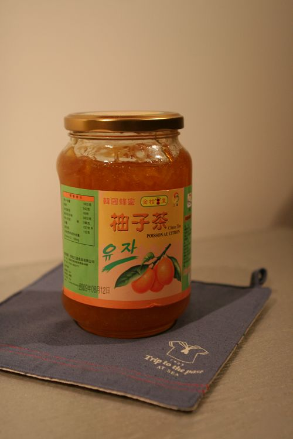

# *奶茶*美好

自从小原子无私教授奶茶秘籍之后，我紧锣密鼓地买回制作奶茶的原料和工具，不断尝试，一次比一次进步，最终做出可口的港式丝袜奶茶。以至于周末的早晨以及工作日的晚上，都会做奶茶来喝。还期望家里来客人，好当场做奶茶来招待他们。  
  
做港式奶茶的锡兰拼配红茶、进口罐装淡奶以及拉袋一只，拉袋上的塑料拉链有一小截在反复练习中被火烧化，但不影响使用。如果没有拉袋，真的可以用现成的丝袜来煮茶哦~先前没有买到淡奶时，我就用光明牛奶来配茶，口感真的没有淡奶的丝滑感，不信可以自己尝试一下。  
  
据说“锡兰拼配红茶”口感梢有些涩口，顶级锡兰红茶口感更好，等我尝过再作评判。现在拼配茶的口感我已很满足，至少能作出象模象样的港式奶茶喽。  
  
从扑土店拎回红色搪瓷壶一只，在水游城4楼看到和扑土店差不多的搪瓷壶，要300元一只，颜色款式还没扑土店里的好看，里面更不是白色而是蓝色，贵在品牌附加值？  
  
  
今天收到TB购买的袋装白糖。。。一大包，被分别装入各种密封罐里，小部分散落在竹篮子里备用，袋装糖用起来既体面又卫生。  
  
  
以及韩国进口釉子茶一瓶，够春节期间食用的量，味道还不错。要把春节过得美美的，所以买了短绒沙发垫和椅垫，希望提高家中色彩的和谐度，有时间再搬回几盆植物，对了，IKEA目前有几款一色的花盆有相配的底盆，看中白色的那款，放在家中一定很好看。   
   
  
  
以下为收集的各种奶茶制作方法，慢慢学习：  
印度奶茶（Masala Chai）配方   
原料：鲜牛奶300毫升、红茶12克、焦糖适量、豆蔻一粒、肉桂一小片、丁香二粒、鲜奶油一匙。   
做法：焦糖放进奶锅，加少量的水煮至糖汁呈金黄色并冒出焦香味，到入鲜牛奶，不断搅拌，加红茶入锅煮沸后，加入香料，改用小火煮1分钟，然后放入奶油搅拌几下，再以小火煮约2分钟，过滤装杯。也可依照各人口味，添加少量的胡椒或巧克力酱。  
  
杏仁奶茶做法  
原料：杏仁100克、牛奶200毫升、白糖适量。  
制作方法：  
（1）把杏仁洗净在热水中浸泡10分钟后，去皮。  
（2）用小石磨带水磨成杏仁汁（用多功能食品加工机则更好）然后用干净的纱布过滤，使杏仁汁流入碗中。  
（3）把杏仁汁倒入锅中，加白糖、适量清水，用文火煮沸。  
（4）把牛奶倒入煮沸的杏仁汁中，搅拌均匀，再次煮沸，晾凉后即可  
  
麦香奶茶  
材料 : 西米1/2杯，统一麦香奶茶。  
做法:  
1. 西米浸透，放入滚水中者至透明，隔去水分，待用。  
2. 将麦香奶茶冰冻待用。  
3. 将冻茶放入杯中，加入煮熟的西米，饮用时拌匀即成。  
  
坚果奶茶  
做法：  
1、将茶叶、清水、一茶匙的坚果切片放进锅中去煮，再加入占20%的牛奶。  
2、粗砂糖与坚果奶茶非常适合，可以当作甜味调料加进锅中。加入奶油之后，在撒上坚果切片。  
3、坚果之外，近来也有以花生或核桃来代用。  
  
香蕉奶茶  
做法：将香蕉切片，宽约4mm，并把统一巧克力奶茶及一人份二、三片的香蕉切片放进锅中冲泡。  
注意：  
沸腾过度容易使味道尽失。可依喜好略加些砂糖，然后淋上奶油、放入装饰用的香蕉。为了不使装饰用的香蕉马上沉入红茶中，其诀窍就是将香蕉切成薄片使之浮起来。  
  
暖姜奶茶  
做法：  
1、将茶叶与磨碎的生姜放入锅中，以清水浸泡。茶叶泡开了之后，加入与清水同量的牛奶并加温。  
2、倒入茶壶之后，注入预先温热的茶杯中，并切宽约1~2mm的生姜片装饰茶杯，便完成了。  
  
玫瑰奶茶  
玫瑰果是野玫瑰的果实。它的维他命C的含量是柳橙的20倍，柠檬的60倍。这道玫瑰果奶茶具有提高肝脏功能的效果。适口的酸味加上蜂蜜的甜味，非常好喝。  
做法：  
用玫瑰果茶包泡茶；在锅中放入200CC牛奶温热，将茶倒入再加热。在奶茶快沸腾前熄火，可按个人喜好酌量加入蜂蜜。  
  
珍珠奶茶制作方法：  
1、雪克杯中倒入一咖啡勺调匀奶茶粉、1勺半果糖、加入三分之一杯热开水，用搅拌棒或咖啡勺调匀，再加满冰块，急速摇动雪克杯20次后，倒入放有珍珠20g的杯中即可。  
2、雪克杯中倒入一咖啡勺奶精，一勺半果糖、加40g热水调匀后，加入二分之一杯红茶水（锡兰红茶、麦香红茶、咖啡红茶均可）再加满冰块，急速晃动雪克杯20次后，倒入盛有珍珠20g的杯中即可。  
注：制作果味珍珠奶茶方法同上，只需再杯中加添果粉2勺。（根据所添加果粉不同可分别制作成木瓜珍珠奶茶、香芋珍珠奶茶等。）

---

## 评论（12）

**喜刷刷** · 2010-02-08

提起这个奶茶用袋装白糖,黄糖,我真跑断腿.JRF没有,JLF没有,倒是最土的SG能找到袋装黄糖.所以说,TB还是挺方便的.试过几次后,我才知道奶茶要用那么浓的红茶做口感才好,满意外的.

**Christina** · 2010-02-08

可能是港式奶茶的口味需要锡兰红茶特有的味道吧，煮出来的茶色象咖啡一样浓郁，你到现在还没开始做吗？工具倒是比我早买好了的呀~俺是说干就干，哈哈~有机会我煮给你尝尝~

**[putooo](http://incafe.blogbus.com)** · 2010-02-09

你的行动真是跟走路风格一样，雷厉风行的~  
这么快拉上~意外啊~！

**Christina** · 2010-02-09

上周几乎天天煮唉，不进步就忒对不起自己的勤奋了～咱悟性高，哈哈哈哈哈哈～

**喜刷刷** · 2010-02-09

怡兰的书里有用果酱冲泡果茶,也非常有意思,不过都需要大量时间去琢磨体会才行.

**小原子** · 2010-02-09

其实你早该拉上的，怪我是马大哈~~但我骨子里是很热情的人哎~对波？希望到时候我们去谁家都能喝上正宗奶茶佬~~嘿嘿！不过奶茶也蛮提神的不比咖啡差。

**[amwen](http://iamwen1982.blogbus.com/)** · 2010-02-09

学习学习……最近对红茶着迷，刚购入叶怡兰的书，又巧遇你这篇文字，不禁跃跃欲试了！

**HANK** · 2010-02-09

哈,保持热情哦.让俺下个月也尝尝.期待啊.咔咔

**Christina** · 2010-02-09

下个月。。。就是3月份喽。。。欢迎来喝奶茶哇：D

**[薇安](http://bulaoge.net/?vivianxu)** · 2010-02-09

我也要小原子无私的教我！哈哈

**[prettymom](http://prettymom.org)** · 2010-02-09

thanks for sharing the recipes. gotta try them when i have time.

**[平底鞋](http://yiping99.spaces.live.com/)** · 2010-02-11

港式奶茶的超级粉丝，别人去HK购物，我只为茶餐厅的一杯奶茶。求奶茶秘籍啊~~~

