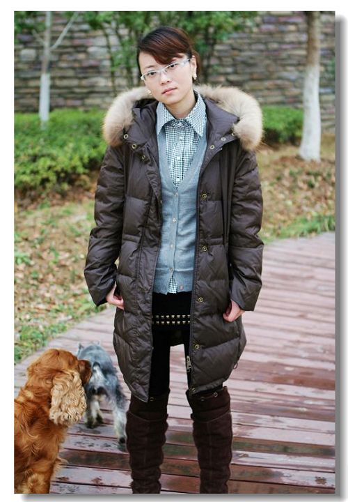
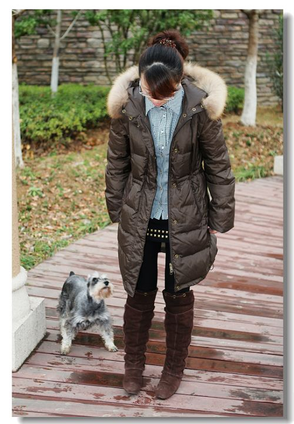
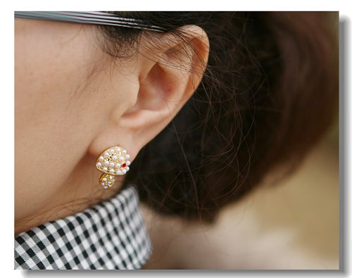

# 阴雨连绵

连续几日阴雨，衣服干不了，只好再烘干晾晒，然而空气中湿度大，晾晒一会儿...就一会儿摸上去还是有点湿。早晨8点未到被一阵响雷闪电惊醒，春天啊春天，来得如此隆重又热烈！天气预报说节前江南会迎来第二场雪，反正也积不起来，不如不下的好，以便给回家的人路上方便。  
  
春节还有4天，工作稍稍悠闲，心情跟着渐渐轻松愉悦。节前最后一个周末做了许多事儿，还在扑土店呆了一个下午，看着她不停地包装商品，不停地包啊包啊，自己做老板并不比打工轻松，坐在家里不开张也要花钱的。我坐在那张儿童床上看着她包快件，喝着她买的日本清酒，那个下午过得无比放松。  
  
周末购入CANON 580EX II闪光灯一只，闪光灯对于光线的平衡，就象豆浆平衡雌性激素一样的效果，哈哈哈哈~  
  
  
我的鞋不是被穿脏的，而是我家小宠们兴奋外出时，经常在上面踩几脚，冬天尚可，夏天被踩的分量不轻哦~  
  
  
也，爱上，这么嗲的饰品：D  

---

## 评论（8）

**Jonathan** · 2010-02-09

给你拜个早年，新年快乐，虎虎生威！

**Christina** · 2010-02-09

感谢~也祝您新年平安健康顺利~

**[薇安](http://bulaoge.net/?vivianxu)** · 2010-02-09

闪光灯用了吗？使用感受怎么样？

**Christina** · 2010-02-09

才用一两次哎，周末才买的，等我用段时间再谈感受吧：D

**喜刷刷** · 2010-02-09

磨蹭的人戴小蘑菇～～～

**Christina** · 2010-02-10

大惊喜，你应该知道我磨蹭不磨蹭哎~呵呵~

**ware** · 2010-02-10

第一张有些愤青的味道 :)

**smile** · 2010-02-11

我最近也狂迷耳环，没时间逛街，坐在办公室偷懒的时候就在网上败了很多。  
喜欢那个有两排柳丁的裙子（还是打底衫？），后一篇穿在毛衣外套里面的也是这件。

