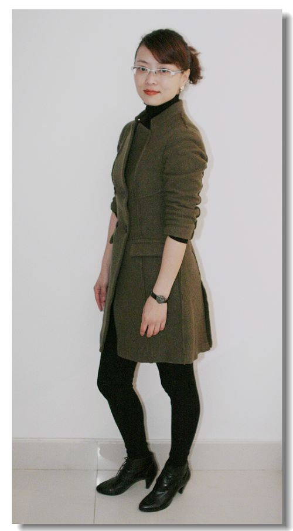
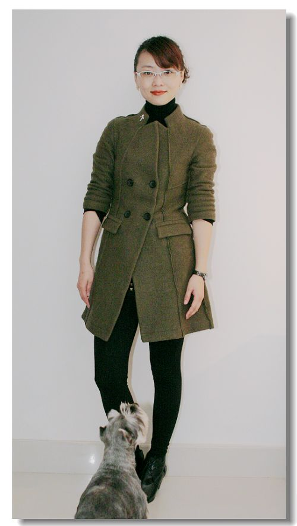
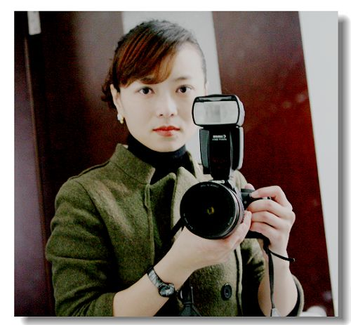

# Dress Blog

这两天工作稍显缓和，我拍，我拍，我拍拍拍~  
  
  
佩戴了蝴蝶结式样的小胸针，上面镶嵌着碎钻，小小的，很别致。  
我喜欢把小的胸针别在衣领或肩膀上。  
   
  
新玩具CANON 580EX II，但愿我不要沦落为器材党啊~  

---

## 评论（9）

**cjcc_1983@126.com** · 2010-02-11

虎年快乐啊

**Christina** · 2010-02-11

新年快乐！

**[prettymom](http://prettymom.org)** · 2010-02-11

i like your coat. it looks very stylish.  
btw what lipstick are you wearing? the color is very nice.

**喜刷刷** · 2010-02-11

我不小心又看到了超短裙~

**陈问** · 2010-02-11

要放假了吧。心散了啊。哈哈

**农妇某人** · 2010-02-11

赶着烧头炉啊！  
南京方言？我狂笑~~~真是很恶毒，却也真是解气！！学习了！  
咸菜色的衣服很有气质，裁剪也很特别。  
新年要到了，祝你吃好玩好休息好！！

**Christina** · 2010-02-12

心的确散了，用的是LANCOME唇膏，新年祝JM们都美丽健康快乐啊！

**大湖** · 2010-02-12

你拍，你拍，你拍拍拍~  
我们看 我们看 我们看看看看~

**zyz** · 2010-02-12

美，最后一张

