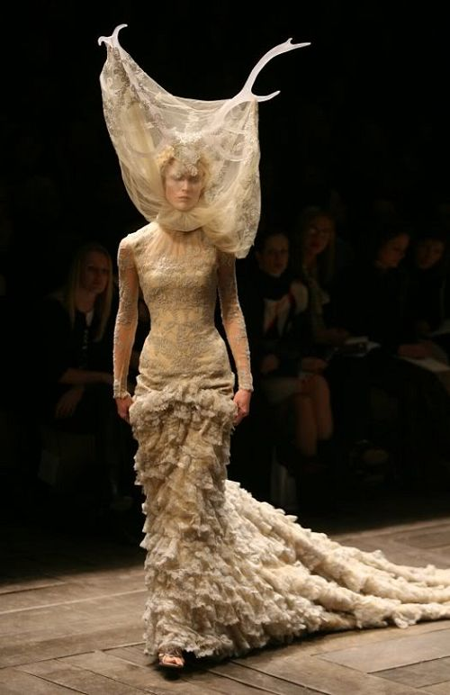
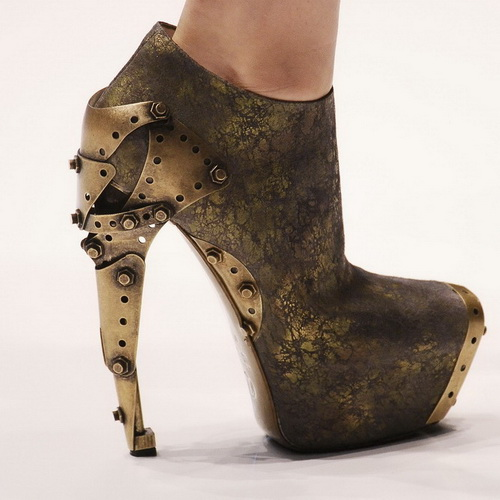
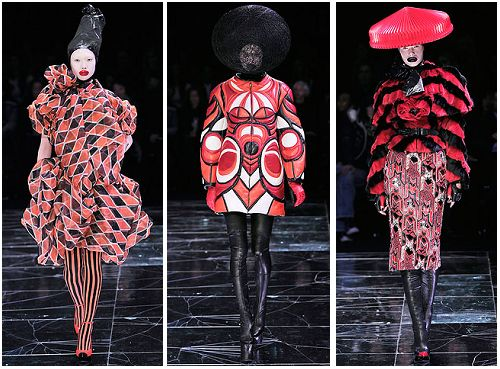
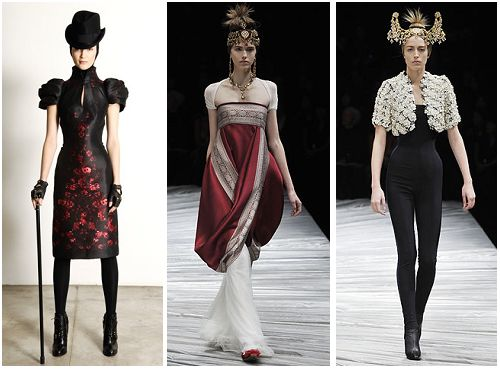
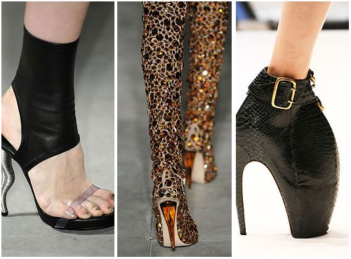
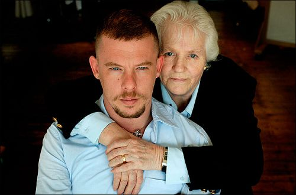

# Found Dead

英伦坏小子Alexander McQueen死在伦敦公寓里，他给我们留下疯狂的想象力。他在母亲过世后几天结束自己的生命， 作为最年轻的“英国时尚奖”得主，他曾在获颁不列颠帝国司令勋章 (CBE)时声称，自己受勋的唯一理由，是为了让母亲一尝夙愿，亲眼看看白金汉宫是什么样。  
  
Alexander McQueen语录：聪明智慧坚强勇敢的女人是我的设计对象，我不在乎她们的高矮胖瘦，我不单希望她们能穿我的服装，更希望她们因此坚强起来。我从来不想和Lagerfeld居住在同一个世界，我也不打算开始做一个对流行谄媚的势利鬼/性感是一堆垃圾！我设计这种低腰裤，根本就是为了拉长女人身体的比例。（来自《新周刊》）  
  
我觉得他的设计既让女人优雅，又令女人强势，LADY GAGA应该是他忠实的用户。  
  
   
   
   
   
   
  
Alexander McQueen和他的母亲  

---

## 评论（8）

**min** · 2010-02-12

色彩斑斓，真是充满想象力的设计！那些鞋子，既优雅又强悍。

**雯子** · 2010-02-12

可惜了哦！LADY GAGA是衣不惊人死不休哦。

**Annie** · 2010-02-12

实在很惋惜，是我最喜欢的设计师之一。

**大姜炖去** · 2010-02-13

这双眼睛又让人喜欢又让人害怕

**不羁之舟** · 2010-02-14

新年好，茶小姐，问候你的全家,幸福快乐:)

**少爷** · 2010-02-15

可惜啊。此人真的很牛。  
祝茶新的一年好运。。。

**[光光](http://gaoguangguang.blogbus.com)** · 2010-02-15

看他的设计，就觉得香奈尔那些好土啊。祝你新年顺利！我爱说新年进步，祝你新年进步。

**大姜炖去** · 2010-02-15

新春快乐，  
王菲春晚的衣服好像就是这位天才设计的

