# 春节快乐！

2.14.这天下午下雪，本来一次普通的遛弯因为天气演变成一场快乐的体验。  
  
LUKE一出来好兴奋的样子。  
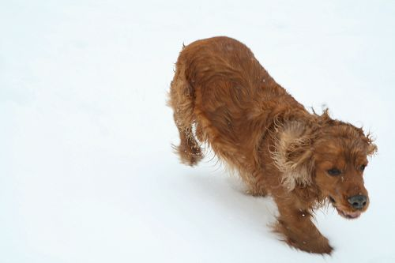  
  
LUKE在厚厚的积雪上跳跃地行走。  
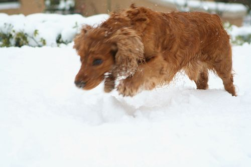  
  
这种表情叫快乐~  
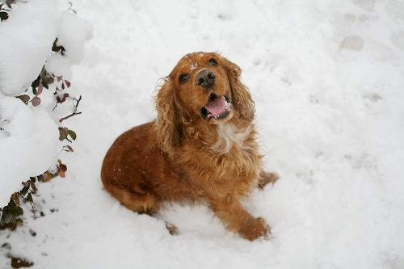  
  
土豆和LUKE抢雪球，把我推倒了。  
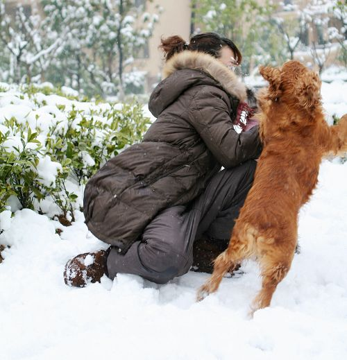  
  
两年不到Luke的体重长了7斤。   
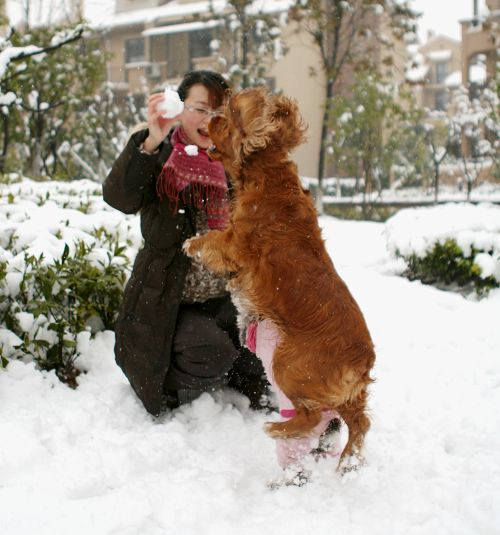  
  
靴子上的雪后来回到屋里就化了，靴子经历过雪水更干净，省了清洗。  
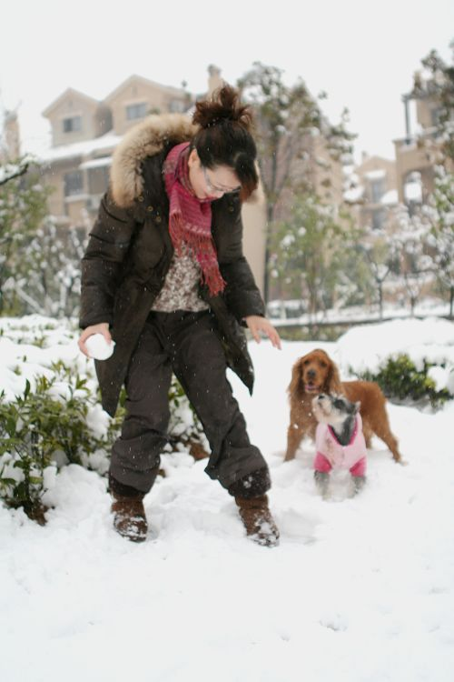  
  
造型比较龌龊的雪人。   
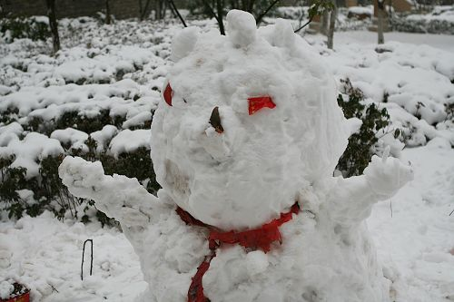  
  
刚盛开就被冰雪定格了。   
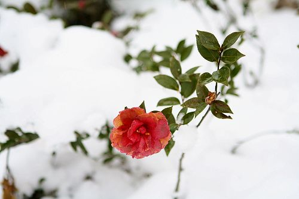  
  
年初一天上还飘着密集的小雪花。  
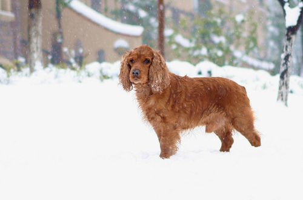  
  
它们追的是我手中的雪球。   
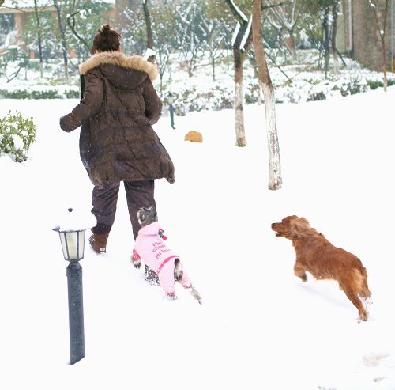  
  
拉着土豆转个圈。  
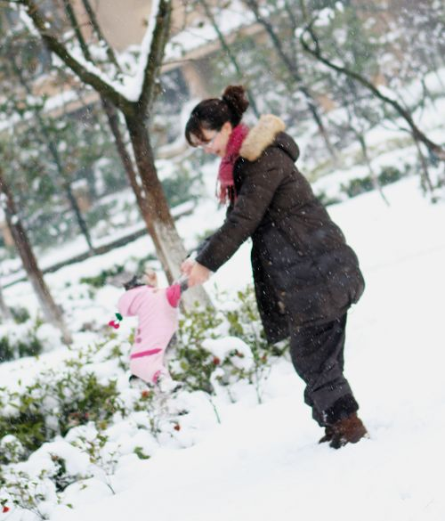  
  
LUKE一定奇怪，为何雪球一扔出来就没了？所以它会在雪地里使劲的扒啊扒的找。   
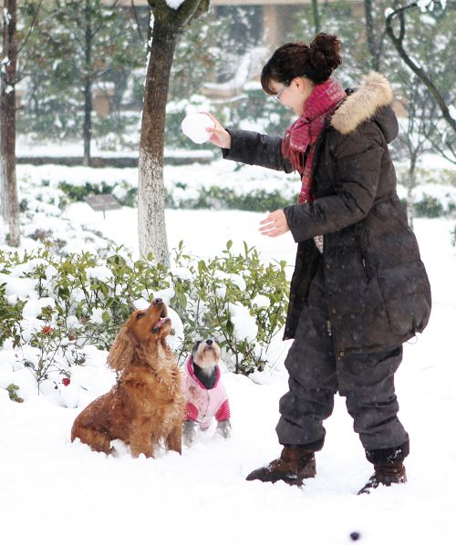   
  
憨啊~  
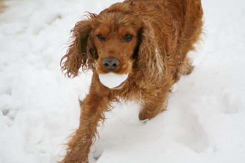   
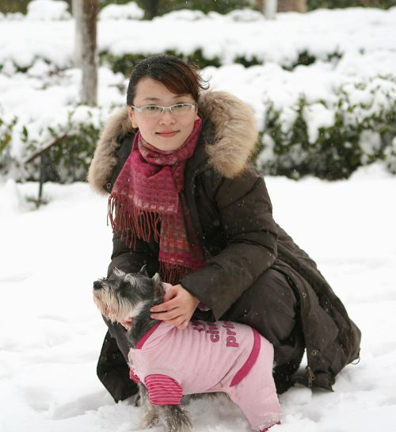   
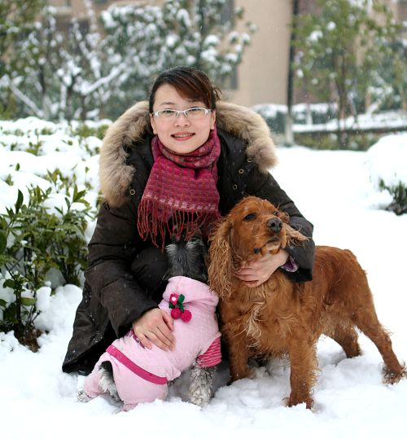  
  
送两只小爪印给天下有情人！  
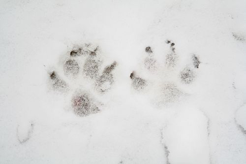

---

## 评论（13）

**itsmin** · 2010-02-15

好开心啊。:+)

**[光光](http://gaoguangguang.blogbus.com)** · 2010-02-15

好好玩啊！小狗真可爱。

**喜刷刷** · 2010-02-15

看你的羽绒服,一不小心“斑点“啦~

**冈本** · 2010-02-15

太可爱咯！！！！！！

南京下了那么多啊。回日本后，真没看到下雪与积雪啊。  
Toby也很喜欢下雪。2年前上海大下雪的时候真很愉快地玩雪啊~~~~~

**少爷** · 2010-02-16

这组照片看得很过瘾啊

**Xiaona W.** · 2010-02-16

好温馨的场面！祝节日快乐！

**大姜炖去** · 2010-02-16

最后一张不错，呵呵  
雪上留爪两枚，左边的是luke？

**[薇安](http://www.bulaoge.net/?vivianxu)** · 2010-02-18

新年快乐哦~

**[โหลดเพลงใหม่](http://www.mp3dee.com)** · 2010-02-19

very good

**Christina** · 2010-02-19

祝大家新年安康、顺心！

**不羁之舟** · 2010-02-19

我也来加一脚~~  
小狗和人都好可爱啊:)

**lilian** · 2010-02-23

杭州的雪虽然也积得起来，可还是太湿，似乎玩不了这样的雪仗。茶是不是穿着冲锋裤啊~~

**Christina** · 2010-02-23

是滑雪裤,呵呵~

