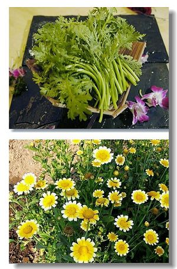

# 农业植物：唐蒿菜

昨晚下班去菜场采购蔬菜，其中有我颇为喜爱的“唐蒿菜”，喜欢用它做汤，配料可自己搭配。昨天的配料是干贝、虾仁和木耳，加水烧开，放入唐蒿菜烫几分钟即可食用，味道清新爽口。  
  
一直惦记着与女伴们在汤山吃的农家菜里的老豆腐，这几天一想到它就滋滋冒口水。于是晚上先烧老豆腐，大家吃的差不多了，再下肥牛卷，问问好象承受不了这道菜辣到嗓子根的辣。我们几个却吃的很带劲儿。  
  
**有关昨晚那顿美餐，转一下问问的描述----**  
  
在茶家吃了晚饭。清蒸海鱼，韭菜黄炒蛋，辣豆腐肥牛，我还处女吃到了干贝唐蒿木耳汤，对于丧失一半味觉的感冒人来说，既有重头辣味，又有清新小汤，我的味蕾在复苏。与LUKE、土豆的桌下情也进一步发展。坐车去山顶看夜景，没有路灯，其实星空更美，夏天可以带望远镜来，我就这样萌发了对银河的憧憬。  
  
（偶补充：干子炒青椒，德国黑啤、失败的烤鸭，无人问津的鸡爪子。以及登山之后又去观“九龙湖”的水。）  
  
最近菜场里唐蒿菜卖得正欢，倾向在开水里烫烫的做法，既无油烟又保证了营养。  
吃多了唐蒿菜，不知道它还开花吧？呵呵~  
注意：唐蒿不是茼蒿，也不是芦蒿哦！  

---

## 评论（8）

**[shanshu](http://shanshu.blogbus.com)** · 2010-02-23

这东西好吃么？苏州菜场MS还没有见到这种菜。

**陈问** · 2010-02-23

昨天吃的太美。看来外卖的凉菜，都不如你亲自下厨的热菜。不过，烤鸭对于LUKE,土豆来说并不失败啊。  
我喜欢唐蒿的清而不寡，就口味来说和芦蒿有点接近，但是芦蒿又是水产蔬菜，放不出那么好看的花来。

**陈问** · 2010-02-23

回去的路上，W说今晚真是有山有水，就是要分开来观赏。哈哈。

**Christina** · 2010-02-23

夏初的傍晚观水应该不错，再约，嘿嘿~

**喜刷刷** · 2010-02-23

最后一句加得很有必要!

**Christina** · 2010-02-23

为你而加，嘿嘿~

**njujessica** · 2010-02-24

红楼梦里有道菜，就是用蒿菜的梗为主料，很鲜美  
就是要炒一盘需要摘好多蒿菜

**Christina** · 2010-02-25

仰视一下楼上看红楼作品如此仔细的精神!

