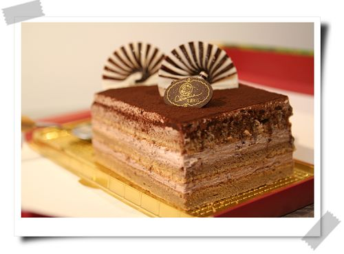
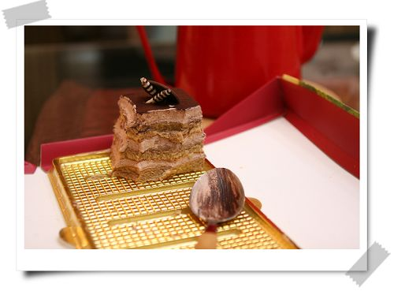
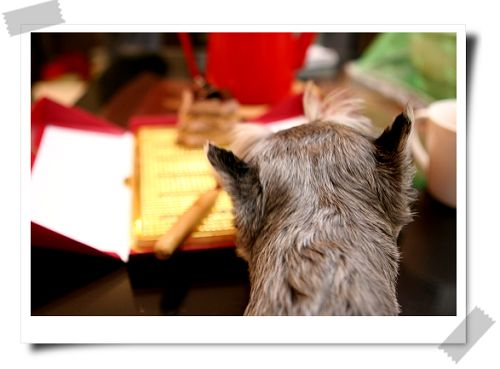
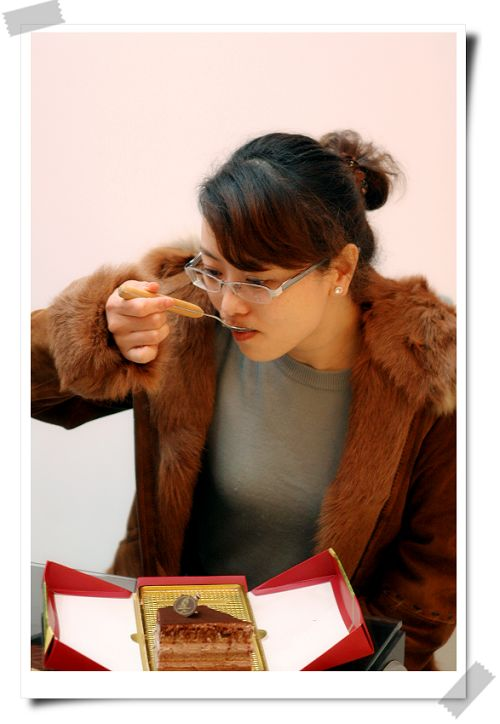

# 提拉米苏的记忆

记忆中的提拉米苏甜到人流汗，所以咖啡店里卖的小分量只能同一时间内享用一次，以免让人甜到厌倦。亦或者我之前吃到的提拉米苏还不正宗？就象每个店里的黑森林蛋糕会有区别一样？  
  
可是我对巧克力味的蛋糕毫无免疫力，曾经喜欢某家的灌浆巧克力蛋糕，天长日久吃下来居然也变化了口感和质感，让人联想到换了厨师的餐馆。那么偶遇到好吃的食物，总能带来小惊喜和莫名的珍惜，比如这款问问送的Christine店的提拉米苏，早晨被我吃掉1/3，晚饭时虽然烧好饭菜，还是禁不住打开冰箱拿出剩下的2/3就着红茶吃起来，甜味点到为止的好，有我喜欢的巧克力蛋糕的影子，以及饱满略带弹性的口感......我的味觉由此进入新的记忆，以后看到它的摸样，这种记忆便会浮出来。任何甜美的事物只要恰倒好处的自然，就会让人欲罢不能的受到吸引。  
  
推荐这首歌曲：[**“Alice”**](http://data10.nghenhac.info/ah/ahha/8/8187ea4ae7d2fcbfec277252ce96dc4d.mp3)，当你正在享受提拉米苏的美味时。小原子很负责任地对我说：“有日语但韩语也多，一时懂一时晕，对你来说都是晕。。。”恩，小原子给我们普及一下初级日语吧，以免真的晕过去，哈哈哈哈~  
  
提拉米苏2/3的摸样；  
  
  
强忍到明早再吃剩下的几分之几；   
  
  
爱上提拉米苏。  
  
  
昨天开工，白天户外与户内的温度差别很大，白天着羊毛西服+短裙，到了晚上需要皮衣来保暖。总结下来公司的中央供暖系统似乎总在拉大户内与户外的温差，这时候外面23度，坐在办公桌前却双脚冰凉，办公室最冷的季节。  

---

## 评论（10）

**陈问** · 2010-02-23

她家东西虽然算不上特别精致美好。但是总体还蛮健康宜人。  
祝你有巧克力的心情。

**Christina** · 2010-02-23

有Christine做早饭很不错啦：P

**[光光](http://gaoguangguang.blogbus.com)** · 2010-02-24

Tiramisu不应该那么甜的，也是我最喜欢的甜点之一。就因为它不是那么甜，所以喜欢。我争取学会做，以后见面礼是一个我做的Tiramisu，岂不是酷死个人儿了。

**[薇安](http://bulaoge.net/?vivianxu)** · 2010-02-24

不然怎么叫带我走吧～

**mandy** · 2010-02-24

也钟爱巧克力味.咖啡味的蛋糕，建议你试试云中的蛋糕。

**onfire518** · 2010-02-24

2002年，大学刚毕业，没事在家上网，无意中发现茶的博客。2010年，我会偶尔看看几个熟悉的博客，时间过的可真快阿！

**Christina** · 2010-02-24

云中的芝士蛋糕好吃，还有那些特别本土的黄油和大块的芝士也有意思。

说到自己做提拉米苏，这两天小原子就自己做了一大盆，晚上我就可以尝到了，呵呵~光光之前是否有烘焙经验？感觉烘焙挺复杂的，原料就得好几种，想想就发毛！

**lilian** · 2010-02-24

最近为了收藏某个不知名甜品的鸡蛋布丁瓶子，已经吃了它家不少鸡蛋布丁了。它家的瓶子很象扑土家的玻璃牛奶瓶，矮矮胖胖的，特别可爱！

**[三月四月](http://11)** · 2010-02-25

第一次吃提拉米苏，很笨的先把上面那层黑色的粉吃掉，还说：这么苦！后来就迷上吃这个东西，每进一家糕点店，我都会看看它的提拉米苏做的如何，卖多少钱。这实在是一个很奇怪的甜品，说甜也不甜，说苦也不苦，说软不软，说硬不硬，还有股酒味，等看了它的由来就更爱了。现在已经不怎么吃这个了，但是一提到还是很激动，喜欢吃克里斯丁的和云中的

**[三月四月](http://11)** · 2010-02-25

看到上面有人收集布丁瓶子的爱好，让我想起自己以前也喜欢收集提拉米苏的杯子。现在我打算收集养乐多的瓶子，然后到时候粘成一个大造型。我妈妈说我有收破烂的潜质

