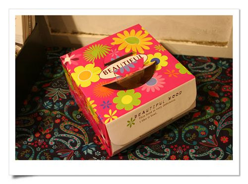
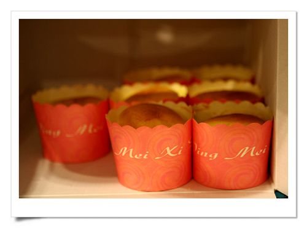
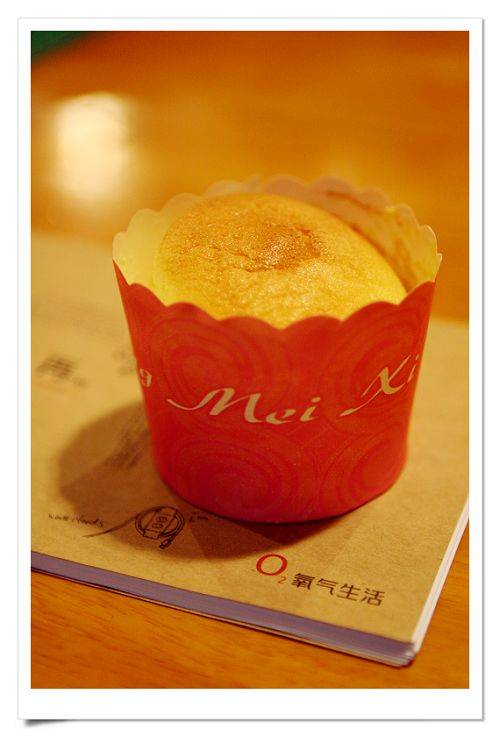
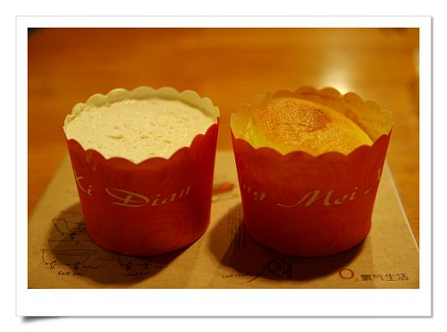
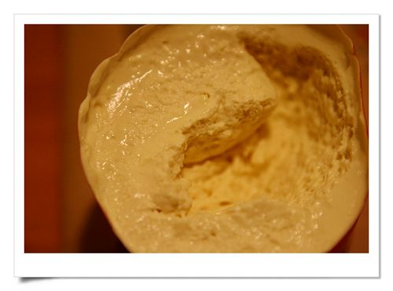
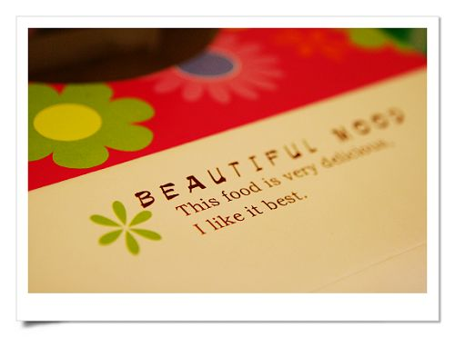

# 小原子*蛋糕

手机忘在办公室一夜....和扑土聊天，聊得我心旌荡漾，快12点才到家。吃到小原子烘焙的提拉米苏，以及没有酸奶味的酸奶蛋糕，桌上三个圆饼也被我一个人吃掉。扑土的手撕鱿鱼，沾上酱油芥末...美味之极。真希望能倒带到昨晚，重新再吃一遍~  
  
即使私家烘焙的蛋糕也有赏心悦目的包装；  
  
  
这些没有酸奶味儿的酸奶蛋糕安静地呆在盒子里等着我们去享用！为何叫酸奶蛋糕只等小原子解答。有些蛋糕吃起来会有点腥气儿，为什么呢？和鸡蛋有关，烘焙蛋糕要用洋鸡蛋喔；  
  
同情一下还没吃到的那几位.......  
  
在冰箱里冰了一宿的提拉米苏，口感甚好，加之小原子慷慨用料，外面可买不到这么货真价实的甜点。把左边的提拉米苏涂抹到右边的酸奶蛋糕上，混合着吃也好。  
  
没有蛋糕全部是料的提拉米苏，据说一个8寸的提拉米苏用料的成本多达200多元，普通原料的成本也有160元左右。我吃完一个提拉米苏，等着扑土劝我吃第二个，但是...没等到...  
  
蛋糕盒上的字母真正表达了我们这些吃货的心情，吃着小原子蛋糕，我们有什么理由不积极生活，乱发脾气以及对得不到的东西毫无涵养宣泄愤慨呢？与美好之物相伴，怎能不美好！  

---

## 评论（16）

**小原子** · 2010-02-25

可以向毛主席保证；真的就是酸奶！问问下午才做了个大盆酸奶蛋糕。相机真好，照的那个清楚~~

**Christina** · 2010-02-25

那为何没有酸奶味儿呢？

**小原子** · 2010-02-25

我是这么理解的；通过蛋黄分解蛋青再分解乃至黄油的香味，最后热量蒸发……酸味就么的来，剩下的就是奶~~

**陈问** · 2010-02-25

还是红枣酸奶蛋糕么？可能红枣味道比较浓？

**Christina** · 2010-02-25

红枣只有你一个人吃到唠，哼，小原子偏心！

**小原子** · 2010-02-25

红枣是我尝试品，以前一直不敢乱篡人家方子。周六我搞红枣，我都觉得红枣味浓点好吃点。

**Christina** · 2010-02-25

芒果味应该比红枣味更得人心，哈哈哈哈哈~

**娟琳雨筝** · 2010-02-25

是的，很赞同你博客里的那句“与美好事物相伴怎能不美好”，何况还有一群那么美好可爱热爱生活的好朋友，呵呵

**陈问** · 2010-02-25

有芒果酸奶么？带果粒的那种不行。小原子是倒的光明红枣酸奶进去的。

**[薇安](http://www.bulaoge.net/?vivianxu)** · 2010-02-25

小原子，能否打包寄来苏州啊。。。。。  
Christina可真幸福，小原子原来是DIY高手！

**Christina** · 2010-02-25

倒！COSTA使用的芒果浓缩汁，据说麦德龙有售，那个能用在蛋糕上吗？

**[果三](http://996612)** · 2010-02-25

才爬上来。  
那个，小原子做得“心灵手巧”，茶姑娘吃得也“心灵手巧”。一样好吃食，没有好的吃食人也不会完美。

**[shao ye](http://jennyshaoye.blogbus.com/)** · 2010-02-26

the last photo: I would amend it as “ I like it the most”

**mandy** · 2010-02-26

有机会请你们尝尝我的手艺 ~~玛格丽特小饼~~

**[三月四月](http://11)** · 2010-02-26

口水……

**Christina** · 2010-02-26

楼上的应该会自己做蛋糕吧？能反手自己卷头发，正手做蛋糕应该容易些^\_^哈哈哈哈哈~

