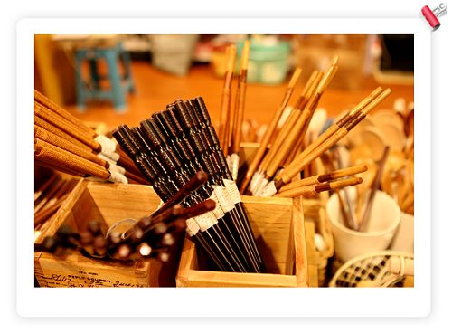
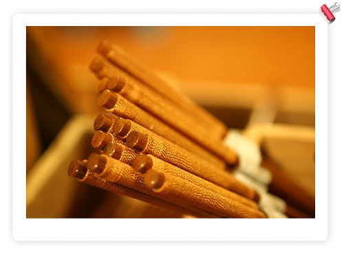
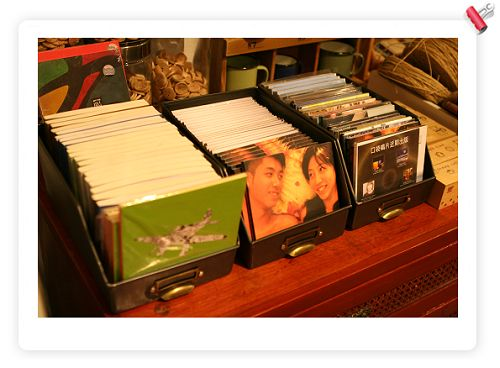

# 换筷子

[**“IN CAFE”**](http://incafe.taobao.com/)进了各种款式的新筷子，早前逛MUJI，看到差不多的筷子要40-70多元一双，对木筷子有爱的我赶紧收藏了一大把回家。  
  
新闻里说筷子每半年要更新一次，正好家里的旧筷子已超时完成使命。  
   
  
可收纳CD的铁皮盒，放书也不错。  

---

## 评论（10）

**陈问** · 2010-02-26

哎呀，那个CD小盒我也收了，还有大箱子。哈哈。

**mavis** · 2010-02-26

美女的东东总是那么漂亮和实用  
看着养眼的很呢  
同时勾起我换筷子的冲动，周末就行动

**Christina** · 2010-02-26

mavis 可以足不出户就购买，IN CAFE在TB有卖的，地址：http://incafe.taobao.com/

我好奇你准备用大铁盒装什么？

**陈问** · 2010-02-26

我装杂志哎。

**果三** · 2010-02-26

喜欢木质品的人，容易接受新生事物，但也恋旧；是个追求自然品质、自由生活的人。

**Christina** · 2010-02-26

同时…我也喜欢金属和皮具…如何解释？

**mavis** · 2010-02-26

多谢茶，我这就顺着你的脚印 去掏宝~

**shuwua** · 2010-02-27

我去淘宝店找了，没有大铁箱，估计扑土来不及上新呢。

**frank** · 2010-02-27

70一双筷子，你有没有搞错，就是10多美元，我工资不低觉得这也太贵了，ikea一美元一把

**Christina** · 2010-02-28

您可以买ikea也可以选MUJI，完全由您的愿望决定。

大铁箱我有照片哎~

