# 美妙下午茶

很有意思的科学实验：科学家分别给两只杯子装满清水，一只上面写着“我爱你”，另一只上面写着“我恨你”，然后放进冰柜中，第二天将杯子取出，用显微镜观察上冻的水纹。发现写着“我爱你”的水纹比写着“我恨你”水纹更好看。  
  
有人问：“如果我嘴上说着爱你，心里却恨呢？”  
“听到‘爱你’的人受益，心里‘恨’的只好自作自受啦。”  
  
**——下午茶——**  
  
美妙下午茶的美妙在于“自力更生，丰衣足食”，大家边热火朝天地聊天，边跟随师傅学看制作咖啡，交流烹饪美食和烘焙经验。我也越来越倾向在家里动手烧几个好吃的菜招待朋友们，那种快乐比直接杀到饭店和咖啡馆甩吃甩喝美妙啊，又为下一次相聚积淀饱满的期待。  
  
小原子为大家煮Cappuccino，边研究爆涨的粉丝团，股票这么涨该多好啊；  
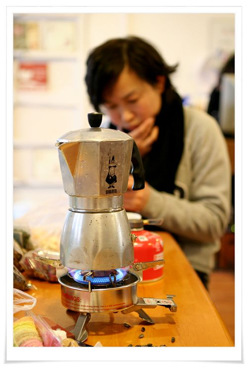  
咖啡煮好了；  
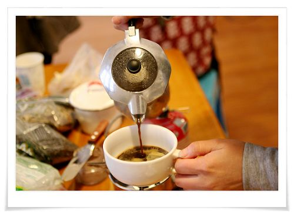  
加入黄糖；  
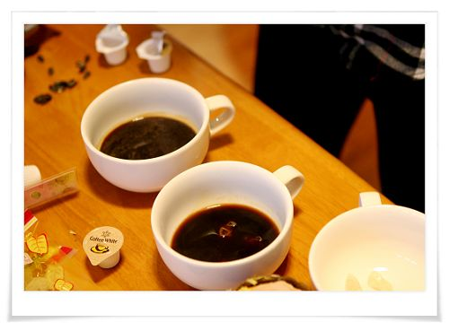  
打奶泡；  
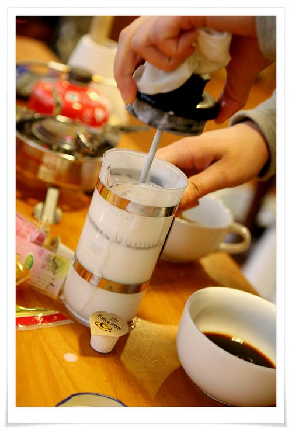  
在COSTA加两滴榛子糖浆要花5元，还是自己备着舒坦，想加多少加多少；  
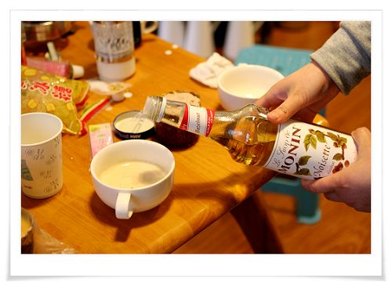  
小原子烘焙的培根面包，瞧这色泽，瞧这缠绵状。。。把我们这几个吃货诱惑得不行。  
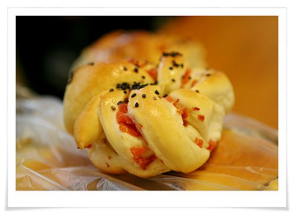  
一枚太后受伤的小心灵，学名“红枣酸奶蛋糕”，这次吃出了酸。。。奶味儿。  
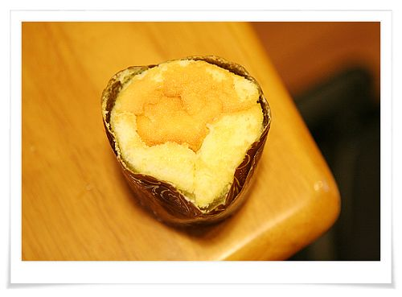  
  
**——在一起——**  
面对小原子这样的女人，我真是汗颜呐，就会那么几样，我学我学我学学学；  
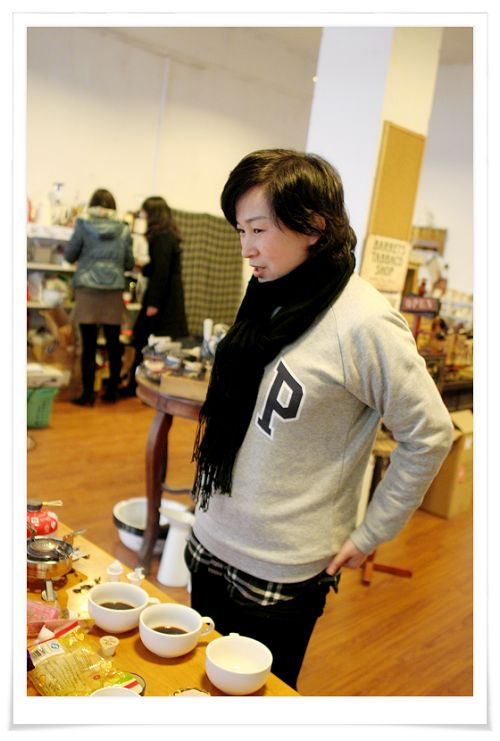  
老板今天很文艺；  
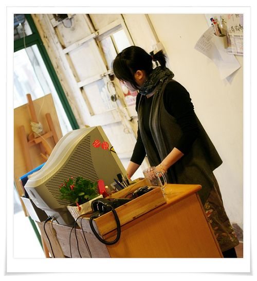  
太后殿下也开始织围脖啦；  
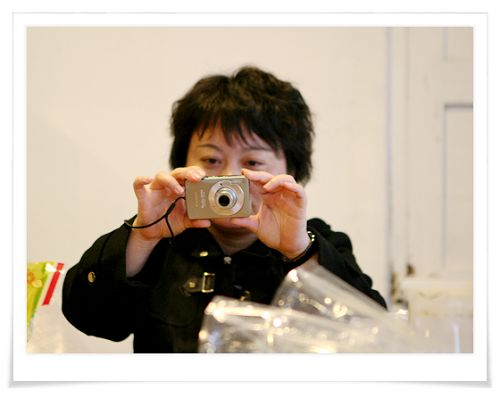  
客串一把老板；  
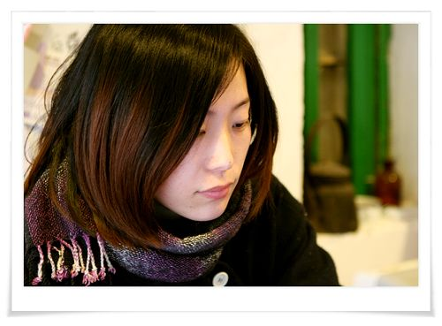  
客串不忘织围脖，越织越暖和；  
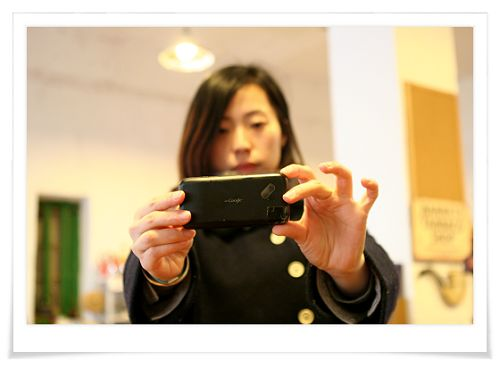  
MM上网也不忘餐叉，最忠诚的吃货啊~  
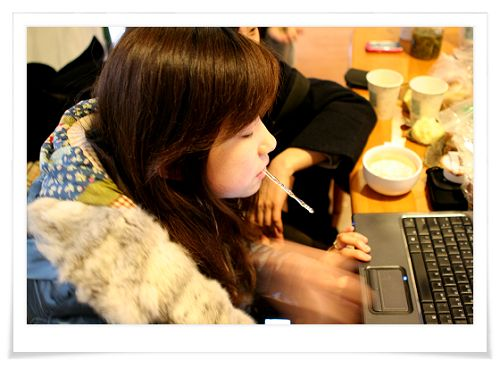  
不知道该吃哪个好，胃口好一切都好；  
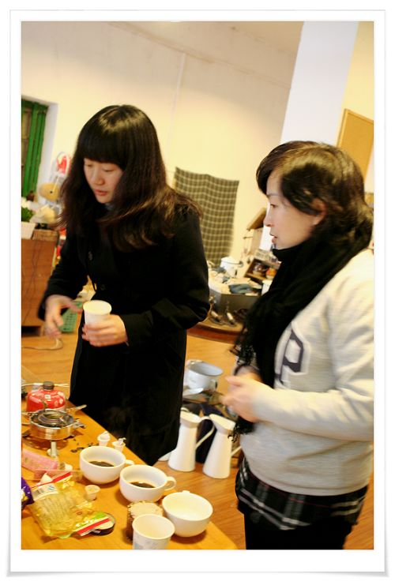  
丢了魔法扫帚的女巫只好站着发呆了。  
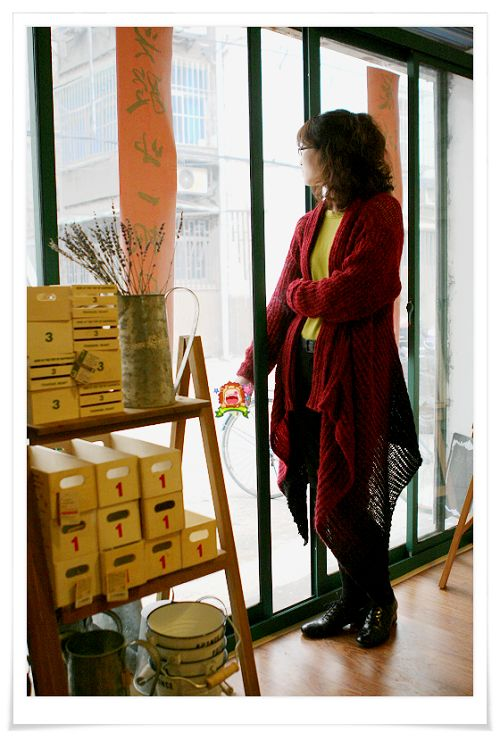  
  
祝朋友们元宵节快乐，心情永远象彩色气球一样绚丽。  
拍摄于IN CAFE。  
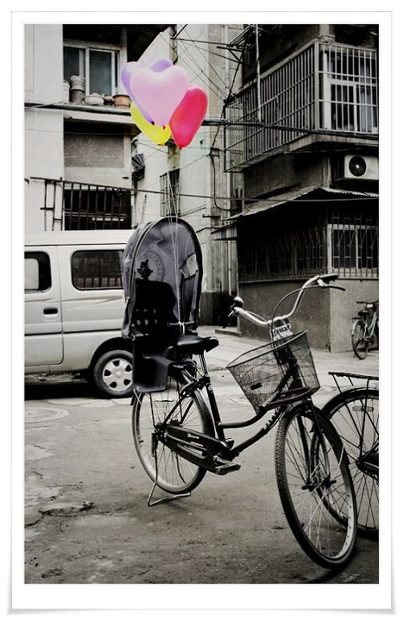

---

## 评论（9）

**shuwua** · 2010-02-28

春暖花开，聚点里的花已提前开了。看着你们开心，我愈加期待早点归队。

**Christina** · 2010-02-28

树娃，我们在这里替你多吃点再多吃点，你在北京也要一样哦，胃口好一切都好！

**陈问** · 2010-02-28

呕！撒花，起哄者路过

**[至清](http://www.yangziqing.net)** · 2010-02-28

精致的生活，源于一颗精致的心，以及对生活的热爱。钦佩茶姑娘的心境与心态。

**lilian** · 2010-03-01

看得我心旌荡漾。。这才是我期待的生活呀。。

**joanna** · 2010-03-01

倒数第二张你么？红色的衣服真闪亮

**Christina** · 2010-03-01

是我哎，里面不要搭配亮黄色就好了。

**少爷** · 2010-03-02

hey, this IN CAFE looks great. I will visit it when I go to Nanjing next time.

**eryu** · 2010-03-03

灰常灰常小资

