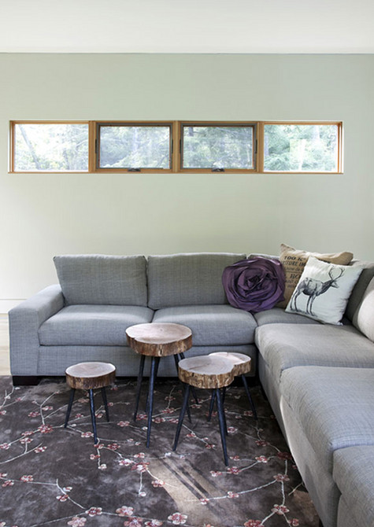
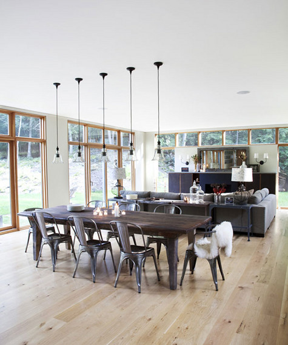
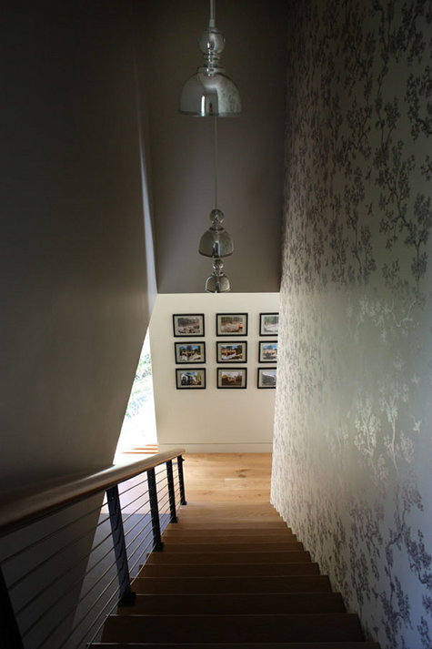
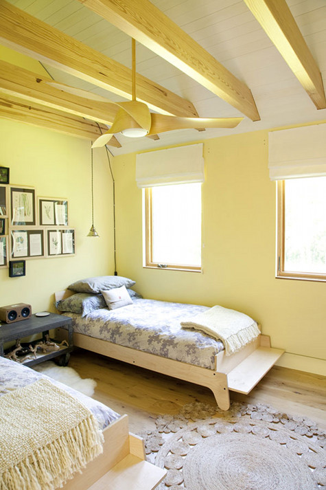
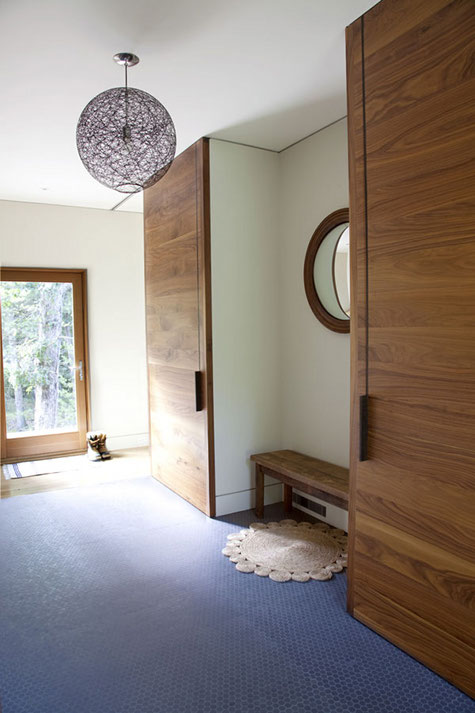

# 北欧家居风

对室内装修有着燃之不尽的热情。在左八的[**“蘑菇网”**](http://mooogu.cn/blog/bofqjs.html)看到这组北欧风情的室内设计，喜欢。家，一切关于幸福的起源，都在这儿。  
   
   
   
   

---

## 评论（6）

**[至清](http://www.yangziqing.net)** · 2010-02-28

喜欢木家具的纹理，以及简约布艺的柔软。  
只是，房期遥遥，实在是无暇关注到此领域，受教了。：）

**[光光](http://gaoguangguang.blogbus.com)** · 2010-03-01

灰色好看，最喜欢家里是深深浅浅的灰。你的家好象也是用的冷色调，我喜欢冷色调的家居布置。

**lilian** · 2010-03-01

好想找间二百方的房子过过装修瘾，现在的房子东西太多，扔又扔不掉，放又放不进，那个难受。。

**Christina** · 2010-03-01

lilian也喜欢装修啊？时常听人说装修多么累多么烦，可是我好喜欢，每天想到装修的事情就很兴奋。也许我应该改行哦：）二百平方的房子….装修起来是很过瘾，面包会有的！

光光，我是很喜欢冷色调的搭配，我家三种主色：黑色，银灰色，巧克力色。并且我还喜欢金属色和皮具质感。以后买家具还是以实用为先，这个蛮重要，弄个过于精致的家具，不适合频繁使用。

**Christina** · 2010-03-01

国内家具设计外面看起来和欧美的没有太明显的差异，可是真正使用起来才会了解，配件！配件！配件的使用感和寿命是无法与欧美高档家具相比较的。以及家具的环保处理，国内真的差好大一截。到了我们这个年纪，无论衣饰还是家具，还是挺注重品质和细节的。

**frank** · 2010-03-02

房子大了，室内设计很难，我没有看到一家室内装饰非常舒服的老中的HOUSE, 我们这里不算BASEMENT有3000-4000 sq ft. 就算请专业的设计也不太能达到自己的期望。

