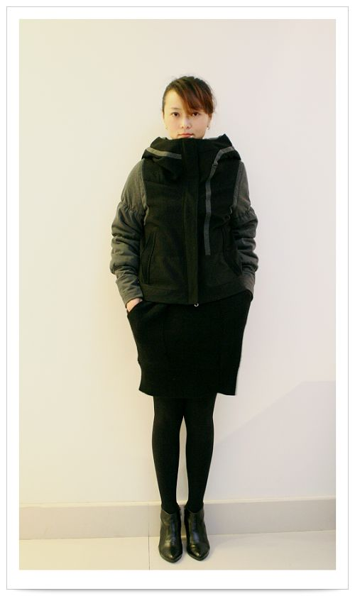
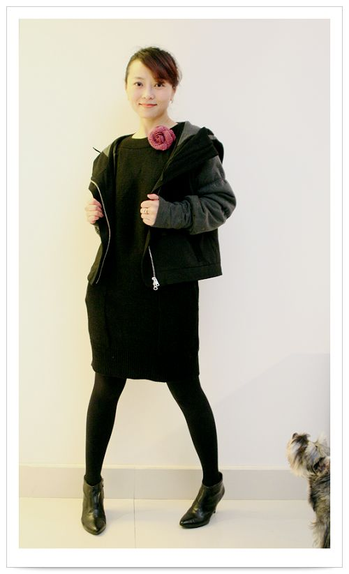
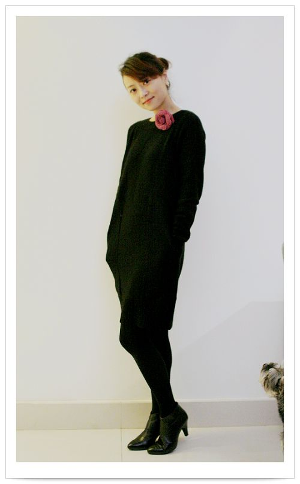

# 扯．淡

有个叫“Timothy zhang”的人，给我们整个公司每一个人发了同样的邮件，邮件内容很好“FUCKING ,STOP SEND THE EMAIL TO ME”。这段时间公司信箱每天接收大量垃圾邮件，估计又以我们公司的地址自动发给每个人信箱下的所有联系人...网络貌似传染病，分分钟，就都被感染了。其实任何东西都会被感染，比如情绪，比如审美，比如大姨妈。。。绝不危言耸听，关系越来越亲近的同性朋友，大姨妈的日子也会越来越接近。  
  
这世界太神奇了。  
我怀疑哪一天我会半身不遂？  
哪一天我会不会把自己家给烧了？！  
一觉醒来发觉从脖子到背部酸痛到僵硬...一壶奶茶小火炖了11个小时...忘得彻彻底底...  
生活TMD的都停止了，只有这恼人的天气与工作。  
  
有人丢了篇[**“叶兆言谈南京的‘尴尬’”**](http://www.dfdaily.com/node2/node31/node2433/userobject1ai211993.shtml)的文章来问貌似南京人的我的观后感。当我看到一半时，我就觉得老叶太能扯了，罗罗嗦嗦写那么多字儿，就象听一个上了年纪的老太太在唠叨，如果哪一天不让他开口说话拿笔写字，他是不是会憋疯了？我看了一半就看不下去了，所谓“尴尬”就是四不象吧，以及我认为南京就是从农村人过渡到城市人，貌似城市的城市。  
  
“三八节”半天休息，公司组织5、60个女人去汤山活动，想到那么多人同时泡在一口汤里还真是蛮壮观的。据说很爽，还吃了好菜。咱对集体活动本来兴趣就不大，休息那半天我计划着去买菜，可是怎么也走不了，工作到6点跑去吃百天酒，把自己灌得云里雾里跑去问问家遛狗...无论如何都要自勉一下：  
  
1942年，不满女性在延安遭受歧视的丁玲写下《三八节有感》，并对女性提出以下四点忠告。  
第一、不要让自己生病。只有健康同你最亲近，好好爱护它。  
第二、使自己愉快。只有愉快里面才有青春，才有享受。  
第三、用脑子。这，才不会上当，被一切甜蜜所蒙蔽，被小利所诱。  
第四、下吃苦的决心，坚持到底。  
  
劳动妇女最光荣，佩戴大红花过三八节：D  
  
  

---

## 评论（18）

**农妇某人** · 2010-03-08

好像是98年左右叶兆言写了一系列的关于南京的小品文，还是可以读读的，《怀旧情结》，如果没记错的话。很多大家写写写，到后来就会比较唠叨，事无巨细，拿来反复咀嚼，比方说张洁，《无字》拿了这么大的奖，却真是懒婆娘的裹脚布，翻来覆去就是那么点事儿……乏！

**喜刷刷** · 2010-03-08

小外套设计得很好啊,我喜欢.另,小心烛火,不是第一次了.

**[joanna](http://yanmer.cn/blog)** · 2010-03-08

第一套和最后一套，超级正！  
可怜的土豆，只被曝光了半个脑袋:-)

**lilian** · 2010-03-08

垂涎这样的裸踝靴很久了，可惜小腿不够纤细。。

**陈问** · 2010-03-08

外套好看，给我穿就是矮个宇航员（摘了头盔的，。哈哈，虽没你美，但一定很有卡通精神……

**lilian** · 2010-03-08

喜欢第二张的笑容，象一绺暖阳趋走心头的阴霾。。

**Christina** · 2010-03-08

to 第5楼，一般勇于自嘲是自信的表现，以及第一张是刚摘了头盔的乱发摸样，酷~哈哈哈哈哈~  
to 第6楼，这种鞋商场里卖的很多的，去找找吧。

**shuwua** · 2010-03-08

第二张看很久还想看。

**Christina** · 2010-03-08

俺的腿被拍成萝卜了….

**mandy** · 2010-03-09

喜欢最后一张，是我的风格~~小花不好看。

**耳雨** · 2010-03-09

太感性的东西会有距离感

**Christina** · 2010-03-10

这朵胸花我好爱，是用毛料制作的，喜欢它的质感。颜色是恰好的水红色~

以及，现在的我貌似不那么感性了，倒是麻木许多。

**Vivien** · 2010-03-10

我觉得你很美呢

**mandy** · 2010-03-11

毛料？怎么感觉就沾上亮颗粒的一种花纤制品，眼拙了~~来个近景？

**YUTU** · 2010-03-12

好美

**Anyayaya** · 2010-03-12

这个系列的感觉像九几年SAMSARA香水的广告

**putooo** · 2010-03-13

外套今天瞧见了，你用它搭配得真好~，晚上的行头也很赞~！

**okdata** · 2010-03-15

人生难以预料，一如杜普蕾没想到她的短暂，不过其绚丽斑斓依然感染我们。

Keep going! Enjoy life.

