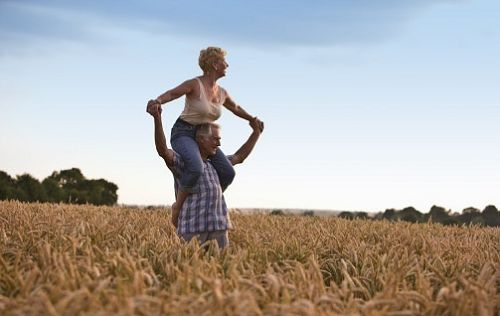

# 谁能共迟暮，对酒及芳晨。

   
  
喜欢这张照片传递的温情、幸福与青春洋溢。“爱情，如果不落实到穿衣、吃饭、数钱、睡觉这些实实在在的生活里去，是不容易天长地久的。”（BY 三毛）就三毛这句展开，内心再强大最终不过是心理疾病的一种，如果爱情没有外在形式支撑的话。这张照片貌似对男性提出了更高的要求，在某一浪漫时刻没有强健的体魄是架不住被女人这样骑的。

---

## 评论（18）

**[薇安](http://bulaoge.net/?vivianxu)** · 2010-03-09

最后一句真逗

**itsmin** · 2010-03-09

这是更高层次的追求。对俺们来说，“相逢不令尽，别后为谁空”已经很难得。

**smile** · 2010-03-09

啊？我怎么和三毛看法正好相反呢？。  
“爱情，如果落实到穿衣、吃饭、数钱、睡觉这些实实在在的生活里去，是不容易天长地久的。”  
或者  
“爱情，如果不落实到穿衣、吃饭、数钱、睡觉这些实实在在的生活里去，是容易天长地久的。”  
（By Smiel）  
呵呵~~

**[三月四月](http://11)** · 2010-03-09

这几年一直很想单身去过，但参加朋友父亲的葬礼时，在墓地里，突然想起自己死后要一个人静静地葬在这里，顿时落泪。所以人还是要一个可以去共迟暮的伴侣，一起穿衣，吃饭，数钱，睡觉

**Calend** · 2010-03-10

哦，我从没想过死后是不是一个人，我只想活得是不是快活。

**Christina** · 2010-03-10

一个人过应该蛮孤单的，找个可爱、身心健康的男人去爱，没什么不好。健康的交往方式，或着朝着健康的方向发展的恋情，对生活也是一种鼓励。毕竟相儒以沫会给你丰富美好的感受。

**[至清](http://www.yangziqing.net)** · 2010-03-10

老大爷如是说：“老太婆，来，让你看看远方的风景。”  
很温情。

**Sherry** · 2010-03-10

日久见人心，患难见真情。

**lilian** · 2010-03-10

人生衬里的底子，不过是那些最俗不可耐的事。

**[三月四月](http://11)** · 2010-03-10

老大爷如是说：“老太婆，来，让你看看远方的风景，看完了换我！”

**IN&amp;OUT** · 2010-03-10

把“最俗不可耐的事”过出快乐的滋味。

**Anyayaya** · 2010-03-11

更实实在在的生活是“洗衣、做饭、挣钱、缺觉“吧？

**朝九晚五** · 2010-03-11

相儒以沫好象不如相忘于江湖

**[少爷](http://jennyshaoye.blogbus.com/)** · 2010-03-12

还好,我家这位得经得住:)

**[huangyuling](http://huang-yuling.net/)** · 2010-03-13

就算再强壮，也经不起这样骑吧？除非很小巧玲珑，看来要练两下子才行，挺浪漫的

**[小丹佛儿](http://www.dlog.cn/dinosaur)** · 2010-03-13

我喜欢这张照片

**putooo** · 2010-03-14

等到现在没有新茶具图。。。><

**okdata** · 2010-03-17

“七七八八”的最好图解

