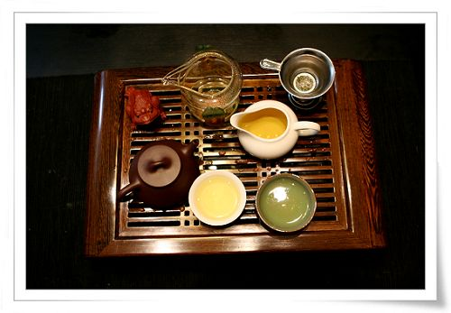
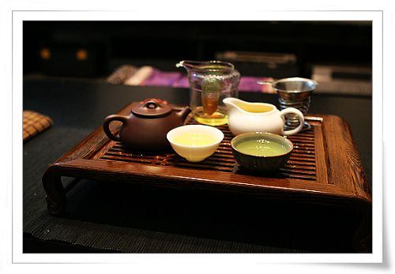
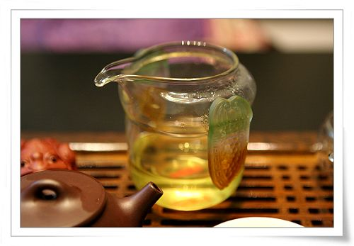
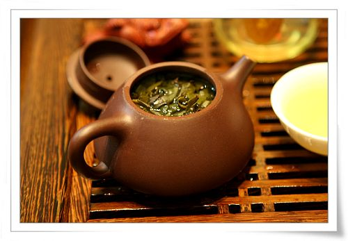
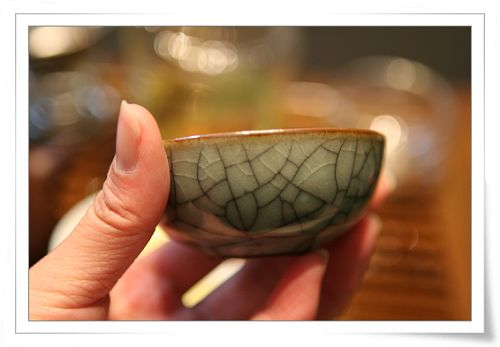
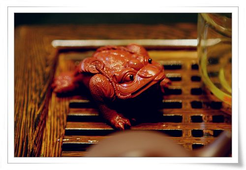
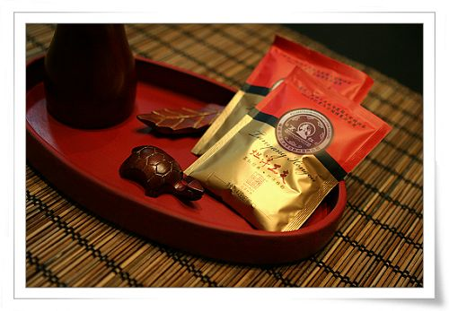
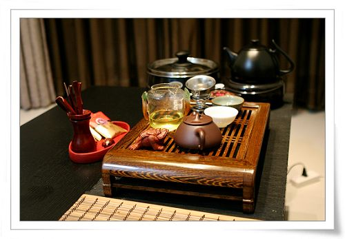

# 新茶具

周末在宜兴“葛盛陶庄”买了两把壶，一把泡红茶，一把泡绿茶用。夫子庙售卖紫砂壶无数，大多不是紫砂制作的假紫砂壶，不懂其中奥妙，还是不要轻易尝试在旅游景点买。  
  
晚上泡了扑土给的铁观音，可惜用错了壶，不急，从玩茶具开始学茶吧。喝茶不就是玩么，多大事啊，咱说干就干。话说拥有了两把新壶的当夜，我兴奋的没睡好觉，总惦记着茶几上的它们。  
  
  
钟爱的公道杯，琉璃设计的把手让人爱不释手啊，观茶色也美！公道杯在冲泡茶时，起到了一个均匀茶汤的作用，多用于品饮乌龙系列的茶时使用。  
  
没有设计的设计最深入人心，专门用来泡红茶的石瓢壶，将来能被我养成什么摸样呢？  
  
家里的存货[**“龙泉瓷”**](http://baike.baidu.com/view/50616.htm)茶具里的小茶杯终于可以把玩起来了。  
  
我的茶宠。茶宠是茶友对用紫砂、玻璃等材质做成的工艺品的昵称。茶宠造型看个人喜欢，使用的养料就是喝剩的茶水，日积月累，茶宠颜色越来越深，越来越有光泽，身价也越来越高。  
【养茶宠物的方法】  
1.茶宠并不是只有普洱茶才能养，主要是因为普洱茶的茶质养这个很容易出效果。   
2.一般选择形制适中的，不要太大，因为还要考虑让它身体的大部分起到蓄水存水的功能。  
3.养的过程中，只需用茶水浇濯，不要用白水。这样才会摸上去有温润顺滑的手感。   
4.砂质也分好坏但不是问题，日常维护中每天必须用刷子清扫，定期用茶布摩挲，使之保持一定程度的亮泽。宠物吐泡，睁眼的事就很容易看到了。   
5.茶宠物和紫砂壶一样，时间长了也会升值。   
6.可以采用人工“发酵”和自然“发酵”两种方式开养：人工发酵即把新养宠物丢在茶桶里，根据自己喜好焖泡上2-4天再拿出来，自然可以达到迅速吃水。自然发酵只能假以时日，慢慢形成效果。  
  
木质，可爱的小乌龟，在扑土店寻的，好玩。  
  
泡茶及洗杯功能兼具的电磁炉，晚上就喝上了。  

---

## 评论（15）

**shuwua** · 2010-03-14

入了石瓢壶啊。我也喜欢这个经典款。整个组合挺漂亮的。

**陈问** · 2010-03-14

壶还蛮美的哎。小茶盘扑土家买的，我认得了，嘻嘻嘻。

**putooo** · 2010-03-14

终于看到全套了，赏心悦目~  
雨天刚好留在屋中慢慢细品~

**Christina** · 2010-03-14

：P等我看书钻研一段时间，请你们一起来品~

**Sherry** · 2010-03-14

还要看书啊。。等不及咯！很期待你和我老友见面，学习一番让你快快进步，快快上手，很想早点喝上你泡的茶。。

**Christina** · 2010-03-14

拔苗助长啊？现在也可以来喝我泡的茶，只是我们的味觉还需要培养，不是么？嘿嘿~

**Sherry** · 2010-03-14

我看我朋友泡茶蛮讲究的，程序一道道的，一边泡茶一边聊茶，还和我们分享他经历的小故事，说的听的泡的喝的都津津有味的，一群老朋友在一起喝茶聊天感觉特棒！很是期待女友们的聚会。。

**shuwua** · 2010-03-15

还有一把壶捏？

**[薇安](http://bulaoge.net/?vivianxu)** · 2010-03-15

爱好越来越广了哦～昨天刚和人谈起家里还有套紫纱、原来大家都玩紫纱了啊

**Christina** · 2010-03-15

还有一把壶留着日后用的时候再上镜，嘿嘿~

**Jennifer** · 2010-03-15

等以后用了一段时间，壶会很漂亮。

**[少爷](http://jennyshaoye.blogbus.com/)** · 2010-03-15

真漂亮,可惜很难往这里带:(

**[紫砂壶](http://www.zisha168.com)** · 2010-05-29

还是在专门的店里买的放心一点，呵呵

**[血糖仪](http://www.4jgo.com)** · 2010-05-31

喜欢茶的朋友还是很多啊

**xiaojingr** · 2012-01-30

想问问这个石瓢壶多少钱，好喜欢，也想买一个.谢谢茶

