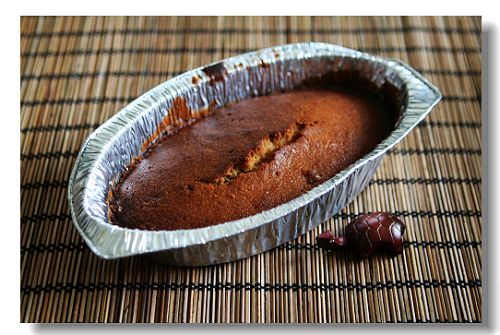
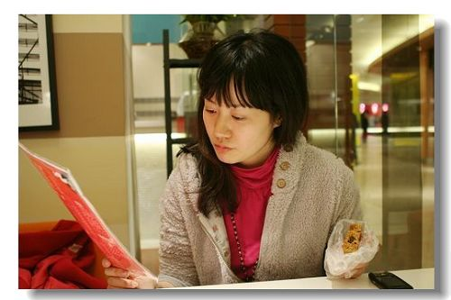

# 黑啤蛋糕

“好诱人呐，是买的吗？”  
“当然不是，是问问烘焙的‘黑啤蛋糕’啊！”  
  
虽然我僵硬着脖子和右肩膀度过了上一周，接下来的周末却让我快乐的不行。  
收了茶具，还收到了爱心蛋糕。  
这么点事儿，也可以让人快乐好多天呐。  
look，生活就是这样被上苍平衡着，不会让你一直受苦哒。  
  
  
这位举着黑啤蛋糕点着2001的菜。  

---

## 评论（5）

**陈问** · 2010-03-15

你们可以一起尝到，我开心~

**Christina** · 2010-03-15

我可舍不得还没到家就破坏了蛋糕的整体画面，她从扑土那儿揪了半块，呵呵~

**Calend** · 2010-03-15

问问好能干哇.你有这样的朋友真幸福.

**Sherry** · 2010-03-15

蛋糕很好吃哇~ 吃到心里甜滋滋滴~

**vivian** · 2010-03-15

最近迷上烘培，但一直没个像样的作品。。。

