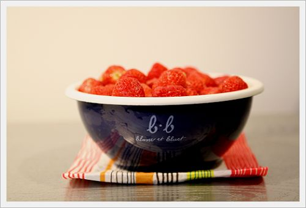

# 挂着

过了下班时间，天色依然明亮，戴上办公室里的破耳机听问问推荐的音乐组合[**“GONTITIスーパーベスト”**](http://www.xiami.com/album/339544)，越听越轻松。喜欢其中的：忘我の調べ ，桜舞う道，My Favorite Things 25th Anniversary CD version 。   
  
下午上了MSN，与外地诸女友打招呼。  
一位5月正式从英国律师行辞职，先睡足觉，再找回自己的生活，联络疏离的友情；  
一位看中海景别墅，正在与卖家熬耐心，打算145万澳元购入；  
一位周末带了20几个客人跑去出差，喝醉了，兼热心肠引来麻烦无数；  
一位自去年辞职在家享受生活多月后，准备复出贡献剩余价值；  
我，抗着僵硬的脖子和肩膀极其困难地度过半身不遂的一周。  
  
多希望她们来南京，喝我泡的茶，做饭给她们吃，然后在暖阳下走走，聊聊天，这梦想对此时的我诱惑很大。没机会见面，但在MSN上却仿佛见着，牵挂在寥寥数语中渐有实在感。被狗屁工作每日折腾，估计上了MSN也说不上几句。现在想挂着不说也好，至少能感觉到彼此。  
  
周末从IN CAFE拎回的搪瓷碗，盛着妈妈买的小草莓，阔爱。  

---

## 评论（9）

**陈问** · 2010-03-15

放松就好啊。我上课归来，也放着慢慢听。

**vivian** · 2010-03-15

听姐姐推荐的音乐，一直潜水很久的我冒个泡~

**Christina** · 2010-03-15

哦，那是问问推荐，呵呵~我们一起感谢她吧~

**喜刷刷** · 2010-03-15

你上周安排得很丰富啊,那些图片愉悦了我每个毛孔.

**frank** · 2010-03-16

有钱呀，145澳元？ 做什么工作赚怎么多？ 在美国，买个70-80万美元好像已经是极限了。

**hank** · 2010-03-16

告诉我拟啥时候有空，我去喝茶，咔咔。

**[至清](http://www.yangziqing.net)** · 2010-03-17

贫穷也好，富裕也罢，终归平淡是福，平凡是真。

**Christina** · 2010-03-17

hank回来啦?我的手机号码没变,把你国内用的号码发我手机上啊~

**okdata** · 2010-03-17

嗯，小草莓，这年头大个的都被操纵过了。  
国人尚未意识人工调节食物的问题

