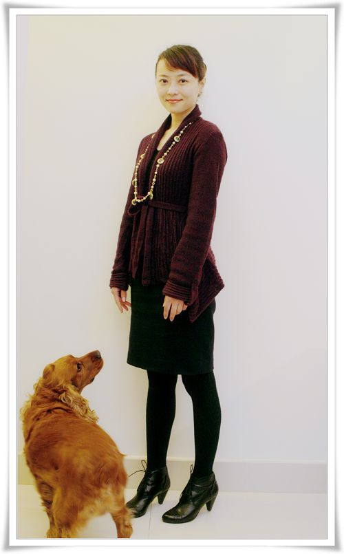
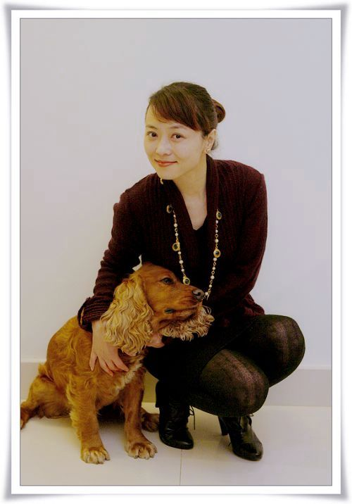

# 只有事务，没有灵魂。

“只有事务，没有灵魂”，非常适合每天工作到麻木的人。想把事情做好，不管这工作多么卑微渺小到如一粒尘埃，这“好”也得有足够的时间才能做好吧。时间。。。醒着的时间除了工作用还有极其可贵的生活也要用。孟女士说：“居家的女人柔美温婉，工作的女人坚韧独立，二者合一，才能构成一个完整的立体女人。”好吧，以此鼓励自己一把。  
  
俺穿着两件围裙，头戴浴帽炒菜，有没有只露出眼睛的围裙？吃完晚饭，再拍点照自我安慰一下。话说这个晚上在围脖上过得开怀，忽然大笑起来的我把睡在身后的土豆吓了一跳，听首弱智的歌[**“不潮不用花钱”**](http://www.popyy.cn/music/buchaobuyonghuaqian/10829/)，喜欢这段旋律与歌词的搭配：  
  
有时灵光一闪而过  
牛顿也吃苹果  
我的念头不太罗嗦  
限时间能入座  
  
请你不要到处叩叩  
潮流需要抠抠不小心就没抠抠  
用力到处扣扣花掉所有抠抠  
钱买不到绝活  
。。。。。。。。  
大姐们，晚安。  
  

---

## 评论（17）

**喜刷刷** · 2010-03-15

今天的表情有春天的感觉.

**Christina** · 2010-03-15

从围脖上下来能不过春天么~

**shuwua** · 2010-03-15

我都加大姐标签老，啊自觉啊？

**小原子** · 2010-03-16

好~我愿意当小妹哈哈哈哈…..  
那个从头套到下身的围裙我觉得创意不错，能做好的话，送给你。

**Christina** · 2010-03-16

啊。。。真的么？愿望就要实现了？不过不好意思麻烦你，我妈妈也有缝纫机的。

**frank** · 2010-03-16

国外节奏更快，更重要的是不能出错，要学会自我调节。

**vivian** · 2010-03-16

有没有只露出眼睛的围裙？ 偶也想要咧。。。

**Christina** · 2010-03-16

更重要的是不能出错，赞同。否则做了99件正确的事，即使只有1件错了，那99件对的也没那1件错的给人印象深刻。

**[光光](http://gaoguangguang.blogbus.com)** · 2010-03-16

小狗好乖啊。

**[joanna](http://yanmer.cn/blog)** · 2010-03-16

luke许久没出镜了，好喜欢它，看起来乖，聪明

**[至清](http://www.yangziqing.net)** · 2010-03-17

仔细想想，每一个人都是从“只有灵魂没有事务”阶段走到“只有事务没有灵魂”阶段。多么伟大的旅程啊。

**okdata** · 2010-03-17

“只有事务，没有灵魂”  
－敬业好于敬人  
纷繁世间，跟对人难；敬业，容易得多  
灵光一闪而过，我们都是俗人

**[小丹佛儿](http://www.dlog.cn/dinosaur)** · 2010-03-17

蛮正点的

**[少爷](http://jennyshaoye.blogbus.com/)** · 2010-03-18

看最后一张你家狗狗美美的表情..:)

**frank** · 2010-03-18

最近被华人社团委以重任，组织40多家的camping, 发现事情真多，以前都是别人做，自己跟着玩，不过，也该是奉献的时候，也能体会别人组织的难处了。

**Christina** · 2010-03-18

哦？！我们姐妹几个不介意被组织到美国camping，哈哈哈哈~

**[huangyuling](http://huang-yuling.net/)** · 2010-03-24

人漂亮，小狗也漂亮

