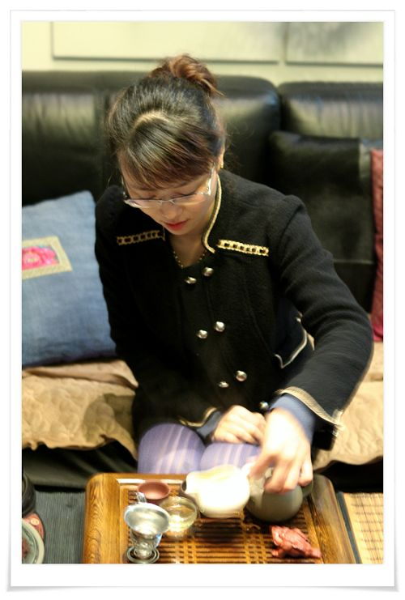

# 幻想型“晨型人”

信誓旦旦要在十点半前睡觉，大概只有两三个晚上如此，其余时候基本还是午夜才睡。前些天看到一篇有关“晨型人”的文章，早上六七点起床只能算起得早，5点起床，才算晨型人。这些人大约晚上9点就睡觉了，对于我这样有时9点才下班的人来讲极不现实。加班俨然成为一种常态，还有午夜12点才下班的主儿，据说遇到院子里放养的两只大狼狗，它们白天睡觉，午夜之后散放在大院里看门。那时候下班的人得打电话到门卫招呼一声，或者直接叫出租到院子里来接。这位遇到大狼狗的同事，既没叫出租也没开车，更没打招呼，路遇大狼狗只好翻墙逃窜。想象这情形既有趣又无奈。  
  
回到晨型人话题上，他们在特定网站上交流心得，起床后上网签到，相互监督鼓励。这种行为的连贯性必须建立在有效并合理安排时间上，原先3小时完成的事情，如何缩短到1小时内完成。当时间管理发挥到极致，渐渐改变做事拖沓，生活质量下降，没时间吃早餐等状况。并且让一整天神清气爽。  
  
作为一个晨型人存在会是怎样的感受？早晨5点起床，8点40离开家，想象这之间的3个多小时可以做许多事儿。跑步锻炼，买菜做早饭，遛狗，洗澡换衣服化妆，还能把午饭需要的菜清理好。。。如此诱惑力弓虽大。。。但，仍然无法跨越客观状况，除非每天8小时后可以毫无牵挂的下班。有一天脖子和肩膀让人忍无可忍了，下班直奔手佳，按摩后的第二天感觉自己瘫痪了似的，下午才爬起来去上班。“晨型人”以及目前工作造成的身体状况提醒我，要挤出时间来锻炼身体，没有健康什么都会离我而去。  
  
下班后在江南公社吃晚饭，服务员们临近下班卖力又激动的工作着，碟子碗乒乒乓乓得响，真跟坐在大食堂里用餐似的。回家泡壶茶喝，晚上泡的金叶子茶，可能属于白茶吧？（欢迎纠错）用上另一只紫砂壶。说实话，喝茶也得酝酿心境，慌慌张张喝茶，怠慢了茶叶与茶具哦。  
  
这把壶的原理来自女性乳房，浑圆的造型很适合把握在手，壶的大小用一只手差不多就可以包住的A罩杯。倒出的水柱没有时粗时细，很流畅，我对此研究尚浅，学习积累后方能详解。  
  
听首贾鹏芳的[**“睡莲”**](http://ftp.nbren.net/users/aban/chuang/music/ok/睡莲.mp3)吧，在这寂静的夜。  
  
  
  
  
  
  
  
放一张《联生活周刊》2010年12期封面故事：功夫茶——武夷山、安溪寻找茶香之源“功夫茶”的图，照片中茶人的面孔、表情、发型、肤色与茶、茶具、茶文化融为一体，很和谐。既薄又透的白色茶杯煞是好看。  

---

## 评论（25）

**陈问** · 2010-03-17

这个壶好看，我喜欢。浑圆 憨态

**Christina** · 2010-03-17

给你弄一把，何如？对了，我看到有把紫砂壶造型和你在MUJI购回的白色陶瓷壶造型差不多，应属于日式的，也不错。适合泡绿茶。

**mavis** · 2010-03-18

Luke好乖哦，一副依恋你的模样~  
真羡慕你可以晚上喝茶，如果是我会彻夜不眠的：）

**vivian** · 2010-03-18

姐姐的壶哪里败的，我一直想败一把，在夫子庙那里看一圈都没看中合心意的。。。

**Christina** · 2010-03-18

vivian看“葛盛陶庄”那篇日志吧，主页最下面。

我家Luke也挺嗲的，最近我觉得它越来越懂事了。

**[不羁之舟](http://blog.sina.com.cn/yangzhoumeiren)** · 2010-03-18

是啊 LAKE看上去好依恋你的样子~

春天又是喝茶天啊`也是穿衣天……

**Anyayaya** · 2010-03-18

回宁去你家品茶？

**陈问** · 2010-03-18

过我眼，即我有。我已经占有啦，未必一定要抱在怀中的。哈哈。

**Sherry** · 2010-03-18

问，你喜欢的这个叫西施壶，见面告诉你为啥叫这个名字，嘿嘿

**Xiaona W.** · 2010-03-18

Luke先生真乖巧，超可爱。

**[光光](http://gaoguangguang.blogbus.com)** · 2010-03-18

我要是喝了这个就睡不着觉了，只能早晨喝。茶是好东西啊。

**Xiaona W.** · 2010-03-18

留言被编辑，失去了原创的原汁原味，很遗憾。

**caicai** · 2010-03-18

现在我近九点半过上床，十点半入睡。早晨还只是七点起来冲锋。不过中午就不睡了，到公司对面做瑜伽一个小时。反倒也很好。心里宁静坚强，觉得生活忙碌但不烦躁，心里总充满希望。  
每天看你的博，真好。。。

**Christina** · 2010-03-18

Xiaona W.，不过是更正你对于LUKE性别的描述，留言表达的意思仍然保留着，不是吗？

**Christina** · 2010-03-18

caicai，忽然想起你那坚强又瘦弱的小肩膀，再去HK提前通知你，我们再见：D

**[至清](http://yangziqing.net)** · 2010-03-18

西施壶原名“文旦壶”。据吴梅鼎《阳羡茗壶赋》说“文旦壶”中的格调高雅者，原先名叫“西施乳”，言壶之形若美女西施之丰乳。事实上此壶式也确实象极美少女丰满的乳房，壶纽像乳头，壶流短而略粗，壶自近底处内收，一捺 底。后来也许觉得“西施乳”之名不雅，便以壶把为倒耳之形为名，改称“倒把西施壶”。

**frank** · 2010-03-18

也够下流的了，不过，应该说壶盖象乳房。

**itsmin** · 2010-03-19

喝茶就是要慢。。。下来，估计适合你的。这把壶跟俺们喜欢的一把有点像，只不过俺们的那把更。。。翘点。有空发给你瞅瞅。  
临近下班卖力又激动的工作着？娃哈哈，真有你的。

**[薇安](http://bulaoge.net/?vivianxu)** · 2010-03-19

我们办公室就有一个晨型人，对号入座的非常精准

**[moko](http://mokochen.blogbus.com)** · 2010-03-19

好漂亮的茶具啊，饮茶可不就得花上时间一点点品味，真好。

**lilian** · 2010-03-19

做不了晨型人，除非工作极度轻松，或者时间能由自己掌控，否则早出晚归辛苦了一天，回家就睡觉，这日子跟机械人有啥两样。平衡也是一种健康。

**Xiaona W.** · 2010-03-19

对不起，是我搞错了，一直以为Luke是个靓妹，原来是个帅哥呀，谢谢您的更正。

**caicai** · 2010-03-19

总记得你的提醒要对我自己好。谢谢。  
有时真的忘了自己。  
你不来HK，我会去NJ的。呵呵

**Cindy** · 2010-03-20

亲爱的茶，很喜欢你这件衣服，有在之前的自拍上介绍过吗？给个链接，谢啦：）

**Christina** · 2010-03-20

大家是不是认为我的衣服都在淘宝买的？说实话自去年四月开始用淘宝，的确买过一些，大多让人失望，偶有一些还可以。对失望的衣服我不太会珍惜。在淘宝购的衣服仅占衣橱5％而已。这件在商店买的：）你可以找一下ANNASU的品牌。＊：）我不喜欢形似的用品，我要质量真正好的。

