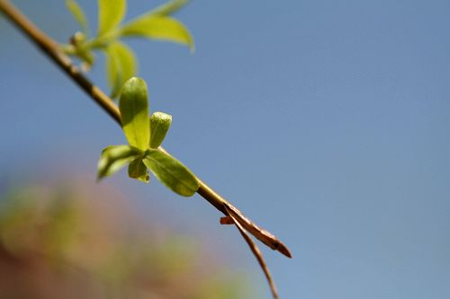

# 春．萌

   
  
路上看到两个慢悠悠骑着自行车的男孩子，边骑边轻声谈笑，比女孩子还柔媚的画面；  
同样在路上，躺着两辆自行车，再望过去，旁边的草坪上一顺躺着两个男孩儿在聊天。  
春天果真来了：）

---

## 评论（8）

**vivian** · 2010-03-19

沙发~

**[至清](http://yangziqing.net)** · 2010-03-19

这个春天，中国西南地区大旱。  
让我们共同约定，珍惜每一滴水。

**lusfe** · 2010-03-20

在贵阳ING，傍晚一阵磅礴大雨，好爽好爽

**[少爷](http://jennyshaoye.blogbus.com/)** · 2010-03-21

拍照片,还得向你学习:)

**[不羁之舟](http://blog.sina.com.cn/yangzhoumeiren)** · 2010-03-22

是柳枝吗？  
这个春天 比较犀利。

**蒜泥** · 2010-03-22

周末的南京天气太糟糕了，出门一趟，灰头土脸。

**[huangyuling](http://huang-yuling.net/)** · 2010-03-24

还没有听到春雷，是不是已经过了？

**老听众** · 2010-03-24

春天是男的？

