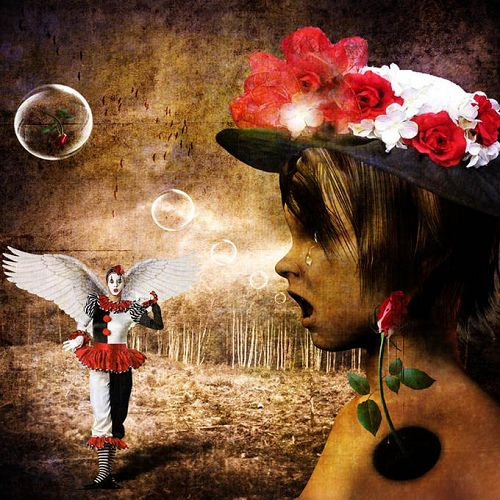

# 鱼龙混杂

北京出差回来的朋友说，北京地铁鱼龙混杂，一进去就听见有人举着大把报纸呐喊：“王菲自杀了，王菲自杀了”。  
  
此声刚落彼声又起：“刘德华学张国荣跳楼啦，跳楼啦。。。”  
  
没走几步，嗡嗡嗡嗡跟念经似的声音贴近耳边：“发票，发票，发票要吗。。。发票，发票，发票要吗。。。”  
  
此女绘声绘色兼表演力丰富，我差点没从椅子上翻过去。  
oh my lady gaga，生活太TMD多姿多彩了。  
  

---

## 评论（10）

**itsmin** · 2010-03-23

London bridge is falling down falling down falling down…

**果三** · 2010-03-23

哈，可以想象得到~

**lilian** · 2010-03-23

上海也一样，一进地铁站耳边就嗡嗡响，恨不能给他们每人嘴上贴一张橡皮膏。

**Anyayaya** · 2010-03-23

03年走在北京的街上，路边一位哥哥压低了嗓门问：“窃听器。。。窃听器要么？“难道我或老公或both有偷窥癖的神采？还是我们两个中的一个看上去有外遇另一个看上去是穷追猛打型的？

**karen** · 2010-03-23

哈哈，这是早几年的事吧，现在天天在北京地铁上忙着看别人吵架，类似：“你神经病阿你”“你有药阿你”之类的。。实在太挤乐

**frank** · 2010-03-23

这多有生活气息，在美国只有周末才有机会

**[huangyuling](http://huang-yuling.net/)** · 2010-03-24

广州虽然是混了点，但好像没那么杂

**Xiaona W.** · 2010-03-24

没有这种景色和气氛，每天挤地铁该多闷得慌呀！进了公司也省得看报纸了，那些头版头条对你来说早不是新闻了。

**[少爷](http://jennyshaoye.blogbus.com/)** · 2010-03-24

说得我不敢回去了….

**大姜炖去** · 2010-03-24

刘德华这条好像三四年前也在北京火车站听到过，当时以为是真的……

