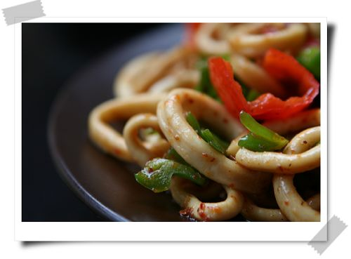
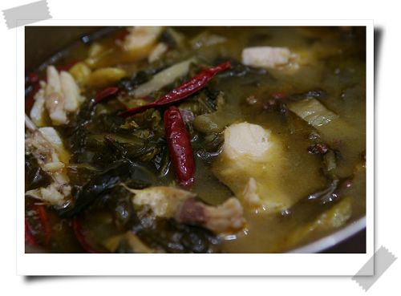
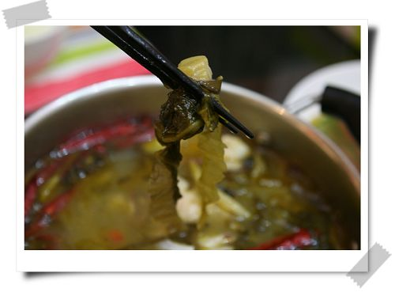

# 只剩味觉还苏醒着。

由衷敬佩在此岗位上工作过的前辈，不知道他们怎么熬过去的。加班的心情各人有各样，有人加班为自己打基础，有人加班只是被剥削。在苦大仇深的加班中，俺们只剩下味觉还苏醒着。  
  
昨天就化冻的鱿鱼圈，蔓延了满屋子腥味儿，本来昨晚就应该烹饪的食物，和我一起挨到今天中午到达终极。冰冻的海鲜在爆炒过程中生出许多水，多么想念新鲜的它们。在海口买了房子的姨娘才回到南京，据说在海口买海鲜直接到渔民那儿采购，既新鲜又便宜。我最关心的是有没有人从异地带着宠物狗去海边度假？真有其事，它们象行李一样随机托运，每斤20元，自备笼子。这消息太美好了！  
  
与其到外面吃地沟油做的上了色素的酸菜鱼，不如自己做卫生。36元一条花鲢，鱼头用料腌一夜明天午饭蒸了吃，鱼肉切成片下到李记酸菜鱼料包里，味道不是一般的鲜美，讲究点的话撒点芝麻粒更好。  
  

---

## 评论（5）

**陈问** · 2010-03-24

我也来试试你的这个。酸菜鱼包哪里买？

**Christina** · 2010-03-24

买菜的时候顺便在菜场买的，建议到超市买料包，放心点。不过鱼是现买的。。。。

**大湖** · 2010-03-24

Looking good! I like to cook, but I do not like the cleaning parts of the work afterwards. Therefore, I do not cook as much a I like to. I will show some of my barbecued dishs during the summer.

**Christina** · 2010-03-24

恩，可以理解。不过吃完饭不清理餐桌餐具，我就感觉整件事情还未结束，一定要打扫干净了才能安心离开厨房。

**Theresa** · 2010-03-24

地沟油，没错，吓得俺现在也不盼着回家大吃大喝了。

