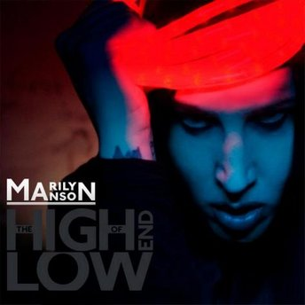

# Leave a Scar

打开门，听到一个声音唱着“Whatever doesn't kill you is gonna leave a scar ....”  
“这个嗓子里有痰的家伙是谁？”  
“Marilyn Manson。”  
“哦，我喜欢。”  
“邪恶啊。。。”  
  
去年这位黑暗摇滚音乐人与Lady Gaga合作一首“LoveGame”，堪称09年乐坛最“雷”的音乐组合。我搜了下[**他的雷人造型**](http://image.baidu.com/i?tn=baiduimage&ct=201326592&cl=2&lm=-1&fr=&pv=&ic=0&z=0&se=1&word=Marilyn+Manson&s=0) ，有几个封面似曾相识，为了晚上顺利入眠，还是看看小图得了。  
  
######以下介绍来自百度#####   
  
玛莉莲·曼森其实是一个乐团名。乐队原名Marilyn Manson and the Spooky Kids，Marilyn Manson是主音的艺名，而Spooky Kids则是指团中其他队员，在一九九二年，名字缩短至Marilyn Manson。乐队中每人的名称均以出名杀人犯为姓，和美艳艺人为名。如主音的名称就是取材自性感女神Marilyn Monroe（玛丽莲·梦露）以及美国杀人魔王Charles Manson（查尔斯·曼森）。他们取名的原因是喜欢“美丽”与“恐怖”的矛盾和对比。  
  
既然这么的离经叛道，就可以知道他们的音乐不会是太主流的流行音乐。他们的主要演奏重金属音乐，每张专辑都改变音乐风格，由工业摇滚至华丽摇滚都有。  
  
看惯了玛丽莲－曼森一贯的白面魔鬼造型，其实很少人知道这位本名布莱恩华纳的真实生活是如何。在他们组团之前，布莱恩是滚石杂志的名乐评，曾经写过像呛红辣椒等许多脍炙人口的作品，之后他决定自己踏入幕前，不过一般乐迷对他过于前卫的音乐理念似乎无法接受，甚至让玛丽莲－曼森渐渐的成为邪恶的代名词，不过他也否认了外传他是撒旦教的忠实信徒，他说只是把这个宗教当成是一种艺术，他并不比一般人更邪恶，别人怎么对他，他就会以相同的方式回报。  
  
或许他能一直坚持他的特异独行，在这个无奇不有的现在，这位搞怪始祖似乎是终于找到了认同，美国累积高达六百万张的销售天量，这次他的再出发似乎是要像他的专辑名称一般惊世骇俗，不得不佩服玛丽莲－曼森的勇气，因为他们以灵魂跟魔鬼交换了这场华美夺目的惊悚盛宴!  
  
   
  
[**《leave a scar》**](http://99.cn/music/330517/)试听：  
  
It's not like I made myself a list   
Of new anddifferent ways to murder your heart   
I'm just a painting that's still wet   
If you touch me, I'll be smeared   
You'll be stained   
Stained for the rest of your life   
So turn around, walk away   
Before you confuse the way we abuse each other   
You're not afraid of getting hurt   
And I'm not afraid of how much I hurt you   
  
I'm well aware I'm a danger to myself   
Are you aware I'm a danger to others?   
There's a crack in my soul   
You thought it was a smile   
  
Whatever doesn't kill you…   
Is gonna leave a scar   
Whatever doesn't kill you…   
Is gonna leave a scar   
  
I'm more like a silver bullet   
And I’m like a gun, not easy to hold   
I'm moving fast and if I stay inside your heart   
I'm certain that this will be   
The end of your life   
So turn around, walk away   
Before you confuse the way we abuse each other   
You're not afraid of getting hurt   
And I'm not afraid of how much I hurt you   
  
I'm well aware I'm a danger to myself   
Are you aware I'm a danger to others?   
There's a crack in my soul   
You thought it was a smile   
  
Whatever doesn't kill you…   
Is gonna leave a scar   
Whatever doesn't kill you…   
Is gonna leave a scar   
Leave a scar   
Leave a scar   
Whatever doesn't kill you will leave a scar   
  
She warned you that she may fuck me   
But chances are I'm going to fuck you over   
  
Whatever doesn't kill you…   
Is gonna leave a scar   
Whatever doesn't kill you…   
Is gonna leave a scar   
Leave a scar   
Leave a scar   
  
Whatever doesn't kill you…   
Is gonna leave a scar

---

## 评论（9）

**大湖** · 2010-03-29

I’m not capable of finding any visual and music pleasure in his creation. I’m surprised that you are. Don’t let him leave a scar on you!

**少爷** · 2010-03-30

He is not my cup of tea either:(

**Xiaona W.** · 2010-03-30

The same here, I hate to say it that I also do not appreciate his songs.

**[光光](http://gaoguangguang.blogbus.com)** · 2010-03-31

八卦一下吧。他的女朋友特别漂亮，又年轻又有才，是歌手和演员，比他小20岁，我忘记名字了，那个女孩是在Across Universe里面的女主角，里面的歌都是她自己唱的，又是Green Day的音乐录影带September里那个女主角，真的超美。他们分分合合了好些年，今年年初宣布订婚。他如果不化奇怪的妆，他的脸也就是个普通人。

**[huangyuling](http://huang-yuling.net/)** · 2010-03-31

有个性，感觉不错

**年糕** · 2010-03-31

你好，好像在你以前的某篇博客上有一个国外结婚拍照的网站，很漂亮。可是怎么也找不到那边文章了，能给个链接吗？

**Christina** · 2010-04-02

http://www.sibblog.com/

**年糕** · 2010-04-02

太谢谢了!!!!

**Christina** · 2010-04-02

光光，这个八卦我喜欢，呵呵~

