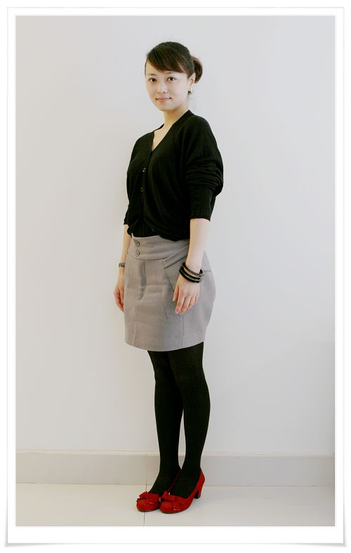
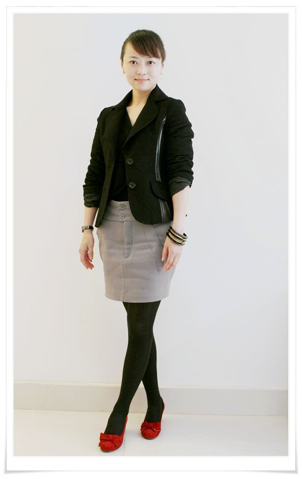

# Dress Blog

MUSIC FASHION  
作者：佳凝  
  
40年来，伦敦切尔西国王大道430号被朋克教母Vivenne Westwood和她的老公Malcolm McLare前后折腾改造了不下5次。1971年，两个人在那儿开了一家服装店，取店名“尽情摇滚”（Let It Rock），专售二手衣物和50年代的摇滚唱片，以及Vivenne Westwood亲手设计的Teddy Boy风格的服饰。一年以后，改出售60年代摇滚风格服饰和唱片，并更换店名为“时光飞逝，可别死得太早”（Too Fast To Live,Too Young To Die）。过了两年，他俩又改变主意了，店铺被重新装饰一番，诺大的艳粉色SEX字母置于门口，这家店正式更名为SEX Boutique，售卖橡胶SM装以及印有色情文字和图案的体恤。  
  
SEX Boutique店里的东西卖得很火，甚至被当时的英国音乐家Adam Ant评价为“史上最牛店铺之一。”McLare决定趁热打铁，实现他一直以来的梦想----组建一只乐队以传播他们两口子离经叛道的朋克精神。当时店里的兼职伙计Steve Jones和Glen Matlock已经伙同Paul Cook组了个不知名的小乐队，听闻老板想经营和打理他们时，哥几个很兴奋，但当时他们还没有主唱，后来一位绿头发小伙子John Lydon来试了几次音，乐队成员就这么到位了。McLaren用店里出售的时装上曾有过的一个淫荡标语Sex Pistols（性手枪）为乐队命名。自此之后，史上最具影响力（之一）的朋克乐队诞生了，而Vivenne Westwood服装设计作品中的反叛与颠覆精神影响着不止一代时装设计师。  
  
这大概可算作音乐与时尚密不可分的铁证了。  
  
对于音乐与时尚的关系，我有一些执拗的看法：一个人在音乐方面的趣味与他的着装品味直接呈正比。这完全有迹可循。我难以想象Vivenne Westwood、Ann Demeulemeester、Rick Owens、Hedi Slimane，以及刚刚离我们而去的Alexander Mcqueen如果失去对音乐的热爱和鉴赏能力，他们的作品是否还有灵魂。我也怀疑对于音乐或其他艺术形态只有浅层认知的“时尚达人”们，是否真的看得懂某些服装设计。  
  
据我了解，在我的祖国，认为时尚就是穿衣打扮的人多如牛毛，而把会臭美的人捧为时尚专家的人就更多了，这些人多到会让你的牙齿疼上好几年。  
  
\*\*\*\*\*\*\*\*\*\*\*\*\*\*\*\*\*\*\*\*\*\* 我的观点 \*\*\*\*\*\*\*\*\*\*\*\*\*\*\*\*\*\*\*\*\*\*\*\*\*  
这篇有意思的文章阐述了音乐与时尚的关系，觉得她写得不错，也认同音乐对时尚产生的影响力。但个人认为除了音乐之外，每个人的经历、审美趋向、工作环境以及生活状态，甚至一段时期的情绪都会产生影响。对于设计师和生意人还要考虑面对怎样的消费群。时尚未必是潮流与奢侈品的专有名词，时尚必定以日常生活为基础，建立理解、设计、消费、流传与观赏。  
  
不要把时尚看得过于神圣，不过是消费品，否则它就不叫时尚，而可以改称为“艺术”。Vivenne Westwood和她老公Malcolm McLare的设计自成风格，被许多设计师追随，它的成功说明市场销售成功，大家都想分得一碗粥。得不到市场承认的时尚，也可以被当作艺术品观赏。无论喝茶还是穿衣，有条件就玩玩，没条件咱就看看，没人当回事儿的东西，自己却搞得高不可攀，幽默。我不能理解的是跟风买GUUCI买LV买TOD'S。。。甚至勒紧裤腰带也要买，你把自己放得比消费品还低，所以你膜拜它，渴望到迷失自我。每个人都有追求美的权利，只是别把这个太当回事儿。  
  
听一首Sex Pistols演唱的[**“pretty vacant ”**](http://cfs.tistory.com/attach/7443/1229191169.mp3)，听着这首歌你能想象出Vivenne Westwood和她老公Malcolm McLare的时尚设计形象吗？  
  
  

---

## 评论（10）

**vina** · 2010-04-02

尤其赞同很多人把臭美的人就追捧成所谓的时尚专家，以及单纯的把穿衣打扮当做时尚的全部。但是在中国这样的情况有一部分原因在于，我和LG也一直的认为，音乐和话剧等艺术形式的欣赏和感受的成本真高，成了一种奢侈，一张演出会的票常常要用过一个普通人的十分之一工资或者更多，甚至是买一张正版唱片、一张电影票……这个也许需要过程，经济快速发展但是我们的素质并不能跟上它的脚步，急功近利的心态让大多数人成了伪时尚主义者。

**mavis** · 2010-04-02

红色的鞋子真的很漂亮啊  
美女你很会搭配，赞！

**[光光](http://gaoguangguang.blogbus.com)** · 2010-04-03

我是红鞋控。这双红好正，好看。西班牙女的最喜欢穿红鞋子了。

**Christina** · 2010-04-03

击掌～我陆续拥有过好几双红鞋：D这双磨毛皮鞋穿得少，担心脏了不好看，哈，小农吧～

**[山树](http://shanshu.blogbus.com)** · 2010-04-04

你的红鞋子确实不少,已经出镜过几双了.  
自从怀孕到现在,我的腿猛粗,都没法见人了.不知道产后能恢复成什么样.  
哭~~

**lu** · 2010-04-04

在网上看见你的博客，觉得你的生活态度真好

**Christina** · 2010-04-04

你也可以的：）

**lu** · 2010-04-04

我每天总是很忙，连弄博客的时间都没有。你博客弄的挺好···很喜欢，我会常来

**joice** · 2010-04-05

你身材保持得很好，是怎么Keep的啊？嘻嘻~~

**Christina** · 2010-04-05

遗传吧~没有刻意保持过，吃东西也随意。

