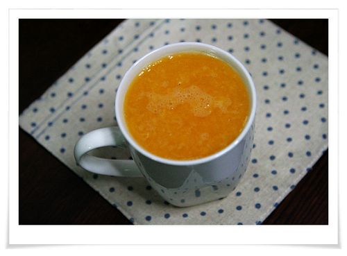

# 挤橙汁

  
  
一箱红橙从春节放到现在，大多时候想不起来吃，想起来了又懒得吃。它们变得越来越少，一个一个被扔掉。晚饭后我拿了几个幸存的橙子分别切成两半，用挤汁的方式制作橙汁，100%纯粹的鲜橙汁哦，没有添加剂，没有水，没有防腐剂，因为一杯鲜橙汁，生活马上有了小小幸福感。 不得不说喝橙汁比吃橙子更愉悦，哈。喝完它，可以舒舒服服的看82界奥斯卡颁奖典礼，加上红地毯，实实在在三个小时，反正从这个晚上开始连着休息三天，我的小心脏激动啊。

---

## 评论（6）

**陈问** · 2010-04-02

哎，这个橙色配水玉垫子真好啊。  
你要开始放假了，怪不得今天很宽心的样子嘛。

**Christina** · 2010-04-03

所以提前邀你一块儿躺草地，那儿人和狗都少，看着就想躺上去，离我家不远，也比从你家去中山陵近，车也好开哇～我拍拍照，你作画，狗狗们可以撒了欢的跑～

**[prettymom](http://prettymom.org)** · 2010-04-03

i love the taste of freshly squeezed orange juice too!

**陈问** · 2010-04-03

你说的是吉山么？我去年在去牛首的路上发现一片草地。http://mosquito511.blogbus.com/logs/36608107.html

**Christina** · 2010-04-04

当然不是，生活区附近的草地，那儿快成高档住宅区了，房价tnnd一个月一个样，涨得俺们心惊肉跳。

**少爷** · 2010-04-04

我也觉得这是种吃水果的好方法。要我一个个吃烦死了，但把它们一起搅了喝，就很可以接受了：）

