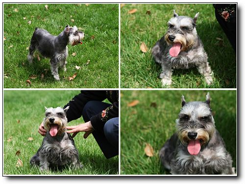
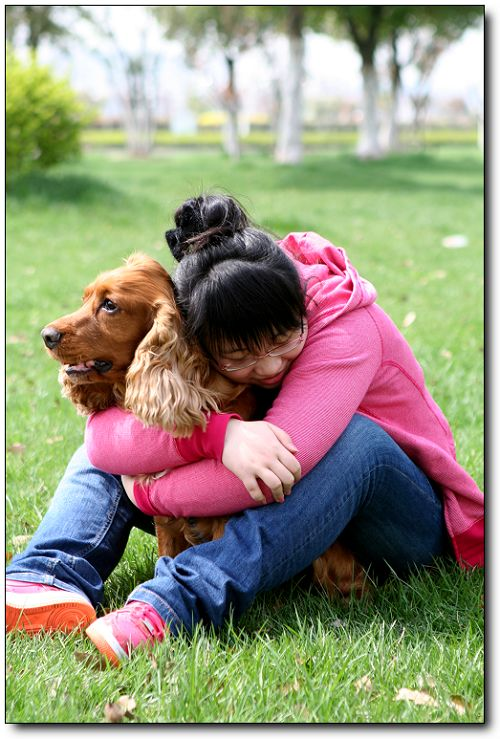
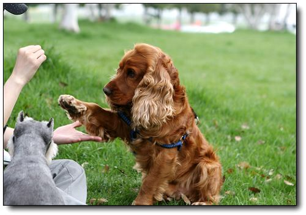
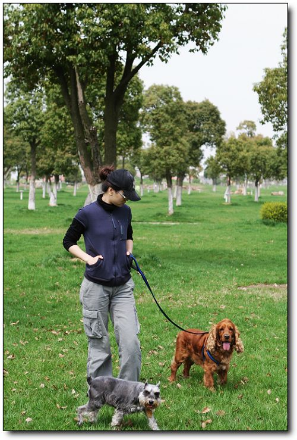
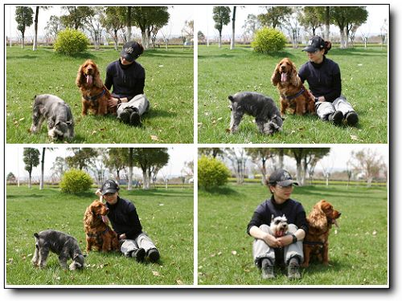
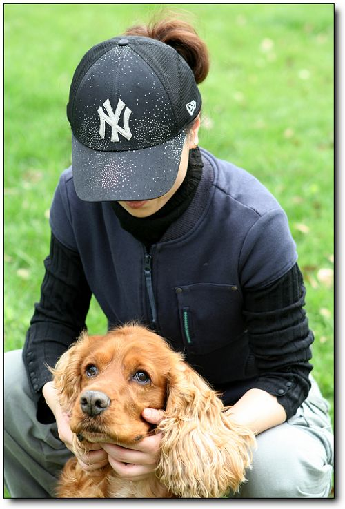
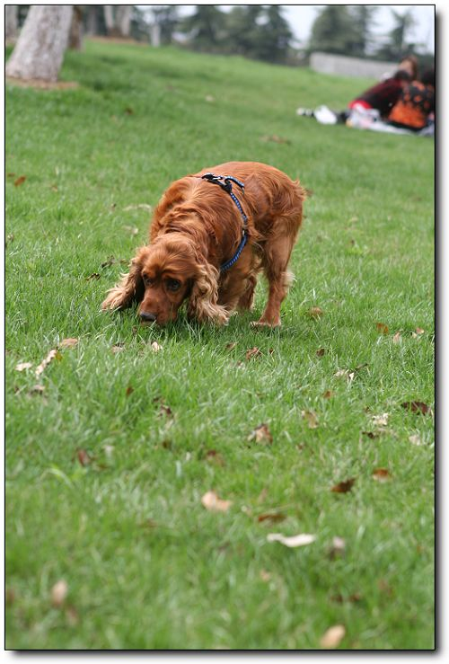

# 无限美好。

能在南京找到一片绿油油的肥草地，且人少狗少，真是幸运事之一。这片一望无际的草地因为少有人践踏而显得格外茁壮，更幸运的是它就在离我家10分钟不到的车程距离。某天当我路过它发现它，我便满心地想要扑倒在它的怀里。  
  
当我穿梭于钢精水泥的楼宇间，呼吸着僵硬的空气，嘈杂声不绝于耳，我会感到不适与小小的焦虑。对大自然的渴望，正如我对这样人迹稀少又广茂的大草地一样的心情。为此，我愿意住到更远的地方，只要有山有水有草地，人，迹，稀，少。我不会大声告诉别人这片草地在哪儿，因为我好担心人类会象蝗虫一样吞噬他们所到之处。  
  
大概连狗狗们都惊喜万分，跳下车在草地上狂奔一阵儿才停下来大口喘气儿。  
  
  
外甥女特别喜欢Luke。  
  
  
憨厚的Luke练习了三天（每个晚上练习10分钟）握手，第三天晚上只要我手拿零食，它就很自觉的开始握手。第四天不用拿零食它也会听指令来握手了。  
  
  
前一天晚上睡的很晚，但是，我们还是要来这片草地上消磨几个小时。有没有发现土豆的下巴上沾着一片落叶，它已经很圣诞老人了，现在更是。如果它的毛再长一些，四肢肯定会沾上更多的叶子和树枝。所以我家门口常常集中出现这些，都是给土豆擦脚的时候从它身上摘下的。  
  
  
我们三个儿都很开心哈~  
  
  
这只狗头会突然神情严肃，若有所思。  
  
  
哦~瞧它的眼神~Luke但凡散步，鼻子贴着地面嗅，有时把鼻子塞进草丛深处，狠狠地嗅，然后抬起头打几个大喷嚏，难道它那沧桑的鼻头是这样塑造出来的？其实我蛮担心它会把虫子吸进鼻孔里，不知道别的可卡是否也这样？  

---

## 评论（18）

**陈问** · 2010-04-04

今天这身穿的很帅气哎。草地貌似很大，不知道这些树木能否长到茂盛。 今天我2人小爬了清凉山，长期不锻炼，走了一下午，还蛮累的哟。

**Christina** · 2010-04-04

树荫肯定有啦，不用担心。明天我们去爬山，我准备试试新机器，呵呵~

**lu** · 2010-04-04

拍的照片真好···

**陈问** · 2010-04-04

说实话，看到你一身休闲，脱离工作的状态，还蛮让人高兴的。

**Christina** · 2010-04-04

说明你把我的快乐当作你的快乐了，你心里有我，嘿嘿~这杆爬的快吧？咱们也网上调调情。。。让shuwua吃吃醋，哈哈哈哈哈~

**shuwua** · 2010-04-04

哼哼，我在看着呢。

**小原子** · 2010-04-04

一幅幸福的春天画面………草地离家这么近，以后有地方度安静周末了。下次我们就在这集中吧？不去遥远的中山陵老。急性子的我还是喜欢开宽阔的大道。嘿嘿~~

**Anyayaya** · 2010-04-05

下周回宁短暂停留

**mavis** · 2010-04-05

茶美女，我证明，可卡确实喜欢使劲呼吸，然后或者打喷嚏，或者独吞好空气，不知道这是什么意思～

**Judy** · 2010-04-05

Hi, 很喜欢你的帽子，请问在哪儿买的？最近很想买一顶帽子，可是都没见到喜欢的，却在这儿见到了。

**Christina** · 2010-04-05

帽子在塞班买的。

**[光光](http://gaoguangguang.blogbus.com)** · 2010-04-06

好喜欢Luke啊。

**少爷** · 2010-04-06

是的，我也可以证明它们会这样对着草地猛吸的。我家两个一样样。

**zyz** · 2010-04-06

这就是幸福：）

**Xiaona W.** · 2010-04-06

我们人是靠眼观察世界，狗狗们是靠鼻嗅察世界，很羡慕你们这幅沐浴春风和谐无限的景色。

**Evans** · 2010-04-06

好奇那个给你们仨拍照的人

**Christina** · 2010-04-07

好奇？准备做专访？她还未成年呢，您兴趣范围的确“广”了些。

**Evans** · 2010-04-08

额，罪恶啊

