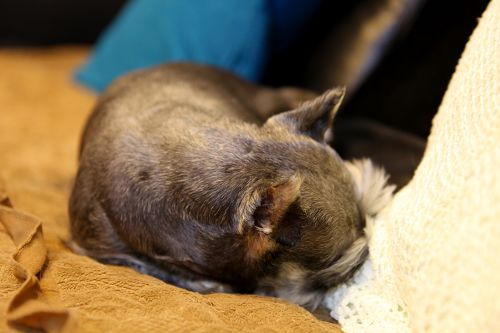
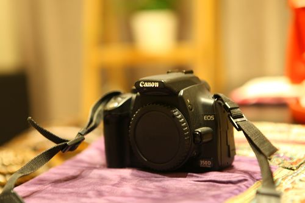
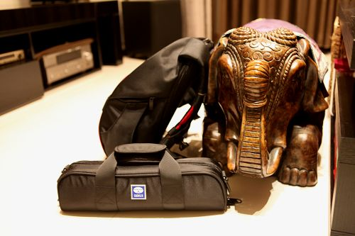

# 有氧运动

四个人两条狗去爬山，春光无限好的下午。  
  
我们爬的这座山比去年5月爬的牛首山好许多，山路修的很好，一路走上去，绿意昂然，各色花卉开得肆无忌惮。山上一片一片的茶园，问了采茶女才知道是龙井茶的茶树。最不可思议的是园主在山上盖的私家庭院，从外面望进去有几处四周都是透明玻璃的房子，坐在家中饮茶，便可将外面的景色尽收眼底，爽呆了。当我们上到山顶，望见山下成片的水田在阳光照射下磷光闪闪，灿黄的油菜花搭配一片红色屋顶，非常好看。多么想搬到这样的地方居住！  
  
爬山不是轻松活，难得这样的有氧运动，以及，那么多好看的自然景色。累了人，累的狗，下了山吃了农家菜，天色渐黑到家，两只狗狗立刻进入梦乡。  
  
  
四个人在家吃午饭，我做了五花肉红烧膳段、筒子骨汤、青菜炒鲜菇、红烧鲈鱼及饭后荸荠甜汤。当我端着新入手的5D MARK II急匆匆离开家，到了山上兴致昂然之际打开相机电源，结果发现没装存储卡。。。。抓狂。好在，春季的风景不会那么快消失，这座山暂时也不会被破坏，但，不是每次都能把漂亮的小鸟捧在手中照相啊~路上我们抓到一只漂亮的小鸟，它站在地面上，一动不动，即使我们走向它，估计它脑子进水了，我们是可怕的人类啊。。。我想在春季结束前每周都来这儿爬山。  
  
今天，要向我的350D告别，感谢它陪伴我度过4年的美好时光。  
  
  
入手思锐 T2205X+G-20云台套装脚架一只。  

---

## 评论（10）

**陈问** · 2010-04-05

难道，转手他人么？

**Christina** · 2010-04-05

哦，我准备送给好朋友练练手。

**vina** · 2010-04-05

狗狗？照片好象猫猫啊，太可爱了~

**大湖** · 2010-04-05

“哦，我准备送给好朋友。”  
Too bad, I don’t think I’m going to get it.  
But I will try to be your best friend from now on.

**[光光](http://gaoguangguang.blogbus.com)** · 2010-04-06

你真是摄影发烧友啊，我只想要最小的007用的那种相机。

**喜刷刷** · 2010-04-06

不知不觉博客八年了,祝贺.相机换成新的了,遛狗的装束倒像是回到了从前….

**Christina** · 2010-04-06

恩，记录的话用MINI相机最方便，以后我是准备上个饼干头的相机，随身带着用。

到8岁，还有2天。。。

**iceshine** · 2010-04-06

看你的博6年了…..

**Christina** · 2010-04-07

这6年您也有一些记忆抹不去，对吗？

**itsmin** · 2010-04-07

八年很长，但也可说只是弹指一挥间？快乐和悲伤的时刻都成为片断。。。留下的只有似水流年。

