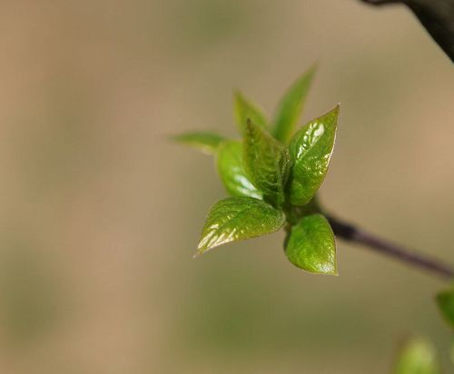

# 融化

  
  
  
中午拍下它，就着相机看效果，小小的一声惊叹。  
AV模式拍摄，包围曝光降一档，ISO100，自动白平衡，没有任何PS。  
第一次在日光下拍摄，截图部分的细节着实打动了我，有种融化的感觉。  
对5D MARK II的表现力没有预知，但我想它应该还可以表现的更好。  
告戒自己，重要的不是机器，重要的是我要拍什么。

---

## 评论（17）

**angie** · 2010-04-07

恭贺开张之喜，嘎嘎。没有PS感觉就很灵动，物总有所值的。

**Christina** · 2010-04-07

嘎个头~5月份赶紧来哦~张开双臂欢迎你~

**angie** · 2010-04-07

我会张开爪子扑过来的：）

**Christina** · 2010-04-07

恩，过来我给你剪指甲~

**陈问** · 2010-04-07

静美的叶！

**令狐** · 2010-04-07

恭喜升级

**Anyayaya** · 2010-04-07

刚打开这页居然看成了“被打劫”。。。心想：文不对题么，照片一点儿不点题。

**Christina** · 2010-04-07

那我换个题目吧~说实话，每次想题目真TNND的困难。为什么必须要有个题目呢？咱又不是专业写手，随便玩玩的么~

**Anyayaya** · 2010-04-08

我没说题目有问题啊！我是说自己老眼昏花看错了，还纳闷被打劫干吗放这么诗意的照片。

**vina** · 2010-04-08

看到图片在心里惊叹了一声，真 美

**耳雨** · 2010-04-08

对玩机器的人来说，重要的不是拍什么，重要的是用什么机器什么什么镜头什么参数拍

**Christina** · 2010-04-08

机器、镜头、参数都是为“拍什么”服务，用不好这些在某些环境限制下拍什么？这也是卡片机与单反机的一些区别，大部分时候卡片机是完全可以胜任的，一旦有环境天气限制，还得用到单反，甚至是中级高级的单反与镜头。机器玩得好的前提下才能顺利过渡到“拍什么”的需求上。这个逻辑不矛盾。

**lilian** · 2010-04-08

上周末也去西湖边捕捉了一抹新绿～

**[薇安](http://bulaoge.net/?vivianxu)** · 2010-04-08

已经升级MARK II 啦，好羡慕，好好利用，一定不会让你失望

**Christina** · 2010-04-08

新绿的照片？

**lilian** · 2010-04-08

http://vhqmlq.blu.livefilestore.com/y1pnAYC8cdCelzxPyKmd7D7F76MAbJuUco-QXY6yMARE\_UnKlR7Pc7nurjMTQstfFvQQYBgs9wwaPG5gg0t4UMpLcK5Ni4PnrwQ/P1110049.jpg

**Xiaona W.** · 2010-04-10

新枝嫩叶，生机勃勃，春意盎然

