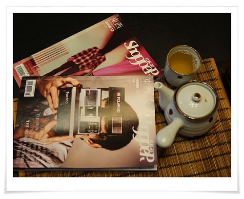
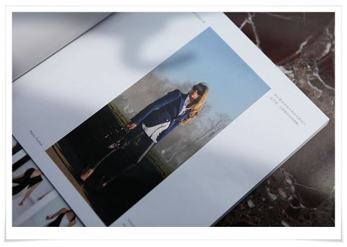

# 《东西》

晚上9点后在永和大王随便吃点东西，一位少女。。。恩。。。这个称呼还是很恰当的，一位少女穿着旱冰鞋从房间深处滑到门口面对大街的窗户前坐下，桌上放着书本文具之类的东西，感觉象在这里做作业似的。。。少女们这情调玩得我这老太太真是体会不了了。。。  
  
在家喝茶看杂志，不打算上网消磨时间的，看着看着就来劲了，因为我手中这本《东西》杂志。每年我都会订一些杂志，从时尚、电子、心理到旅游到后来从不阅读的《收获》，提起《收获》那完全成为一种不可自控的惯性，从十几岁饥渴的阅读到现在一个字都看不下去，但停止订购感觉把自己某些部位给残废了。那么就这样永无止境的年年订购到老？等退休了再阅读？没有答案，估计老天也很无奈。  
  
几周前坐在扑土店里，她顺手递来两本杂志，《东西》和《生活潮》，我就完全被《东西》吸引了。我们以为这是上海或广东办的杂志，仔细探究发现主管单位居然是江苏广播电视总台（集团），北京某传媒公司协办。。。这既改变了我对南京人的印象又影响了我对传媒公司的看法。有个老朋友靠贩煤炭积累的资本，几年前投资500万在北京搞了个传媒公司，当时我想这种素质的人也能搞传媒？当然现在的我不会这么想，做生意需要什么素质？适者生存。回到话题中来，我着实小小的被触动了一下，按照我的性格，很快我就预订了全年的《东西》。  
  
《东西》杂志大致有时尚、音乐、设计、摄影、美食几大块儿，用某专业人士的话讲“有点杂”，如果杂的有条理也好，我想他们的编辑里得有许多外语专业的人，欧美资讯翻译过来再编辑。品位还不错，尤其是里面的图片，反正不是装B那类，又区别于大牌时尚杂志的风格，文字不多，图片好看，内容超前，总能介绍些新东西给读者，非常适合刺激一下烦躁又麻木的上班族，也适合热爱接受新事物的老太太。  
  
  
在杂志上发现了她，网络资源被频繁利用，不过还是很好看的，光光，对吧？  
  
这本杂志每一期中间会出现若干短小页面，3月这部分展示的是西雅图宝利来街拍，一律中英文对照。说到宝利来，听说SX-70今年会再次上市销售，200元胶卷只能拍10张。以及3月STYLISH部分的时装摄影很特别，4月不如3月好看，不过4月“复古花容”里模特的面孔好喜欢啊。  
  
杂志介绍的音乐也好，之所以好是因为有我喜欢的音乐风格，大多新到没听过。没听过自然没有发言权，自然得闭嘴看人家写的，然后将感兴趣的找来听一听。  
  
看着杂志里面的模特，情不自禁感叹：“鞋跟越来越高，让男人们怎么活啊？！”  

---

## 评论（8）

**vina** · 2010-04-08

啊，是我推荐的那张图片呢～只是姿势略有不同了～

**einsure** · 2010-04-08

你说的《生活潮》是O2吗？   
他们还有一本杂志叫《Tea》-轻熟女生活，感觉也蛮清新

**Christina** · 2010-04-08

可能是O2吧，以及那个什么轻熟女杂志，提不起长期的兴趣，我就是喜欢上了《东西》，内容编辑的好看好玩新颖，编辑们提供给读者新鲜的东西，这条路不错。如果编辑们的眼界比读者还低，谁会买呢？

还有那个《明日风尚》，我是完全看不下去的。我知道有许多人喜欢它，我不是专业写手也不文艺，更不会因为大家喜欢我就喜欢。

**[不羁之舟](http://blog.sina.com.cn/yangzhoumeiren)** · 2010-04-08

我也定个东西去~~关于那个 收获 呃 同样的感觉啊

**[山树](http://shanshu.blogbus.com)** · 2010-04-08

啊，这个茶壶和薇安新买的一样的。IN CAFE在哪里的啊？网店？

**[薇安](http://bulaoge.net/?vivianxu)** · 2010-04-08

我刚想说，茶具买的一样呐，都在扑土家买的，楼上的就提前比我开腔了。

**[薇安](http://bulaoge.net/?vivianxu)** · 2010-04-08

《东西》在哪定 的啊

**[光光](http://gaoguangguang.blogbus.com)** · 2010-04-09

你是做问我哦？我走神来着，好看，好看的，多有型。。

