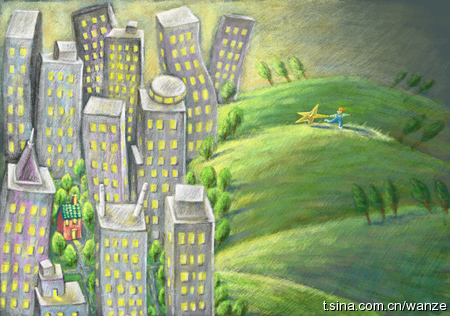

# 逃离城市的追梦人

  
  
[**Wanze**](http://wanze.ycool.com/)画的，深得我心。  
我管它叫“逃离城市的追梦人”。  
左边是焦虑，右边是梦乡。

---

## 评论（6）

**vina** · 2010-04-08

怎么一眨眼就更新了那么多啊～所以每天早上开机就打开你的blog是这么多年都没有失望过的….图片真舒服～有大图就好了，我可以做桌面～

**陈问** · 2010-04-08

恩，这么理解其实和表达的内心也蛮贴切的。

**Sherry** · 2010-04-08

往哪儿逃呢？

**lilian** · 2010-04-08

最近去看了《爱丽丝梦游仙境》。。。无处可逃的时候，那就掉进兔子洞吧。。

**lu** · 2010-04-08

主题很好 色彩很漂亮 敢问这画的作者是？

**Christina** · 2010-04-08

白底紫字写着作者名字~

